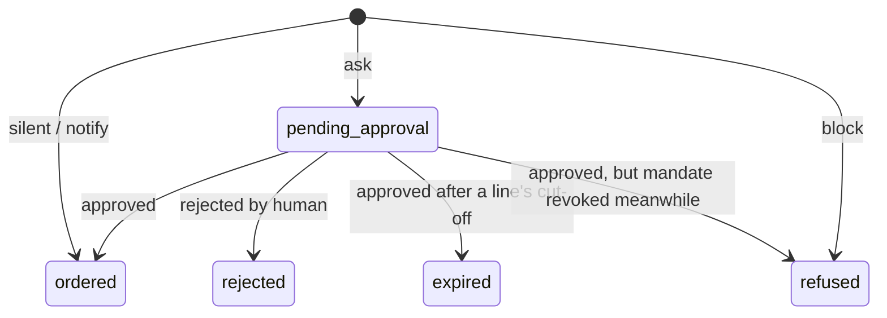
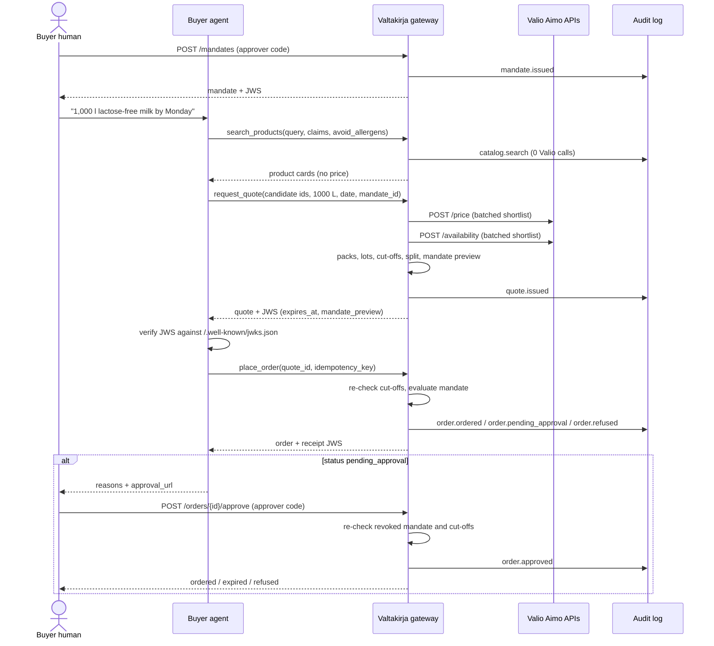

# Valtakirja trust protocol

Version 0.1 (Junction 2026). This document describes what the gateway in this repo does today, so an outside agent developer can build a buyer agent against it. Where the code makes a simplification for the demo, it says so.

The short version: a human issues a **mandate** to their purchasing agent. The agent asks the gateway for a **quote**. The gateway signs the quote and previews it against the mandate. The agent places an **order** on that quote. A deterministic rules engine puts the order into one of four **tiers**. Every step lands in a hash-chained **audit log** that both sides can read and verify.

## 1. Actors

| Actor | Who | What they do |
|---|---|---|
| Buyer human | e.g. a hotel F&B manager | Issues and revokes the mandate. Approves or rejects held orders. |
| Buyer agent | Any AI agent (Claude, Gemini, a script) | Searches, asks for quotes, places orders. Identified by `agent_id`. Can never approve its own orders. |
| Gateway | Valio Aimo's Valtakirja service (this repo) | Holds the catalog, calls Valio Aimo's price and availability APIs, signs mandates, quotes and receipts, enforces the mandate, writes the audit log. |
| Approver | The buyer human (or someone they delegate to) | Calls approve or reject on orders in `pending_approval`. |

Human actions (issue or revoke a mandate, approve or reject an order) require the `X-Approver-Code` header when `VALTAKIRJA_APPROVER_CODE` is set. This is a demo stand-in for the buyer's real login (see [DECISIONS.md](DECISIONS.md)).

## 2. Transports

The same operations are exposed twice, over one service layer (`valtakirja/service.py`):

- **REST / OpenAPI**: `GET /openapi.json`, interactive docs at `/docs`.
- **MCP** (Streamable HTTP) at `/mcp/`. Tools: `search_products`, `get_product`, `request_quote`, `suggest_substitutes`, `place_order`, `get_order`, `get_mandate`. The server also ships with usage instructions for the model.

| Operation | REST | MCP tool |
|---|---|---|
| Search catalog | `GET /products?q=&claims=&avoid_allergens=&labels=&temperature=&category=&limit=&agent_id=` | `search_products` |
| Product details | `GET /products/{id}` | `get_product` |
| Substitutes | `GET /products/{id}/substitutes?delivery_date=&amount=&unit=&mandate_id=` | `suggest_substitutes` |
| Quote | `POST /quotes`, `GET /quotes/{id}` | `request_quote` |
| Order | `POST /orders`, `GET /orders`, `GET /orders/{id}` | `place_order`, `get_order` |
| Order history | `GET /orders/{id}/history` | |
| Approve / reject | `POST /orders/{id}/approve`, `POST /orders/{id}/reject` (human) | none, on purpose |
| Mandates | `POST /mandates` (human), `GET /mandates`, `GET /mandates/{id}`, `GET /mandates/{id}/history`, `POST /mandates/{id}/revoke` (human) | `get_mandate` |
| Audit | `GET /audit?subject=&buyer=&limit=`, `GET /audit/verify` | |
| Public key | `GET /.well-known/jwks.json` | |
| Allergen codes | `GET /allergens` | |

REST errors are `{"error": "<code>", "message": "<text>"}` with an HTTP status. MCP tools return the same object instead of raising (except `request_quote`, see section 12).

## 3. Signatures

Everything the gateway signs is a **compact JWS** (RFC 7515) with **Ed25519** (`alg: EdDSA`, RFC 8037).

- Header: `{"alg": "EdDSA", "kid": "<kid>", "typ": "<typ>"}`.
- Header and payload are serialised as canonical JSON (keys sorted, separators `,` and `:`, UTF-8, no ASCII escaping), then base64url without padding.
- `kid` is the first 16 hex characters of SHA-256 over the raw 32-byte public key.
- The public key is published as a JWKS at `GET /.well-known/jwks.json`:
  `{"keys": [{"kty": "OKP", "crv": "Ed25519", "x": "<base64url>", "kid": "<kid>", "alg": "EdDSA", "use": "sig"}]}`.

| `typ` | Payload |
|---|---|
| `valtakirja-mandate+jws` | The mandate object (section 4) |
| `valtakirja-quote+jws` | The quote object (section 5) |
| `valtakirja-order+jws` | The order receipt: `id, quote_id, mandate_id, status, total_ex_vat, lines, decision` |

The key is generated on first start and stored at `$VALTAKIRJA_DATA_DIR/gateway_ed25519.pem`. There is one key and no rotation yet.

Note that the gateway signs the mandate, not the human. The signature proves "the gateway recorded this mandate as issued by `issued_by`", authenticated by the approver code. A production version would have the human sign it (section 11).

## 4. The mandate

Source: `valtakirja/mandate.py`, class `Mandate`. All money is EUR excluding VAT.

| Field | Type | Default | Meaning |
|---|---|---|---|
| `id` | string | required | Mandate id, e.g. `M-HOTEL-AURORA`. |
| `buyer` | string | required | Organisation the agent buys for. |
| `agent_id` | string | required | The only agent allowed to order under this mandate. |
| `issued_by` | string | required | The human who issued it. |
| `valid_until` | datetime or null | null | After this, every order is blocked. |
| `revoked` | bool | false | Set by `POST /mandates/{id}/revoke`. Blocks every order. |
| `notify_above_eur` | number or null | null | Above this, the order goes through and the human gets an FYI. |
| `auto_approve_limit_eur` | number | 500 | Up to this, no human is needed. Above it, the order is held. |
| `hard_limit_eur` | number or null | 5000 | Above this, the order is refused. |
| `daily_limit_eur` | number or null | null | Today's `ordered` total plus this order above the limit means a human must approve. |
| `allowed_categories` | list or null | null | Valio Aimo category codes. Null means any. |
| `avoid_allergens` | list | [] | GS1 allergen codes, e.g. `AM` milk, `AN` tree nuts, `AP` peanuts, `AW` gluten cereals. `AM`, `AN` and `AW` expand to their whole family (see `GET /allergens`). |
| `allow_may_contain` | bool | false | If false, "may contain" counts as contains. |
| `unknown_allergens` | `ask` or `block` | `ask` | What to do when a product has no allergen declaration. Never `silent`: unknown is never safe. |
| `required_claims` | list | [] | Claims every line must carry, e.g. `FREE_FROM_LACTOSE`. |
| `substitutions` | tier | `ask` | Tier for any line marked `substitute_for`. |
| `terminal_products` | tier | `silent` | Tier for products shipped from the supplier's warehouse (stock unknown). |
| `min_delivery_reliability` | number or null | 0.9 | Lines with historical full-delivery rate below this are held. |
| `later_delivery` | `notify`, `ask` or `block` | `ask` | Tier when the earliest delivery is after the requested date. |
| `max_comparison_price_eur` | map | {} | Cap per comparison unit, e.g. `{"L": 2.5}`. Above it, held. |

Issuing (`POST /mandates`) re-signs and stores the mandate and writes `mandate.issued` to the audit log. Re-issuing with the same id replaces it; with MariaDB the old version stays queryable (section 9).

## 5. The quote

`POST /quotes` with:

```json
{
  "agent_id": "aurora-purchasing-agent",
  "mandate_id": "M-HOTEL-AURORA",
  "delivery_date": "2026-11-16",
  "items": [
    {"product_ids": ["<id>", "<id>"], "amount": 1000, "unit": "L", "substitute_for": null, "note": null}
  ]
}
```

- `unit` is `L`, `KG` or `SALES_UNIT` (packs). With L or KG the gateway converts to packs and rounds up to the allowed lot size.
- Several `product_ids` for one item means "these are candidates". The gateway prices all of them, ranks orderable ones by comparison price (EUR per L or KG), and fills the need cheapest first, splitting across products when stock is short.
- One `product_id` that can't be ordered is kept in the quote, so the reasons are visible and the mandate blocks it.
- At most 50 items and 200 candidate ids per quote. Price and availability are fetched in two batched calls per item (price cached 10 min, availability 60 s), so a one-item quote costs at most 2 live calls.

Response: `{"quote": {...}, "jws": "<compact JWS of quote>"}`. Quote fields:

| Field | Meaning |
|---|---|
| `id` | `Q-XXXXXXXX` |
| `agent_id`, `mandate_id` | As requested. |
| `issued_at` | Gateway time (Europe/Helsinki, ISO 8601, ms). |
| `expires_at` | `min(issued_at + VALTAKIRJA_QUOTE_TTL, earliest order_cutoff of any orderable line)`. Default TTL 900 s. |
| `requested_delivery_date` | As requested. |
| `currency` | `EUR` |
| `lines[]` | One per chosen product (below). |
| `total_ex_vat`, `total_inc_vat` | Sums of line totals. |
| `uncovered[]` | Needs that couldn't be filled: `{item, uncovered, unit}` or `{item, uncovered, reason}`. |
| `alternatives_considered[]` | Up to 6 per item: `{product_id, name, comparison_price, orderable, why_not[]}`. |
| `valio_api_calls` | Live calls this quote cost: `{price_calls, availability_calls, cache_hits}`. |
| `mandate_preview` | Only with `mandate_id`: `{outcome, findings[]}`, what will happen if this quote is ordered now. |

Each line has: `product_id, name, brand, sales_unit, content_per_sales_unit {amount, unit, source}, quantity, covers {amount, unit}, unit_price_ex_vat, unit_price_inc_vat, vat_rate, comparison_price {ex_vat, per}, list_price_ex_vat, line_total_ex_vat, line_total_inc_vat, logistic_model (Stock|Terminal), available_amount, stock (known|plenty|unknown), available_date, delivery_date, order_cutoff, delivery_reliability, co2_estimate_kg, co2_note, labels, claims, allergens, temperature, orderable, issues[]`, and `substitute_for` when set.

`delivery_date = max(requested, available_date)`. `co2_estimate_kg` is a product-group average times quantity, labelled as an estimate.

### Issue codes (`valtakirja/quote.py`)

Each issue is `{code, severity, message}`. A line with any `blocking` issue has `orderable: false`.

| Code | Severity | Meaning |
|---|---|---|
| `UNIT_MISMATCH` | blocking | Need is in L but the product is measured in KG, or the reverse. |
| `CONTENT_UNKNOWN` | blocking | Can't tell how many L or KG one pack holds, so quantity can't be computed. |
| `NO_PRICE` | blocking | Valio Aimo returned no price. |
| `NO_AVAILABILITY` | blocking | Valio Aimo returned no availability. |
| `SALES_BLOCK` | blocking | Product is sales-blocked. |
| `UNDELIVERABLE` | blocking | No schedule lines: no delivery date at all. |
| `OUT_OF_STOCK` | blocking | No available date, or available amount 0. |
| `CUTOFF_PASSED` | blocking | The order cut-off (`closingTime`) for the quoted date is in the past, even if the API still reports the date. Also added at order time if the cut-off passed after the quote was issued. |
| `LOT_SIZE` | warning | Sold in lots; quantity rounded up. |
| `PRICE_EXPIRES` | warning | Price `validTo` is before the delivery date. |
| `LATER_DATE` | warning | Earliest delivery is after the requested date. |
| `STOCK_UNKNOWN` | warning | Terminal product: supplier stock is unknown. |
| `PARTIAL_STOCK` | warning | Known stock is below the quantity. (Removed from lines that `plan` sized to stock.) |
| `LOW_RELIABILITY` | warning | Historical full-delivery rate below 0.9. |
| `DATA_STALE` | warning | Valio Aimo couldn't be reached live (rate limit, error, or the gateway paused calls after a 429), so the line uses the last copy fetched: price up to 15 min old, availability up to 5 min. The cut-off is still checked against now. Always sends the order to a human (`availability.data_stale`). |

## 6. Tiers and rules

The rules engine (`mandate.evaluate`) is plain Python. No LLM is involved. It returns a list of findings `{rule, outcome, message, product_id}` and the overall tier is the strictest finding.

| Tier | Order status | Meaning |
|---|---|---|
| `silent` | `ordered` | Routine. Ordered and logged. |
| `notify` | `ordered` | Ordered; the human gets an FYI. |
| `ask` | `pending_approval` | Held until a human approves or rejects. |
| `block` | `refused` | Refused, with the rule that fired. |

If the tier is `silent` or `notify`, a final `mandate.ok` finding is added with the total.

| Rule id | Tier | Fires when |
|---|---|---|
| `mandate.revoked` | block | Mandate is revoked. |
| `mandate.expired` | block | Now is after `valid_until`. |
| `mandate.agent` | block | Calling `agent_id` is not the mandate's `agent_id`. |
| `order.empty` | block | The quote has no lines. |
| `spend.hard_limit` | block | Total > `hard_limit_eur`. |
| `spend.auto_limit` | ask | Total > `auto_approve_limit_eur` (and not over the hard limit). |
| `spend.notify` | notify | Total > `notify_above_eur` (and within the auto limit). |
| `spend.daily_limit` | ask | Today's ordered total + this total > `daily_limit_eur`. |
| `need.partial` | ask | Part of the need is uncovered. |
| `availability.<code>` | block | Any blocking issue on a line, code lowercased: `availability.unit_mismatch`, `availability.content_unknown`, `availability.no_price`, `availability.no_availability`, `availability.sales_block`, `availability.undeliverable`, `availability.out_of_stock`, `availability.cutoff_passed`. |
| `delivery.later_date` | mandate's `later_delivery` | Line has `LATER_DATE`. |
| `price.expires` | ask | Line has `PRICE_EXPIRES`. |
| `availability.data_stale` | ask | Line has `DATA_STALE`: never ordered on last-known data without a human. |
| `product.category` | block | Category not in `allowed_categories`. |
| `product.claims` | block | Line lacks a `required_claims` claim. |
| `allergen.contains` | block | Line contains an avoided allergen. |
| `allergen.may_contain` | block | Line may contain one and `allow_may_contain` is false. |
| `allergen.unknown` | mandate's `unknown_allergens` (ask or block) | Mandate has allergen rules and the product has no allergen declaration. |
| `substitution` | mandate's `substitutions` | Line is marked `substitute_for`. |
| `supply.terminal` | mandate's `terminal_products` | Terminal product (only emitted when that setting isn't `silent`). |
| `supply.reliability` | ask | `delivery_reliability` < `min_delivery_reliability`. |
| `price.comparison_cap` | ask | Comparison price above `max_comparison_price_eur[per]`. |
| `mandate.ok` | silent or notify | All checks passed. |

Warnings `LOT_SIZE`, `STOCK_UNKNOWN`, `PARTIAL_STOCK` and `LOW_RELIABILITY` have no rule of their own. Terminal and reliability are judged from the line's `logistic_model` and `delivery_reliability` fields against the mandate instead.

## 7. Orders

`POST /orders` with `{agent_id, mandate_id, quote_id, idempotency_key?}`. The gateway, in order:

1. If `idempotency_key` matches an existing order, returns that order unchanged. Use one key per quote so retries never order twice.
2. Loads the mandate and quote, re-verifies the quote's own signature.
3. Rejects a quote already used (`quote_used`): **one order per quote**, enforced by an atomic `UPDATE ... WHERE order_id IS NULL`.
4. Rejects an expired quote (`quote_expired`, audit event `order.rejected`).
5. Re-checks every line's cut-off against the clock (no API call) and adds `CUTOFF_PASSED` where needed.
6. Re-runs the mandate engine with today's spend, maps the tier to a status, signs a receipt, stores the order.

Order fields: `id (PO-XXXXXXXX), quote_id, mandate_id, agent_id, buyer, status, total_ex_vat, total_inc_vat, delivery_date, lines[], decision {outcome, findings[], by: "mandate-engine", at}, approval, order_url, approval_url, idempotency_key, created_at, updated_at, receipt_jws`.

### Statuses



| Status | Meaning |
|---|---|
| `ordered` | Accepted. (In this demo there is no downstream Valio Aimo order API; see DECISIONS.) |
| `pending_approval` | Waiting for a human. `approval_url` points to the UI. |
| `refused` | Blocked by the mandate, or approved after the mandate was revoked. |
| `rejected` | A human rejected it. |
| `expired` | A human approved it, but a line's cut-off had already passed. |

Approve or reject: `POST /orders/{id}/approve` or `/reject` with `{"by": "<name>", "note": "..."}` and the approver header. Only `pending_approval` orders can be decided (`not_pending` otherwise). The result is stored in `approval {by, approved, note, at, result_reason}`.

The `receipt_jws` is signed when the order is placed and is not re-signed after approval. It proves the engine's original decision; the human decision is in the order record, the audit log and the order history.

### Error codes

`mandate_not_found`, `quote_not_found`, `order_not_found`, `product_not_found` (404); `quote_signature`, `quote_used`, `quote_expired`, `not_pending` (409); `too_many_candidates` (400); `valio_unavailable` (503, Valio Aimo error or the gateway's per-minute budget of live calls is used up, and no recent last-known copy of the data exists; carries `retry_after` seconds in the body and a `Retry-After` header when known); `rate_limited` (429, per client IP on POST).

## 8. Sequence



## 9. Audit log

Every operation appends one event. Events: `mandate.issued`, `mandate.revoked`, `catalog.search`, `quote.issued`, `substitutes.suggested`, `order.ordered`, `order.pending_approval`, `order.refused`, `order.rejected` (expired quote), `order.approved`, `order.rejected_by_human`.

Each row: `seq, ts, actor, actor_type (agent|human|system), event, subject, buyer, data, prev_hash, hash`.

**Hash chain** (`store.audit`):

```
rec  = {"ts", "actor", "actor_type", "event", "subject", "buyer", "data", "prev_hash"}
hash = sha256( canonical_json(rec) ).hexdigest()
prev_hash of the first event = "0" * 64
prev_hash of event n = hash of event n-1 (by seq)
```

`canonical_json` is the same as for signatures: `json.dumps(obj, sort_keys=True, separators=(",", ":"), ensure_ascii=False)` encoded as UTF-8. `data` is the parsed JSON object, not its stored string.

**Verify**: `GET /audit/verify` walks all events in `seq` order, recomputes each hash and checks each `prev_hash`. It returns `{ok, events, head}` or `{ok: false, broken_at_seq}`. A third party can do the same from `GET /audit` output (newest first, so reverse it), and can pin `head` to detect a later rewrite of the whole chain.

**Second check (MariaDB)**: with `VALTAKIRJA_DB_URL` set, `mandate`, `purchase_order` and `audit_event` are `WITH SYSTEM VERSIONING` tables. The database keeps every past row version on its own. `audit_event` is append-only, so any row with a closed `ROW_END` means someone ran UPDATE or DELETE. `/audit/verify` adds `system_versioning {rows_changed_or_deleted, seqs}` and fails if it's non-zero. The same history powers `GET /orders/{id}/history` (every status version, plus the mandate `FOR SYSTEM_TIME AS OF` the decision and approval times, and which fields changed since) and `GET /mandates/{id}/history`. With SQLite there is no versioning; history shows only the current row.

## 10. Verifying offline

A buyer can check a quote or receipt with only the JWKS, without trusting the gateway's other answers:

1. Fetch `GET /.well-known/jwks.json` once over HTTPS and pin it.
2. Split the compact JWS into `header.payload.signature`.
3. Decode the header. Check `alg == "EdDSA"`, `kid` matches the pinned key, and `typ` is the one you expect (`valtakirja-quote+jws` for a quote).
4. Verify the Ed25519 signature over the ASCII bytes `header.payload` (the two base64url strings joined by a dot).
5. Decode the payload. For a quote, check `expires_at` is in the future, `agent_id` and `mandate_id` are yours, and the totals and lines are what you will commit to.
6. For a receipt, check `quote_id` matches the quote you ordered, and read `status` and `decision.findings`.

```python
import base64, json, httpx
from cryptography.hazmat.primitives.asymmetric.ed25519 import Ed25519PublicKey

def b64d(s: str) -> bytes:
    return base64.urlsafe_b64decode(s + "=" * (-len(s) % 4))

def verify(token: str, jwks: dict, typ: str) -> dict:
    h, p, s = token.split(".")
    header = json.loads(b64d(h))
    key = next(k for k in jwks["keys"] if k["kid"] == header["kid"])
    assert header["alg"] == "EdDSA" and header["typ"] == typ
    Ed25519PublicKey.from_public_bytes(b64d(key["x"])).verify(b64d(s), f"{h}.{p}".encode())  # raises if forged
    return json.loads(b64d(p))

base = "http://localhost:8000"
jwks = httpx.get(f"{base}/.well-known/jwks.json").json()
r = httpx.post(f"{base}/quotes", json={...}).json()
quote = verify(r["jws"], jwks, "valtakirja-quote+jws")
assert quote == r["quote"]
```

The reference buyer in `buyer/` does the same in the browser with Web Crypto.

## 11. Known limits of v0.1

- The gateway signs mandates on the human's behalf; the human authenticates with a shared approver code.
- One signing key, no rotation, no `exp` or `iat` JWS claims (expiry is inside the quote payload).
- Prices are the mock's catalog prices; the mock ignores the customer number.
- No real order is sent to Valio Aimo; `ordered` is the end state.
- `notify` is recorded but no notification is pushed yet.

## 12. Implementation notes for agent developers

- Always pass `mandate_id` to `request_quote` and read `mandate_preview` before ordering. It is the same engine that will decide the order, so a `block` preview will be refused.
- The preview can differ from the final decision: cut-offs are re-checked at order time and the daily spend may have changed.
- The MCP `request_quote` tool lets gateway errors propagate as MCP tool errors instead of returning `{error, message}` like the other tools.
- Search never costs live API calls. Quote only the products you would actually buy.
