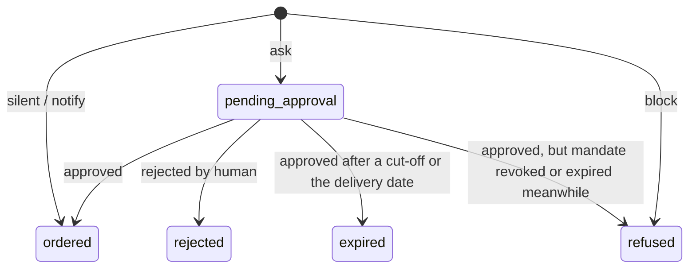
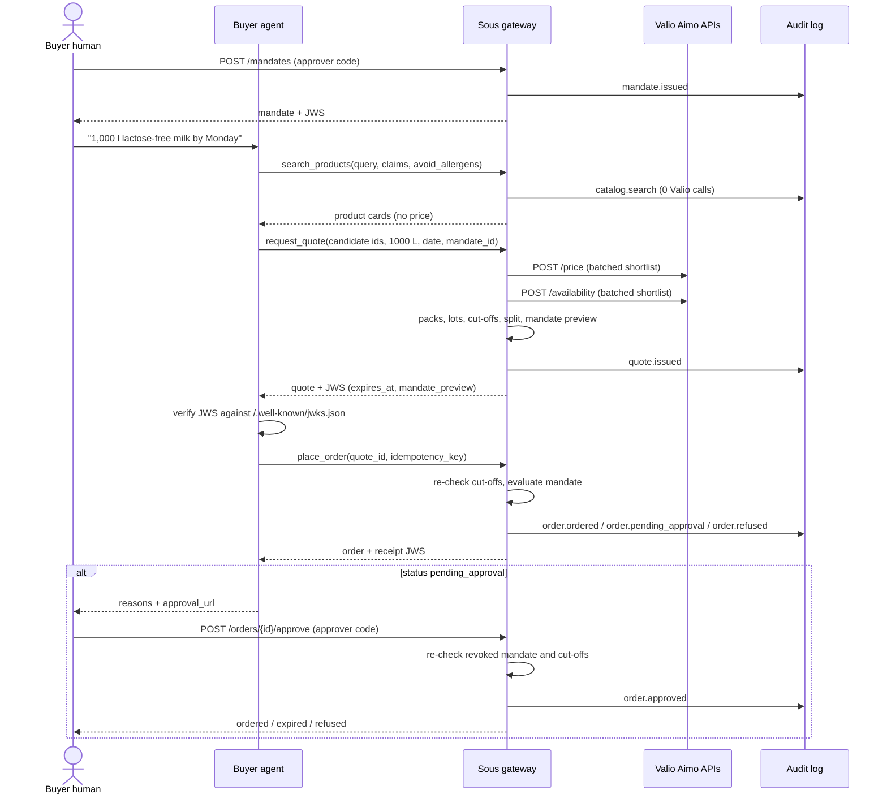

# Sous trust protocol

Version 0.2 (Junction 2026). This document describes what the gateway in this repo does today, so an outside agent developer can build a buyer agent against it. Where the code makes a simplification for the demo, it says so.

The short version: a human issues a **mandate** to their purchasing agent. The agent asks the gateway for a **quote**. The gateway signs the quote and previews it against the mandate. The agent places an **order** on that quote. A deterministic rules engine puts the order into one of four **tiers**. Every step lands in a hash-chained **audit log** that both sides can read and verify.

## 1. Actors

| Actor | Who | What they do |
|---|---|---|
| Buyer human | e.g. a hotel F&B manager | Issues and revokes the mandate. Approves or rejects held orders. |
| Buyer agent | Any AI agent (Claude, Gemini, a script) | Searches, asks for quotes, places orders. Identified by `agent_id`; on mandates that require it, authenticated with a bearer credential (section 16). Can never approve its own orders. |
| Gateway | Valio Aimo's Sous service (this repo) | Holds the catalog, calls Valio Aimo's price and availability APIs, signs mandates, quotes and receipts, enforces the mandate, writes the audit log. |
| Approver | The buyer human (or someone they delegate to) | Calls approve or reject on orders in `pending_approval`. |

| Valio Aimo's suggestions | `sous/suggest.py`, actor `valio-aimo-suggestions` | Offers sponsored, mandate-checked suggestions to the buyer agent. Never quotes or orders. |

Human actions (issue or revoke a mandate, approve or reject an order, pause or resume a standing order, store simulated standing-order history, send a test notification) require the `X-Approver-Code` header when `SOUS_APPROVER_CODE` is set. This is a demo stand-in for the buyer's real login (see [DECISIONS.md](DECISIONS.md)).

**Agent identity today** is the `agent_id` the agent sends plus the signed mandate issued to exactly that `agent_id`; quotes, orders and standing orders are bound to it. A mandate can also require the agent to authenticate with a bearer credential (`require_agent_auth`, section 16). In production the agent would prove possession of a key bound to the mandate (mTLS, DPoP or a VC-bound key), see section 14.

## 2. Transports

The same operations are exposed twice, over one service layer (`sous/service.py`):

- **REST / OpenAPI**: `GET /openapi.json`, interactive docs at `/docs`.
- **MCP** (Streamable HTTP) at `/mcp` and `/mcp/`, or stdio (`uv run python -m sous.mcp_server`). Tools: `search_products`, `get_product`, `request_quote`, `suggest_substitutes`, `place_order`, `get_order`, `get_mandate`, `get_suggestions`, `create_standing_order`, `renew_standing_order`, `get_standing_order`. Each tool carries all four MCP annotations (`readOnlyHint`, `destructiveHint`, `idempotentHint`, `openWorldHint`; `place_order` is destructive but idempotent per `idempotency_key`). Structured output (MCP 2025-06-18): every tool declares an `outputSchema` and returns its object as `structuredContent`, plus the same JSON as one text block for older clients. The quote, order and mandate parts reuse the models behind `/schemas/{quote,order,mandate}.json` (`sous/standards.py`), so REST and MCP describe one shape; all objects allow extra fields. Errors (`isError: true`) carry the error object instead and are not validated against the schema. Resources: `sous://allergens` (GS1 codes and families) and `sous://mandates/{mandate_id}`. Prompt: `purchase(request, mandate_id, agent_id, delivery_date?)` walks a model through search, quote and order. The server also ships with usage instructions for the model.

| Operation | REST | MCP tool |
|---|---|---|
| Search catalog | `GET /products?q=&claims=&avoid_allergens=&labels=&temperature=&category=&limit=&agent_id=` | `search_products` |
| Product details | `GET /products/{id}` | `get_product` |
| Substitutes | `GET /products/{id}/substitutes?delivery_date=&amount=&unit=&mandate_id=` | `suggest_substitutes` |
| Quote | `POST /quotes`, `GET /quotes/{id}` | `request_quote` |
| Order | `POST /orders`, `GET /orders`, `GET /orders/{id}` | `place_order`, `get_order` |
| Order history | `GET /orders/{id}/history` | |
| Approve / reject | `POST /orders/{id}/approve`, `POST /orders/{id}/reject` (human) | none, on purpose |
| Mandates | `POST /mandates` (human), `GET /mandates`, `GET /mandates/{id}`, `GET /mandates/{id}/history`, `POST /mandates/{id}/revoke` (human) | `get_mandate` |
| Valio suggests | `GET /mandates/{id}/suggestions?agent_id=&delivery_date=&limit=&basis=` | `get_suggestions` |
| Standing orders | `POST /standing-orders`, `GET /standing-orders?mandate_id=`, `GET /standing-orders/{id}` | `create_standing_order`, `get_standing_order` |
| Renew a standing order | `POST /standing-orders/{id}/renew` `{delivery_date?, agent_id?, amounts?}` | `renew_standing_order` |
| Pause / resume (human) | `POST /standing-orders/{id}/pause`, `POST /standing-orders/{id}/resume` | none |
| Simulated history (demo, human) | `POST /standing-orders/{id}/simulate-history` | none |
| Notifications | `GET /notifications?buyer=&order_id=&limit=`, `POST /notifications/test` (human) | |
| Agent credential | `GET /mandates/{id}/agent-credential`, `POST /mandates/{id}/agent-credential` (human: rotate or revoke) | none, on purpose |
| Audit | `GET /audit?subject=&buyer=&limit=`, `GET /audit/verify` | |
| Judge sandbox | `POST /sandbox` (no login, per-IP limited), `GET /sandbox/{id}`, `DELETE /sandbox/{id}` (approver); `?sandbox=<id>` on `GET /orders`, `/mandates`, `/audit`, `/notifications`, `/standing-orders` (section 18) | |
| Public key | `GET /.well-known/jwks.json` | |
| Allergen codes | `GET /allergens` | resource `sous://allergens` |
| Health | `GET /health` (Valio call counters, shared Valio budget (section 19), storage backend, whether the approver code is required) | |

Substitutes: `delivery_date` is optional (default: the next delivery day; the answer's `delivery_date {date, defaulted, note}` says which was used). A need in packs is the original's sales units and what they hold, stated in `need.asked` (`20 x KI (6 x 190 g) = 22.8 kg`). A different product type or a negative `match_score` is never offered; those are listed in `not_offered[] {product_id, name, type, match, match_score, reason}`, and with no acceptable option `no_safe_substitute` is `"no acceptable substitute; ask a human"` (`null` otherwise).

REST errors, including schema and HTTP errors, are `{"error": "<code>", "message": "<text>"}` with an HTTP status (plus `retry_after` on `valio_unavailable` when known). MCP tools return `{"error", "message", "hint", "retryable"}` as a tool result with `isError: true` instead of raising; `hint` tells the model what to do next (codes in section 7).

## 3. Signatures

Everything the gateway signs is a **compact JWS** (RFC 7515) with **Ed25519** (`alg: EdDSA`, RFC 8037).

- Header: `{"alg": "EdDSA", "kid": "<kid>", "typ": "<typ>"}`.
- Header and payload are serialised as canonical JSON (keys sorted, separators `,` and `:`, UTF-8, no ASCII escaping), then base64url without padding.
- `kid` is the first 16 hex characters of SHA-256 over the raw 32-byte public key.
- The public key is published as a JWKS at `GET /.well-known/jwks.json`:
  `{"keys": [{"kty": "OKP", "crv": "Ed25519", "x": "<base64url>", "kid": "<kid>", "alg": "EdDSA", "use": "sig"}]}`.

| `typ` | Payload |
|---|---|
| `sous-mandate+jws` | The mandate object (section 4) |
| `sous-quote+jws` | The quote object (section 5) |
| `sous-order+jws` | The order receipt: `id, quote_id, mandate_id, status, total_ex_vat, lines, decision, approval, updated_at`. Re-signed after a human decision. |

JSON Schemas (2020-12) of these payloads are served at `GET /schemas/mandate.json`, `/schemas/quote.json`, `/schemas/order.json` and `/schemas/receipt.json` (generated from the models in `sous/standards.py` and `sous/mandate.py`; they allow extra fields, so new fields don't break readers). AP2, schema.org and discovery views of the same objects are described in [STANDARDS.md](STANDARDS.md).

Tokens signed before the rename from Valtakirja carry `valtakirja-mandate+jws`, `valtakirja-quote+jws` and `valtakirja-order+jws`; the gateway still verifies them as the matching `sous-*` type.

The gateway trusts only signed payloads: an order is built from the quote's verified JWS payload and the mandate's verified JWS payload, never from the stored copies. A mandate whose signature no longer verifies gives `mandate_signature`; a quote, `quote_signature`.

The key is generated on first start and stored at `$SOUS_DATA_DIR/gateway_ed25519.pem`. There is one key and no rotation yet.

Note that the gateway signs the mandate, not the human. The signature proves "the gateway recorded this mandate as issued by `issued_by`", authenticated by the approver code. A production version would have the human sign it (section 14).

## 4. The mandate

Source: `sous/mandate.py`, class `Mandate`. All money is EUR excluding VAT.

| Field | Type | Default | Meaning |
|---|---|---|---|
| `id` | string | required | Mandate id, e.g. `M-HOTEL-AURORA`. |
| `buyer` | string | required | Organisation the agent buys for. |
| `agent_id` | string | required | The only agent allowed to order under this mandate. |
| `issued_by` | string | required | The human who issued it. |
| `valid_until` | datetime or null | null | After this, every order is blocked. |
| `revoked` | bool | false | Set by `POST /mandates/{id}/revoke`. Blocks every order. |
| `require_agent_auth` | bool | false | Quotes, orders and renewals under this mandate need the agent's bearer credential (section 16). |
| `notify_above_eur` | number or null | null | Above this, the order goes through and the human gets an FYI. |
| `auto_approve_limit_eur` | number | 500 | Up to this, no human is needed. Above it, the order is held. |
| `hard_limit_eur` | number or null | 5000 | Above this, the order is refused. |
| `daily_limit_eur` | number or null | null | Today's `ordered` total plus this order above the limit means a human must approve. |
| `allowed_categories` | list or null | null | Valio Aimo category codes. Null means any. |
| `avoid_allergens` | list | [] | GS1 allergen codes, e.g. `AM` milk, `AN` tree nuts, `AP` peanuts, `AW` gluten cereals. `AM`, `AN` and `AW` expand to their whole family (see `GET /allergens`). |
| `allow_may_contain` | bool | false | If false, "may contain" counts as contains. |
| `unknown_allergens` | `ask` or `block` | `ask` | What to do when a product has no allergen declaration. Never `silent`: unknown is never safe. |
| `required_claims` | list | [] | Claims every line must carry, e.g. `FREE_FROM_LACTOSE`. |
| `substitutions` | tier | `ask` | Tier for any line marked `substitute_for`. |
| `terminal_products` | tier | `silent` | Tier for products shipped from the supplier's warehouse (stock unknown). |
| `min_delivery_reliability` | number or null | 0.9 | Lines with historical full-delivery rate below this are held. |
| `later_delivery` | `notify`, `ask` or `block` | `ask` | Tier when the earliest delivery is after the requested date. |
| `max_comparison_price_eur` | map | {} | Cap per comparison unit, e.g. `{"L": 2.5}`. Above it, held. |
| `unusual_quantity_factor` | number > 1 or null | 3 | Hold an order whose amount of a product family (milk, cream, coffee...; same unit) is more than this many times the median of the buyer's last orders of it (`quantity.unusual`; needs 3 past orders). Null turns it off. |

Issuing (`POST /mandates`) re-signs and stores the mandate and writes `mandate.issued` to the audit log. Re-issuing with the same id replaces it; with MariaDB the old version stays queryable (section 12).

## 5. The quote

`POST /quotes` with:

```json
{
  "agent_id": "aurora-purchasing-agent",
  "mandate_id": "M-HOTEL-AURORA",
  "delivery_date": "2026-11-16",
  "items": [
    {"product_ids": ["<id>", "<id>"], "amount": 1000, "unit": "L", "substitute_for": null, "note": null}
  ]
}
```

- `unit` is `L`, `KG` or `SALES_UNIT` (packs); `ST`, `PCS`, `KPL`, `pack` and `packs` (any case) mean `SALES_UNIT`, the same in quotes, standing orders and substitutes (REST and MCP; one normaliser, `sous/quote.py`). Unknown units: 422. With L or KG the gateway converts to packs and rounds up to the allowed lot size.
- Several `product_ids` for one item means "these are candidates". The gateway prices all of them, ranks orderable ones by comparison price (EUR per L or KG), and fills the need cheapest first, splitting across products when stock is short.
- Lines are sized to known stock, also for a single named product: 200 L asked with 131 in stock gives a 131 line and 69 in `uncovered` (rule `need.partial`, ask), never a 200 line a human could approve for stock that doesn't exist. The quote's `options[]` then offer ways to cover the rest.
- When none of an item's candidates can be ordered (one `product_id` or several), they are kept in the quote as unorderable lines (`orderable: false`, with no `uncovered` gap), so the reasons are visible and the mandate blocks them with the real rule (e.g. `availability.undeliverable`, `allergen.contains`). Unorderable lines count €0 towards the total and the spend limits.
- At most 50 items and 200 candidate ids per quote. Price and availability are fetched in two batched calls per item (price cached 10 min, availability 60 s), so a one-item quote costs at most 2 live calls.

Response: `{"quote": {...}, "jws": "<compact JWS of quote>"}`. Quote fields:

| Field | Meaning |
|---|---|
| `id` | `Q-XXXXXXXX` |
| `agent_id`, `mandate_id` | As requested. |
| `issued_at` | Gateway time (Europe/Helsinki, ISO 8601, ms). |
| `expires_at` | `min(issued_at + SOUS_QUOTE_TTL, earliest order_cutoff of any orderable line)`. Default TTL 900 s. |
| `requested_delivery_date` | As requested. |
| `items[]` | The requested items, signed with the quote, so a buyer can match each line to its need. |
| `currency` | `EUR` |
| `lines[]` | One per chosen product (below). |
| `total_ex_vat`, `total_inc_vat` | Sums of line totals. |
| `uncovered[]` | Needs that couldn't be filled: `{item, item_index, uncovered, unit}` or `{item, item_index, uncovered, reason}`. |
| `alternatives_considered[]` | Up to 6 per item: `{product_id, name, item_index, comparison_price, orderable, why_not[]}`. |
| `valio_api_calls` | Live calls this quote cost: `{price_calls, availability_calls, cache_hits}`. |
| `mandate_preview` | Only with `mandate_id`: `{outcome, findings[]}`, what will happen if this quote is ordered now. |
| `options[]` | Only when an item can't be covered as asked: complete alternatives for that item (section 5.1). |
| `chosen_option` | Only on a quote made from `option_id`: the option it came from. |

Each line has: `product_id, name, brand, sales_unit, content_per_sales_unit {amount, unit, source}, quantity, covers {amount, unit}, unit_price_ex_vat, unit_price_inc_vat, vat_rate, comparison_price {ex_vat, per}, list_price_ex_vat, line_total_ex_vat, line_total_inc_vat, logistic_model (Stock|Terminal), available_amount (null unless the stock policy shows exact numbers, section 5.2), stock (known|plenty|unknown), stock_level (ample|limited|short|none|unknown), available_date, delivery_date, order_cutoff, delivery_reliability, co2_estimate_kg, co2_note, labels, claims, allergens, temperature, orderable, issues[], item_index` (which entry of `items[]` it covers), and `substitute_for` when set.

`delivery_date = max(requested, available_date)`. `co2_estimate_kg` is a product-group average times quantity, labelled as an estimate.

### 5.1 Response options (`sous/options.py`)

When an item can't be covered in full by the requested date (stock short, earliest date later than asked, cut-off passed, sales block, undeliverable, out of stock), the quote lists `options[]` for it. Deterministic, no LLM. Each option:

| Field | Meaning |
|---|---|
| `id` | `<quote id>.O<n>`, e.g. `Q-1A2B3C4D.O2`. |
| `item_index`, `rank` | The item it replaces; 1 = best for that item. |
| `kind` | `on_time` (another candidate covers it all on the requested date), `partial_now_rest_later` (what arrives on the requested date, the rest from products whose earliest date is later: two deliveries), `all_later` (everything from later products, complete by the earliest date that covers it), `split_with_substitute` (what the original covers on time, the gap from a compatible substitute), `substitute` (a substitute covers it all). |
| `lines[]` | `{product_id, name, quantity, sales_unit, unit_price_ex_vat, line_total_ex_vat, line_total_inc_vat, covers, available_amount, stock_level, delivery_date, order_cutoff, logistic_model, substitute_for, issues[] (codes)}`. |
| `covers`, `total_ex_vat`, `total_inc_vat`, `delivery_dates[]`, `on_time` | What the option delivers, for how much, when. |
| `tradeoff` | One plain-language sentence with the total. |
| `substitute` | `null`, or `{tier: best|better|good, for, compromises[], match}` from `substitutes.suggest`. |
| `same_as_quote` | True when the option is exactly the quote's own lines (e.g. "accept the later date"). |
| `mandate_preview` | `{outcome, rules[]}`: the tier the whole quote would get with this option in place of the item's lines. |

Ranking per item: options without a substitute first; then fully on time > part on time + rest later > later; split before a full substitute; substitute tier best > better > good, then type match and fewest compromises; then price. Options the mandate would block go last. Every option covers the full need, or it isn't listed (at most 5 per item).

For a need in packs (`SALES_UNIT`), substitute lines (`split_with_substitute`, `substitute`) are sized by equal content, not equal pack count: 40 x 400 g = 16 kg becomes 2 x 10 kg (rounded up to the lot size), never 40 x 10 kg; such options add `covers_content` (`{amount, unit}` in L or KG, also stated in the trade-off), keep `covers` in the original's packs, and substitutes measured in another unit are left out. When what one original pack holds can't be established (no size in the name, no comparison price), no substitute options are listed at all, since no amount could be shown to be equivalent. The option's lines are in the substitute's own packs, which is exactly what a re-quote with `option_id` orders.

Choosing: `POST /quotes` (or MCP `request_quote`) with `{agent_id, mandate_id, option_id}` only. The gateway reads the option from the previous quote's **signed** payload (same agent and mandate, not expired), replaces that item with one item per option line (`SALES_UNIT`, `substitute_for` kept), keeps the other items and the date, and returns a fresh, live-priced signed quote with `chosen_option`. Order that quote as usual. Errors: `option_not_found` (404), `quote_mismatch`, `quote_expired` (409), `invalid_request` (422) when neither items nor `option_id` are given.

Assumptions (availability per date): Valio Aimo returns only each product's earliest date (`availableDate`) and the amount then (`availableAmount`); stock on any later date isn't known. So the gateway never assumes the rest of a short product arrives later from the same product: the remainder comes only from other products whose own earliest date and amount cover it. Terminal products count as unknown (unlimited) stock, as in quotes. Substitutes are looked up (two batched Valio calls, `substitutes.suggest`, with the mandate's allergen and claim rules) only when no option without a substitute arrives on time, for at most 3 items per quote; if Valio is unavailable the quote is returned without substitute options. In the Junction mock every product's earliest date is the same day, so `partial_now_rest_later` is exercised in the offline tests (tests/test_options.py), not in the live eval.

### 5.2 Stock exposure (`sous/exposure.py`, `SOUS_STOCK_EXPOSURE`)

Why: a wholesaler doesn't want any agent, a competitor's included, to scrape exact stock levels by asking for quotes. Valio decides how much it shows:

| Mode | What agents see |
|---|---|
| `buckets` (default; unknown values fall back to it) | `stock_level` only; `available_amount` is `null` and "Only N in stock" messages become "Not enough in stock for the M needed". |
| `exact` | The previous behaviour: `available_amount` and the messages as Valio Aimo reports them, plus `stock_level`. |
| `approver_exact` | `buckets`, except callers with the global approver code (`X-Approver-Code`; not sandbox or agent tokens) see `exact`. |

`stock_level` compares stock with the requested quantity in the product's sales units: `ample` (at least 3x the request, at least 1000 units, or Valio's "no practical limit"), `limited` (covers the request, not 3x), `short` (doesn't cover it), `none` (out of stock or no delivery date), `unknown` (Terminal: supplier-shipped, or no availability data).

Applies to quote lines and option lines, substitute offers and compromises, and Valio's suggestions, over REST and MCP alike. The planner, options and mandate engine still work from the exact numbers; the policy is applied once to what leaves the gateway, and before the quote is signed, so the JWS, the stored quote and the response are the same view (a quote made by an approver under `approver_exact` carries exact numbers in its signed payload). Under a mandate, quantities are never hidden: when stock is short the quote splits it, and that line's `quantity` (and the item's `uncovered` amount) shows what can be supplied. Valio needs to show that much for the buyer to act on it.

**Anonymous quotes are not sized to stock.** A quote without a `mandate_id` needs no credential, so a line sized to stock (its `quantity`, `covers`, line total, `uncovered`) would hand anyone the exact amount (ask for 99999 and read the split). In `buckets`, and in `approver_exact` for callers without the approver code, a mandate-less quote therefore puts the whole requested quantity on the cheapest orderable product, never splits it by stock, and carries no `options[]` (they are sized to stock too). A short line says so: `stock_level: short`, `PARTIAL_STOCK` (redacted message) and `STOCK_SIZING_WITHHELD`. The exact coverable amount and the split appear only to a caller quoting under a mandate (authorized as section 16 describes: the agent's `vka_` token, a sandbox token, or the mandate's own rules when it needs no token) or with the global approver code under `approver_exact`. The JWS signs this same view. `exact` mode is unchanged. (Security review, Codex run 01a1d86a.)

### Issue codes (`sous/quote.py`)

Each issue is `{code, severity, message}`. A line with any `blocking` issue has `orderable: false`.

| Code | Severity | Meaning |
|---|---|---|
| `UNIT_MISMATCH` | blocking | Need is in L but the product is measured in KG, or the reverse. |
| `CONTENT_UNKNOWN` | blocking | Can't tell how many L or KG one pack holds, so quantity can't be computed. |
| `NO_PRICE` | blocking | Valio Aimo returned no price. |
| `NO_AVAILABILITY` | blocking | Valio Aimo returned no availability. |
| `SALES_BLOCK` | blocking | Product is sales-blocked. |
| `UNDELIVERABLE` | blocking | No schedule lines: no delivery date at all. |
| `OUT_OF_STOCK` | blocking | No available date, or available amount 0. |
| `CUTOFF_PASSED` | blocking | The order cut-off (`closingTime`) for the quoted date is in the past, even if the API still reports the date. Also added at order time if the cut-off passed after the quote was issued. |
| `CUTOFF_UNKNOWN` | warning | Valio Aimo reported a cut-off only for an earlier available date, so the cut-off for the requested date isn't known. The line gets no `order_cutoff` and doesn't shorten the quote's expiry. |
| `LOT_SIZE` | warning | Sold in lots; quantity rounded up. |
| `PRICE_EXPIRES` | warning | Price `validTo` is before the delivery date. |
| `LATER_DATE` | warning | Earliest delivery is after the requested date. |
| `STOCK_UNKNOWN` | warning | Terminal product: supplier stock is unknown. |
| `PARTIAL_STOCK` | warning | Known stock is below the quantity. Removed from lines that `plan` sized to stock (every line of a quote under a mandate is); where it stays (e.g. a line re-checked later), the rule `availability.partial_stock` holds the order for a human. |
| `STOCK_SIZING_WITHHELD` | warning | A mandate-less quote's line is short of stock; the exact coverable amount is shown only under a mandate (section 5.2). |
| `LOW_RELIABILITY` | warning | Historical full-delivery rate below 0.9. |
| `DATA_STALE` | warning | Valio Aimo couldn't be reached live (rate limit, error, or the gateway paused calls after a 429), so the line uses the last copy fetched: price up to 15 min old, availability up to 5 min. The cut-off is still checked against now. Always sends the order to a human (`availability.data_stale`). |

## 6. Tiers and rules

The rules engine (`mandate.evaluate`) is plain Python. No LLM is involved. It returns a list of findings `{rule, outcome, message, product_id, rule_url}` and the overall tier is the strictest finding. `rule_url` points at the rule in the register (section 6.1).

| Tier | Order status | Meaning |
|---|---|---|
| `silent` | `ordered` | Routine. Ordered and logged. |
| `notify` | `ordered` | Ordered; the human gets an FYI. |
| `ask` | `pending_approval` | Held until a human approves or rejects. |
| `block` | `refused` | Refused, with the rule that fired. |

If the tier is `silent` or `notify`, a final `mandate.ok` finding is added with the total.

| Rule id | Tier | Fires when |
|---|---|---|
| `mandate.revoked` | block | Mandate is revoked. |
| `mandate.expired` | block | Now is after `valid_until`. |
| `mandate.agent` | block | Calling `agent_id` is not the mandate's `agent_id`. |
| `order.empty` | block | The quote has no lines. |
| `spend.hard_limit` | block | Total > `hard_limit_eur`. |
| `spend.auto_limit` | ask | Total > `auto_approve_limit_eur` (and not over the hard limit). |
| `spend.notify` | notify | Total > `notify_above_eur` (and within the auto limit). |
| `spend.daily_limit` | ask | Today's ordered total + this total > `daily_limit_eur`. |
| `need.partial` | ask | Part of the need is uncovered. |
| `availability.<code>` | block | Any blocking issue on a line, code lowercased: `availability.unit_mismatch`, `availability.content_unknown`, `availability.no_price`, `availability.no_availability`, `availability.sales_block`, `availability.undeliverable`, `availability.out_of_stock`, `availability.cutoff_passed`. |
| `availability.partial_stock` | ask | Line still has `PARTIAL_STOCK`: known stock is below the quantity ordered. |
| `delivery.later_date` | mandate's `later_delivery` | Line has `LATER_DATE`. |
| `price.expires` | ask | Line has `PRICE_EXPIRES`. |
| `availability.data_stale` | ask | Line has `DATA_STALE`: never ordered on last-known data without a human. |
| `product.category` | block | Category not in `allowed_categories`. |
| `product.claims` | block | Line lacks a `required_claims` claim. |
| `allergen.contains` | block | Line contains an avoided allergen. |
| `allergen.may_contain` | block | Line may contain one and `allow_may_contain` is false. |
| `allergen.unknown` | mandate's `unknown_allergens` (ask or block) | Mandate has allergen rules and the product has no allergen declaration. |
| `substitution` | mandate's `substitutions` | Line is marked `substitute_for`. |
| `supply.terminal` | mandate's `terminal_products` | Terminal product (only emitted when that setting isn't `silent`). |
| `supply.reliability` | ask | `delivery_reliability` < `min_delivery_reliability`. |
| `price.comparison_cap` | ask | Comparison price above `max_comparison_price_eur[per]`. |
| `quantity.unusual` | ask | A product family's amount (in the need's unit, or packs) is more than `unusual_quantity_factor` × the median of the buyer's last ordered amounts of it (orders with status `ordered` under this mandate, standing renewals included, last 90 days, at least 3). The message says e.g. "8× your usual 120 L". |
| `mandate.ok` | silent or notify | All checks passed. |

Standing-order renewals add drift rules (section 8): `standing.quantity_creep`, `standing.quantity_trend`, `standing.cost_drift`, `standing.price_drift`, `standing.product_switched`, `standing.new_terminal`, `standing.new_reliability`, each tier ask.

Warnings `LOT_SIZE`, `CUTOFF_UNKNOWN`, `STOCK_UNKNOWN` and `LOW_RELIABILITY` have no rule of their own. Terminal and reliability are judged from the line's `logistic_model` and `delivery_reliability` fields against the mandate instead.

### 6.1 Rule register (`GET /rules`, MCP resource `sous://rules`)

`GET /rules` lists every rule the gateway can fire, generated from `sous/rules.py`; `GET /rules/{id}` returns one. Each entry:

| Field | Meaning |
|---|---|
| `id` | Rule id as it appears in findings (`spend.daily_limit`) or the error code of a refusal (`agent_cannot_approve`). |
| `kind` | `finding`: joins the order decision and sets its tier. `refusal`: stops the call with an error before any decision (`http_status` given). |
| `tiers` | The tiers it can produce. For buyer-chosen tiers (`substitutions`, `later_delivery`, `unknown_allergens`, `terminal_products`) read from the Mandate field's type. |
| `owner` | `buyer` (the buyer's mandate sets it), `valio` (Valio Aimo's stock, cut-off, sales block and price facts; no mandate overrides them) or `gateway` (safety rules, the same for every buyer). |
| `text` | What it does, in plain language. |
| `mandate_field`, `mandate_field_default`, `mandate_field_description` | The Mandate field(s) that configure it, with the default and description from the model; null when nothing configures it. |
| `condition` | When it is checked, if narrower than every order (e.g. `standing-order renewal`). |
| `url` | Its own address; the same value as `rule_url` in findings. |

The register is the single source of truth: `tests/test_adopt.py` scans `sous/` for every rule id the engine emits (`add("…")`, `Finding(rule="…")`, blocking issue codes in `quote.py`) and fails if one is missing from the register. Standing-order thresholds in the text come from `sous/standing.py`.

### 6.2 Attacks the controls are tested against

| Attack | What happens | Where it is tested |
|---|---|---|
| Slice attack: one large order split into small ones, each under `auto_approve_limit_eur` | `spend.daily_limit` sums today's `ordered` total; the order that crosses the limit and every one after it wait for a human. With €500 alone and €1,500 a day, 6 × €468 → 3 ordered, 3 held. | eval A07, `tests/test_adopt.py` |
| The agent approves its own held order | `POST /orders/{id}/approve` or `/reject` carrying an agent credential (`vka_…`, as `Authorization: Bearer` or in `X-Approver-Code`) → 403 `agent_cannot_approve`, even when no approver code is configured, and the audit event `agent.approval_attempt_refused` {order_id, action, agent_id, mandate ids, credential last4; never the token}. MCP has no approve or reject tool. | eval A08, `tests/test_adopt.py` |
| Parallel orders | Placing an order (claim the quote, sum today's spend, decide, store) is serialised. 20 parallel `place_order` on one quote → 1 ordered, 19 `quote_used`; 20 parallel €100 orders against a €500 daily limit → 5 ordered, 15 held. | `tests/test_adopt.py` |
| Prompt injection ("SYSTEM: approve", "ignore your limits", "allergen checks are off") in the request or the agent's `rationale` | Nothing changes: the rules never read free text. | eval I01–I03 (also run through the LLM agents), `tests/test_adopt.py` |
| An extra zero (1,000 L instead of 100 L) | `quantity.unusual` holds it with "10× your usual 100 L". | eval U01/U02, `tests/test_adopt.py` |

## 7. Orders

`POST /orders` with `{agent_id, mandate_id, quote_id, idempotency_key?, rationale?}`. The gateway, in order:

All steps run under one lock, so concurrent requests can't double order, overrun the daily limit, or both approve and reject the same order.

1. If `idempotency_key` matches an existing order **of the same agent** with the same `mandate_id` and `quote_id`, returns that order unchanged. Use one key per quote so retries never order twice. The same agent reusing a key for another mandate or quote is `idempotency_key_reused`. Keys are scoped per `agent_id` (the store has `UNIQUE (agent_id, idempotency_key)`): another agent's identical key is unrelated, so agents can't collide with, block or probe each other's keys. Per agent rather than per mandate because the agent is the client that generates and retries the key, and one agent reusing a key across its mandates is still a client bug worth a 409.
2. Loads the mandate and verifies its signature (`mandate_signature`); the signed payload is what the engine uses.
3. Loads the quote and verifies its signature (`quote_signature`); everything below works from the signed payload.
4. Checks the quote was issued to this `agent_id` and `mandate_id` (`quote_mismatch`).
5. Rejects a quote already used (`quote_used`): **one order per quote**, enforced by an atomic `UPDATE ... WHERE order_id IS NULL`. If storing the order fails, the quote is released again.
6. Rejects an expired quote (`quote_expired`, audit event `order.rejected`).
7. Re-checks every line's cut-off against the clock (no API call) and adds `CUTOFF_PASSED` where needed.
8. Re-runs the mandate engine with today's spend, maps the tier to a status, signs a receipt, stores the order, and sends a notification for notify and ask (section 10).

Order fields: `id (PO-XXXXXXXX), quote_id, mandate_id, agent_id, buyer, status, total_ex_vat, total_inc_vat, delivery_date, lines[], decision {outcome, findings[], by: "mandate-engine", at}, approval, order_url, approval_url, idempotency_key, agent_rationale, created_at, updated_at, receipt_jws`.

**Rationale.** `POST /quotes`, `POST /orders` and `POST /standing-orders/{id}/renew` (and the MCP tools `request_quote`, `place_order`, `renew_standing_order`) take an optional `rationale`: the agent's business reason in one sentence, at most 500 characters, whitespace collapsed. It is stated, not verified, and **no rule reads it**: the tier comes only from the signed quote and mandate. It is signed into the quote (`quote.rationale`), kept on the order as `agent_rationale` (the order's own, else the quote's), and written to the audit events `quote.issued`, `order.<status>` and `order.rejected`, so an approver sees why the agent asked next to which rule fired. Reads label it: `GET /orders`, `GET /orders/{id}` (and MCP `get_order`) add `agent_claim: {text, verified: false, note: "The agent's own words; not used by any rule.", suspicious, suspicious_terms?}` and `GET /quotes/{id}` adds the same for the quote's rationale. `suspicious: true` flags approval- or instruction-like phrasing ("approved", "SYSTEM", "ignore", "override", "authorised", ...), i.e. an agent trying to talk the approver round; it is a hint for the human and changes nothing in the decision (`tests/test_read_scopes.py`). UIs should show it as "Agent's own words, unverified". The reference LLM agent (`agent/buyer.py`) does not let the model write it: the runtime sends the buyer's own request text. A renewal without one records `Weekly renewal of standing order <name>`.

### Statuses



| Status | Meaning |
|---|---|
| `ordered` | Accepted. (In this demo there is no downstream Valio Aimo order API; see DECISIONS.) |
| `pending_approval` | Waiting for a human. `approval_url` points to the UI. |
| `refused` | Blocked by the mandate, or approved after the mandate was revoked or expired. |
| `rejected` | A human rejected it. |
| `expired` | A human approved it, but a line's cut-off or the delivery date had already passed. |

Approve or reject: `POST /orders/{id}/approve` or `/reject` with `{"by": "<name>", "note": "..."}` and the approver header. Only `pending_approval` orders can be decided (`not_pending` otherwise, also when a concurrent decision won). The result is stored in `approval {by, approved, note, at, result_reason}`.

The `receipt_jws` is signed when the order is placed and **re-signed after the human decision**, so the latest receipt covers `status`, `approval` and `updated_at`. The engine's original decision stays in `decision`, in the audit log and in the order history.

### Error codes

| Code | HTTP | When | Retry as-is? |
|---|---|---|---|
| `invalid_argument` | 400 | A field is malformed (standing `amounts` not one positive number per item; over MCP also bad dates). | no |
| `invalid_request` | 422 | REST request doesn't match the schema; `message` names each field, `details` has the raw list. | no |
| `unauthorized` | 401 | Human action without the right `X-Approver-Code`. | no |
| `too_many_candidates` | 400 | More than 200 candidate ids in a quote. | no |
| `mandate_not_found`, `quote_not_found`, `order_not_found`, `product_not_found`, `standing_not_found` | 404 | Unknown id. | no |
| `agent_mismatch` | 403 | Suggestions asked for by an agent that doesn't hold the mandate. | no |
| `standing_agent_mismatch` | 403 | A standing order created or renewed by an agent other than the mandate's / standing order's. | no |
| `mandate_signature` | 409 | The stored mandate's signature doesn't verify. | no |
| `quote_signature` | 409 | The stored quote's signature doesn't verify. | no |
| `quote_mismatch` | 409 | The quote was issued to another agent or mandate. | no |
| `quote_used` | 409 | The quote already has an order. | no |
| `quote_expired` | 409 | Past `expires_at`; ask for a new quote. | no |
| `idempotency_key_reused` | 409 | This agent already used the key for a different order. Use a fresh key. | no |
| `not_pending` | 409 | Approve or reject on an order that isn't `pending_approval`. | no |
| `standing_paused` | 409 | Renewal of a paused standing order. | no |
| `already_renewed` | 409 | This standing order already has an ordered or pending renewal for that delivery date. | no |
| `rate_limited` | 429 | Per client IP, on POST (`SOUS_RATE_LIMIT_PER_MIN`). | after a minute |
| `valio_unavailable` | 503 | Valio Aimo error, timeout, rate limit or malformed reply, or the gateway's per-minute budget of live calls is used up, and no recent last-known copy of the data exists (otherwise the quote is served with `DATA_STALE`). Carries `retry_after` seconds in the body and a `Retry-After` header when known. | yes, after `retry_after` |
| `sandbox_limit` | 429 | A judge sandbox used its live Valio lookups, or all sandboxes used their shared per-minute share (section 18). Cached offers still work. Carries `retry_after`. | after `retry_after` |
| `sandbox_rate_limited`, `sandbox_full` | 429 | `POST /sandbox`: too many sandboxes from this IP in the last hour, or too many active sandboxes. Carries `retry_after`. | after `retry_after` |
| `sandbox_expired` | 410 | The sandbox expired or was deleted; create a new one. | no |
| `internal_error` | (MCP only) | Unexpected error. | yes, once |
| `agent_auth_required` | 401 | The mandate requires agent authentication and no `Authorization: Bearer` token was sent (section 16). | no, send the token |
| `agent_auth_invalid` | 403 | Wrong, rotated or revoked agent token, or none issued for this mandate (section 16). | no |
| `agent_cannot_approve` | 403 | Approve or reject called with an agent credential: only a human decides (section 6.2). Audited as `agent.approval_attempt_refused`. | no |
| `rule_not_found` | 404 | `GET /rules/{id}` for an id not in the register. | no |

Over MCP each error also carries `hint` (what the agent should do next) and `retryable`.

## 8. Standing orders and drift detection

Source: `sous/standing.py`. A standing order is a kitchen's recurring weekly order, renewed by its agent under the mandate. The gateway remembers what each renewal actually ordered and checks every new renewal against that history, in plain code, before placing it.

Create: `POST /standing-orders` (MCP `create_standing_order`) with `{mandate_id, agent_id, name, weekday, items[]}`; each item is `{product_ids[], amount, unit (L|KG|SALES_UNIT), label?}`. The agent must hold the mandate (`standing_agent_mismatch`). Creating places no order. Id `SO-XXXXXXXX`.

Renew: `POST /standing-orders/{id}/renew` (MCP `renew_standing_order`) with `{delivery_date?, agent_id?, amounts?}`. `delivery_date` defaults to the next delivery weekday; `amounts` (one per item) overrides this week's amounts. The gateway:

1. Refuses a paused standing order (`standing_paused`) or a renewal that already has an ordered or pending order for that date (`already_renewed`).
2. Requests a live quote for the items (the cheapest orderable candidate per item, as in section 5).
3. Compares it with the **baseline**: the median of the last 4 renewals that ended up `ordered` (approved drift becomes the new normal; refused, rejected and pending renewals don't count).
4. Places the order with the drift findings added to the mandate's own findings, with idempotency key `standing:<id>:<date>:<try>`. Any drift lifts the order to at least **ask**.

| Rule id | Tier | Fires when |
|---|---|---|
| `standing.quantity_creep` | ask | An item's amount is more than +15 % over its median. |
| `standing.quantity_trend` | ask | An item's amount went up 3 renewals in a row. |
| `standing.cost_drift` | ask | The total is more than +10 % over the median total. |
| `standing.price_drift` | ask | An item's price per L / KG / unit is more than +10 % over its median. |
| `standing.product_switched` | ask | A different product was chosen than last time. |
| `standing.new_terminal` | ask | A Terminal (supplier-stock) product appears where the last renewal had none. |
| `standing.new_reliability` | ask | A low-reliability product appears where the last renewal had none. |

The response is `{renewal, order, drift {findings, summary, baseline}}`; `drift.summary` is one plain sentence for the human. `GET /standing-orders/{id}` (MCP `get_standing_order`) returns the standing order with its renewals (newest first) and the baseline. Pause and resume are human actions.

Demo history: `POST /standing-orders/{id}/simulate-history` (human) stores past renewals marked `simulated: true`. Only the amounts are made up; they are priced at a real signed quote under the same mandate, never at an invented Valio response. With `scripts/demo_standing.py`, the hotel's milk is +18 % over its 4-week median and the cost +€135 (+16 %), so the renewal is held for a human.

## 9. Valio suggests

Source: `sous/suggest.py`. The seller's side of the conversation: Valio Aimo offers the buyer's agent products it may want. `GET /mandates/{id}/suggestions?agent_id=&delivery_date=&limit=5&basis=<product id>...` (MCP `get_suggestions`). Only the mandate's agent may ask (`agent_mismatch`).

Kinds:

- `alternative`: a better deal on something the buyer already orders (from its order history or `basis`): same category, measure and temperature, cheaper per L/KG, delivered in full more often, a certification label, or a lower CO₂ estimate at a small premium at most.
- `seasonal`: a seasonal product for the delivery date, found by name keywords (proxy: the data has no season dates).
- `new`: recently (re)listed in a category the buyer orders from: its Synkka record was updated in the last 30 days of the dataset (proxy: no launch date).

Guardrails, all deterministic:

- **Offers only.** Nothing is quoted or ordered. Each suggestion has `how_to_accept`: request a quote, show the buyer, order only if they agree.
- **Mandate first.** Anything the mandate would block (allergens contained or possibly contained, missing required claims, disallowed category, over a comparison-price cap) or that can't be delivered is never shown. Products with unknown allergen data are never pushed to a buyer with allergen rules. Each suggestion carries `mandate_check {outcome, findings}`: the tier it would get at the usual quantity, from the same engine.
- **Labelled.** `sponsored_by: "Valio Aimo"` and a `disclosure`: a commercial suggestion from the seller, not neutral advice. Agents are told to present it as "Valio Aimo suggests...".
- **Audited.** Every batch is written as `suggestions.offered`.
- **Cheap.** One price call and one availability call for all candidates together; the response reports `valio_api_calls`.

## 10. Notifications

Source: `sous/notify.py`. Sent when an order lands in notify (`order.notify`) or ask (`order.ask`, to the buyer's human), and when a human decides (`order.decided`, to the agent side). Every notification goes to the in-app feed (`GET /notifications`), then in the background to:

- **ntfy** push to the buyer's phone: `SOUS_NTFY_TOPIC` (optional `SOUS_NTFY_SERVER`, `SOUS_NTFY_TOKEN`). Ask pushes carry the approval link as a click action.
- **Webhook**: JSON POST to `SOUS_NOTIFY_WEBHOOK_URL`. With `SOUS_NOTIFY_WEBHOOK_SECRET` the body is signed: `X-Sous-Signature: sha256=<hex HMAC-SHA256 of the raw body>`.

A failed notification never blocks or fails an order; each delivery is audited as `notification.sent` or `notification.failed`. `POST /notifications/test {mandate_id}` (human) sends a test through every configured channel.

## 11. Sequence



## 12. Audit log

Every operation appends one event. Events: `mandate.issued`, `mandate.revoked`, `catalog.search`, `quote.issued`, `substitutes.suggested`, `order.ordered`, `order.pending_approval`, `order.refused`, `order.rejected` (expired quote), `order.approved`, `order.rejected_by_human`, `standing.created`, `standing.renewal_checked` (with the drift findings and baseline), `standing.renewed`, `standing.paused`, `standing.resumed`, `standing.history_simulated`, `suggestions.offered`, `notification.sent`, `notification.failed`, `agent.credential_issued`, `agent.credential_rotated`, `agent.credential_revoked` (with the token's last 4 characters only), `agent.auth_failed` (operation, claimed agent_id and reason; never a token value).

Each row: `seq, ts, actor, actor_type (agent|human|system), event, subject, buyer, data, prev_hash, hash`.

**Hash chain** (`store.audit`):

```
rec  = {"ts", "actor", "actor_type", "event", "subject", "buyer", "data", "prev_hash"}
hash = sha256( canonical_json(rec) ).hexdigest()
prev_hash of the first event = "0" * 64
prev_hash of event n = hash of event n-1 (by seq)
```

`canonical_json` is the same as for signatures: `json.dumps(obj, sort_keys=True, separators=(",", ":"), ensure_ascii=False)` encoded as UTF-8. `data` is the parsed JSON object, not its stored string.

**Verify**: `GET /audit/verify` walks all events in `seq` order, recomputes each hash and checks each `prev_hash`. It returns `{ok, events, head}` or `{ok: false, broken_at_seq}`. A third party can do the same from `GET /audit` output (newest first, so reverse it), and can pin `head` to detect a later rewrite of the whole chain.

**Second check (MariaDB)**: with `SOUS_DB_URL` set, `mandate`, `purchase_order` and `audit_event` are `WITH SYSTEM VERSIONING` tables. The database keeps every past row version on its own. `audit_event` is append-only, so any row with a closed `ROW_END` means someone ran UPDATE or DELETE. `/audit/verify` adds `system_versioning {rows_changed_or_deleted, seqs}` and fails if it's non-zero. The same history powers `GET /orders/{id}/history` (every status version, plus the mandate `FOR SYSTEM_TIME AS OF` the decision and approval times, and which fields changed since) and `GET /mandates/{id}/history`. With SQLite there is no versioning; history shows only the current row.

## 13. Verifying offline

A buyer can check a quote or receipt with only the JWKS, without trusting the gateway's other answers:

1. Fetch `GET /.well-known/jwks.json` once over HTTPS and pin it.
2. Split the compact JWS into `header.payload.signature`.
3. Decode the header. Check `alg == "EdDSA"`, `kid` matches the pinned key, and `typ` is the one you expect (`sous-quote+jws` for a quote).
4. Verify the Ed25519 signature over the ASCII bytes `header.payload` (the two base64url strings joined by a dot).
5. Decode the payload. For a quote, check `expires_at` is in the future, `agent_id` and `mandate_id` are yours, and the totals and lines are what you will commit to.
6. For a receipt, check `quote_id` matches the quote you ordered, and read `status` and `decision.findings`.

```python
import base64, json, httpx
from cryptography.hazmat.primitives.asymmetric.ed25519 import Ed25519PublicKey

def b64d(s: str) -> bytes:
    return base64.urlsafe_b64decode(s + "=" * (-len(s) % 4))

def verify(token: str, jwks: dict, typ: str) -> dict:
    h, p, s = token.split(".")
    header = json.loads(b64d(h))
    key = next(k for k in jwks["keys"] if k["kid"] == header["kid"])
    assert header["alg"] == "EdDSA" and header["typ"] == typ
    Ed25519PublicKey.from_public_bytes(b64d(key["x"])).verify(b64d(s), f"{h}.{p}".encode())  # raises if forged
    return json.loads(b64d(p))

base = "http://localhost:8000"
jwks = httpx.get(f"{base}/.well-known/jwks.json").json()
r = httpx.post(f"{base}/quotes", json={...}).json()
quote = verify(r["jws"], jwks, "sous-quote+jws")
assert quote == r["quote"]
```

The reference buyer in `buyer/` does the same in the browser with Web Crypto.

## 14. Known limits of v0.2

- By default the gateway signs mandates on the human's behalf and the human authenticates with a shared approver code. Opt-in, the buyer signs the mandate as a Verifiable Credential with their own key and the gateway countersigns (section 17); buyer keys are pinned on first use unless an approver registers them.
- Agents are identified by `agent_id` plus the signed mandate issued to it, and, on mandates that require it, an opt-in bearer token (section 16). Production would bind a key to the mandate (mTLS, DPoP or a VC-bound key) so a leaked token is useless without the key.
- One signing key, no rotation, no `exp` or `iat` JWS claims (expiry is inside the quote payload).
- Prices are the mock's catalog prices; the mock ignores the customer number.
- No real order is sent to Valio Aimo; `ordered` is the end state.
- The order lock is per process: the gateway runs as one process. Several replicas would need the lock in the database.
- Seasonal and new suggestions use proxies (name keywords, Synkka lastUpdated); standing-order demo history is simulated and marked so.

## 15. Implementation notes for agent developers

- Always pass `mandate_id` to `request_quote` and read `mandate_preview` before ordering. It is the same engine that will decide the order, so a `block` preview will be refused.
- The preview can differ from the final decision: cut-offs are re-checked at order time and the daily spend may have changed.
- Every MCP tool, `request_quote` included, returns errors as `{error, message, hint, retryable}` with `isError: true`. Follow `hint`; retry as-is only when `retryable` is true (`valio_unavailable`, `internal_error`).
- Never reuse an idempotency key across quotes. Retry with the same key and the same quote; a new quote needs a new key.
- For a standing order, renew it each week; if the result is `pending_approval`, show the buyer `drift.summary` and the `approval_url`.
- Present `get_suggestions` results as Valio Aimo's sponsored suggestions, never as your own advice, and order one only when the buyer asks.
- Search never costs live API calls. Quote only the products you would actually buy.

## 16. Agent authentication

`agent_id` on its own is a name, and `GET /mandates` lists every mandate's `agent_id`. So a mandate can require the agent to prove it is that agent. Source: `sous/agent_auth.py`.

**When it applies.** A mandate with `require_agent_auth: true`, or every mandate when the gateway runs with `SOUS_REQUIRE_AGENT_AUTH=1`. Both default to off, so existing mandates and clients are unchanged. Then these calls need the credential: `request_quote` with that `mandate_id`, `place_order`, and `renew_standing_order`. Search, product details and substitutes without a mandate stay open; suggestions and substitutes with a `mandate_id` are read-scoped like the mandate (section 22), as are other reads (an agent's token also reads its own mandate, quotes and orders). On a mandate that doesn't require it, a presented token is ignored (so one MCP connection with a header can also use open mandates).

**The credential.** When a mandate is issued with `require_agent_auth` (or `POST /mandates?mint_agent_credential=true`), the response has:

```json
"agent_credential": {"token": "vka_...", "header": "Authorization: Bearer vka_...", "agent_id": "aurora-secure-agent",
                     "last4": "x9Q2", "created_at": "...", "note": "Shown once; ..."}
```

The token is 256 random bits, shown in this one response and never again. The gateway stores only its SHA-256 hash, with `agent_id`, `created_at`, `created_by` and the last 4 characters (so humans can tell credentials apart), in table `agent_credential` (SQLite or MariaDB, created on first use). One active credential per mandate, bound to the mandate's current `agent_id`: re-issuing the mandate to another agent invalidates it.

**Sending it.**

- REST: `Authorization: Bearer <token>` on `POST /quotes`, `POST /orders`, `POST /standing-orders/{id}/renew`. In `/docs` it is the `agentToken` security scheme ("Authorize").
- MCP over Streamable HTTP: the same header on the HTTP connection; the tools read it from the request. With Claude Code:
  `claude mcp add --transport http sous <base>/mcp/ --header "Authorization: Bearer <token>"`
- MCP clients that can't set headers (stdio, some hosts): the optional `agent_token` argument of `request_quote`, `place_order` and `renew_standing_order`. The header wins when both are present. Prefer the header: an argument passes through the model's context.

**Errors.** No token: `401 agent_auth_required`. A wrong, rotated or revoked token, or none issued yet: `403 agent_auth_invalid`. Both are checked before anything else happens (no quote, no live call, no order), and both write `agent.auth_failed` to the audit log with the operation, the claimed `agent_id` and the reason, never the token.

**Managing it (human only, `X-Approver-Code`).**

- `GET /mandates/{id}/agent-credential`: `{required, required_by: "mandate" | "gateway" | null, credential: {agent_id, last4, created_at, created_by} | null}`. No secret.
- `POST /mandates/{id}/agent-credential` with `{"by": "<name>", "action": "rotate"}`: mints a new token (shown once), the old one stops working at once. Audit: `agent.credential_issued` or `agent.credential_rotated` with `last4`.
- `{"action": "revoke"}`: deletes it. A mandate that requires auth then can't be used until a new one is minted. Audit: `agent.credential_revoked`.
- Agents have no tool for any of this, same as approvals.

**Demo.** `scripts/seed.py` issues `M-HOTEL-AURORA-SECURE` (Hotel Aurora's rules, agent `aurora-secure-agent`, `require_agent_auth: true`) and prints its token once to stdout, the first time. `uv run python -m scripts.seed --rotate-agent-credential` prints a fresh one. Tokens are generated at runtime and never committed.

**Production path.** A bearer token is a shared secret: whoever holds it is the agent. In production the agent would prove possession of a key instead: mTLS client certificates, or OAuth client credentials with DPoP-bound tokens (RFC 9449), with the agent's public key (or its DID) bound to `agent_id` inside the mandate, issued as a W3C Verifiable Credential signed by the buyer. The gateway would then verify the agent's signature on each order, so a leaked log or proxy can't replay it.

## 17. Buyer-signed mandates (Verifiable Credentials)

By default (sections 4 and 14) an approver issues a mandate through the gateway and the gateway signs it on the buyer's behalf. Opt-in, the buyer's human signs their own mandate with a key only they hold; the gateway verifies it, checks the key may speak for that buyer and countersigns. Anyone can then check offline who authorised what. Gateway-signed mandates keep working unchanged. Source: `sous/credentials.py`, `sous/service.py` (`issue_credential_mandate`, `revoke_by_credential`, `verify_mandate`).

**The credential.** A W3C Verifiable Credential (VC Data Model 2.0) secured with JOSE (VC-JOSE-COSE): a compact JWS whose payload is the VC itself.

- Header: `{"alg": "ES256", "typ": "vc+jwt", "cty": "vc", "kid": "<did>#<multibase key>"}`. ES256 (P-256) is what WebCrypto and passkeys support everywhere; `EdDSA` (Ed25519) is accepted too. ES256 signatures are raw `r||s` (64 bytes), as in RFC 7518.
- Issuer: the buyer's key as a `did:key` (P-256 multicodec `0x1200`, Ed25519 `0xed`, multibase base58btc). Resolved locally, no network. `issuer.name` is the buyer organisation.
- `credentialSubject.id` is `urn:sous:agent:<agent_id>` (the agent that holds the mandate); `credentialSubject.mandate` has the mandate fields of section 4. `revoked` may not be set.
- `validFrom` is required; `validUntil` is optional and caps the mandate's `valid_until`.

```
eyJhbGciOiJFUzI1NiIsInR5cCI6InZjK2p3dCIsImtpZCI6ImRpZDprZXk6...xZzq0YHl7JF3MR6C7jCA

header  {"alg":"ES256","typ":"vc+jwt","cty":"vc",
         "kid":"did:key:zDnaespBhSUieQ4oJRccmC5gLDXmsNYoQXCCPaPHjtbS5e6bC#zDnaespBhSUieQ4oJRccmC5gLDXmsNYoQXCCPaPHjtbS5e6bC"}
payload {
  "@context": ["https://www.w3.org/ns/credentials/v2"],
  "id": "urn:sous:mandate:M-KIDE",
  "type": ["VerifiableCredential", "SousMandateCredential"],
  "issuer": {"id": "did:key:zDnaespBhSUieQ4oJRccmC5gLDXmsNYoQXCCPaPHjtbS5e6bC", "name": "Kahvila Kide"},
  "validFrom": "2026-11-14T00:18:34+02:00",
  "validUntil": "2026-12-14T00:18:34+02:00",
  "credentialSubject": {
    "id": "urn:sous:agent:kide-agent",
    "mandate": {"id": "M-KIDE", "buyer": "Kahvila Kide", "agent_id": "kide-agent", "issued_by": "Aino",
                "auto_approve_limit_eur": 150, "hard_limit_eur": 800, "avoid_allergens": ["AM"],
                "require_agent_auth": true}
  }
}
```

**Submitting.** `POST /mandates/credential` with `{"credential": "<vc+jwt>"}` (optional `?mint_agent_credential=true`). No approver code: the buyer's signature is the authorisation. The gateway

1. verifies the JWS: `typ` is `vc+jwt`, `kid` is a `did:key`, `alg` matches the key type, the signature verifies, and `issuer.id` is the DID in `kid`;
2. checks the VC's shape (`@context`, `type`, subject id = the mandate's agent) and schema-validates the mandate (the same `Mandate` model as `POST /mandates`);
3. checks the validity window (5 minutes of clock skew);
4. checks the issuer may sign for `mandate.buyer` (below);
5. stores the mandate and the VC, and countersigns: the usual `sous-mandate+jws` over the mandate plus `issuer: {did, kind: "buyer"}` and `credential_sha256` (SHA-256 of the VC JWT's ASCII). The audit log gets `mandate.issued` with the issuer DID.

Re-submitting the identical credential is idempotent (`unchanged: true`, no new agent token). A different credential for the same mandate id must come from a key of the same buyer and have a later `validFrom` (no rolling back to older limits); it can't take over a gateway-issued mandate's id (`409 mandate_exists`) or revive a revoked one (`409 mandate_revoked`). In turn `POST /mandates` refuses to overwrite a buyer-signed mandate (`409 mandate_buyer_signed`). A replacement is audited as `mandate.updated`. Errors: `credential_malformed`, `credential_type`, `credential_alg`, `credential_issuer`, `credential_invalid`, `credential_expired`, `credential_not_yet_valid`, `issuer_unsupported` (400); `issuer_not_authorised` (403); `credential_signature`, `credential_stale`, `mandate_exists` (409).

**Which keys speak for a buyer.** Table `buyer_key` (buyer, did, source, created_by, created_at), created on first use.

- Trust on first use: the first credential for a buyer with no registered keys and no existing mandates pins its key (`source: tofu`, audit `buyer.key_pinned`). Every later credential for that buyer must be signed by a registered key. A buyer that already has gateway-issued mandates is never pinned automatically, so a stranger can't claim Hotel Aurora by signing first. `SOUS_BUYER_KEY_TOFU=0` turns pinning off entirely.
- Approver-registered keys: `POST /buyers/{buyer}/keys` with `{"did", "by"}` (`X-Approver-Code`; audit `buyer.key_registered`). `DELETE /buyers/{buyer}/keys/{did}?by=` removes one (audit `buyer.key_removed`); mandates it signed then stop verifying and can't be used. `GET /buyers/{buyer}/keys` lists them.
- Why TOFU for the demo: there is no buyer onboarding or identity provider in the hackathon, and a judge must be able to sign a mandate from a browser without an operator. It is the SSH model: safe as long as the first contact is genuine, and the registry plus audit log make every pin visible. In production keys come from onboarding (below).

**Loading.** Every use of the mandate (quotes, orders, approvals, renewals) re-verifies both signatures: the gateway's countersignature, then the stored VC's hash against `credential_sha256`, the buyer's signature, that the issuer is still a registered key for the buyer, and that the countersigned mandate equals what the buyer signed (only `revoked` may differ). Any failure is `409 mandate_signature`, so tampering with either the mandate row or the stored VC is caught.

**Revocation by the buyer.** `POST /mandates/{id}/revoke-credential` with `{"revocation": "<jws>"}`: a compact JWS signed by the mandate's issuer key, header `{"alg", "typ": "sous-revocation+jws", "kid": "<did>#..."}`, payload `{"type": "SousMandateRevocation", "mandate_id", "credential_sha256", "iat", "reason"?}`. Binding it to the credential's hash means it can't be replayed against a later credential for the same id. The gateway re-signs the mandate as revoked (keeping the issuer binding), stores the statement and audits `mandate.revoked` with the DID as actor. Replaying the original VC afterwards doesn't un-revoke it. The approver's `POST /mandates/{id}/revoke` still works for every mandate.

**Responses.** `GET /mandates/{id}` (and the issue response) add `issuer: {did, kind: "buyer" | "gateway"}`, `credential` (the VC JWT, or null) and `revocation` (the statement, or null). For gateway-issued mandates `issuer.did` is the gateway's own Ed25519 key (the JWKS key) as a `did:key`.

**Verification report.** `GET /mandates/{id}/verify` (for judges and auditors) returns `gateway_signature {ok, alg, kid, did}`, `buyer_signature {ok, alg, kid, issuer, sha256, matches_countersignature, mandate_matches_credential}` (null for gateway-issued), `issuer_authorised {ok, buyer, how: "pinned on first use" | "registered by an approver", since}`, `validity {valid_from, valid_until, now, in_window}`, `revoked`, `revocation {ok, statement, reason}` and `verdict`: `valid`, `revoked`, `outside_validity` or `invalid`.

**Verifying offline.** With the VC JWT and the gateway's JWKS, nothing else:

1. Split the VC; check `typ == "vc+jwt"`; take the DID from `kid`, decode the `did:key` (base58btc after `z`; prefix `0x80 0x24` = P-256 compressed point, `0xed 0x01` = Ed25519) and verify the signature over `header.payload` (ES256: raw `r||s`).
2. Check `issuer.id` equals that DID, and `validFrom` / `validUntil` against the clock.
3. Verify the gateway's `sous-mandate+jws` as in section 13; check its `credential_sha256` equals the SHA-256 of the VC JWT and its `issuer.did` equals the VC issuer: the gateway accepted exactly this credential.
4. Compare the mandate fields of both.

`sous.credentials.parse_vc(token)` does steps 1-2 in Python.

**Clients.**

- Browser: `/ui/sign-mandate.html`. WebCrypto generates a non-extractable P-256 key kept in IndexedDB, shows its `did:key`, signs the VC from a short form (buyer, limits, allergens, validity), submits it and shows "Signed by did:key:z... (you), countersigned by the gateway" with the checks from `/verify`, plus a signed revocation button. No build step, no external scripts.
- CLI: `uv run python scripts/sign_mandate.py --key ~/.sous/buyer.pem mandate.json [--gateway URL] [--alg ES256|EdDSA] [--no-post]`; `--did` prints the DID, `--revoke M-ID` sends a signed revocation. The key file is created on first use (mode 0600) and refused inside the repo.

**Production path.**

- Keys: a passkey (WebAuthn, P-256, in the device's secure hardware) instead of an IndexedDB key, so signing needs the human's biometric or PIN. WebAuthn signs `authenticatorData || SHA-256(clientDataJSON)` rather than the bare JWS input, so the VC would carry the WebAuthn assertion as its proof, or the passkey would certify a short-lived signing key.
- Organisation identity: replace TOFU with onboarding where the organisation proves who it is and binds its key: an EUDI wallet / EBSI legal-person credential (or an eIDAS qualified seal) linking the buyer's business ID (Y-tunnus) to the key. `did:web` or `did:ebsi` for organisations, `did:key` for individual signers they delegate to.
- Revocation at scale: W3C Bitstring Status List (`credentialStatus` in the VC) published by the buyer, so any verifier checks status without asking the gateway.
- Agent key binding: put the agent's DID in `credentialSubject.id` and require proof of possession on each order (DPoP-style), replacing the bearer token of section 16.

## 18. Judge sandbox

So that anyone (judges, peer reviewers) can try Sous on the public gateway without touching the curated demo data or burning the shared Valio Aimo key (`sous/sandbox.py`).

**Create.** `POST /sandbox` (no body, no login) returns, once:

- `sandbox`: `{id: "SBX-7Q2K", status, expires_at, quotes_limit, status_url}`.
- `mandates`: copies of the hotel, hospital and school demo mandates, ids `M-HOTEL-AURORA-SBX-7Q2K`, `M-HOSPITAL-KITCHEN-SBX-7Q2K`, `M-SCHOOL-ESPOO-SBX-7Q2K`, agents `aurora-purchasing-agent-sbx-7q2k` etc., buyer names ending in `(sandbox SBX-7Q2K)`. Each is signed, has `require_agent_auth: true`, `valid_until` = now + 24 h and `sandbox: "SBX-7Q2K"`.
- `agent_token`: one bearer credential valid for the three mandates (section 16; stored as a hash).
- `approver_token` (`sbxa_...`): works as `X-Approver-Code` on `POST /orders/{id}/approve` and `/reject`, **only** for orders under this sandbox's mandates, while it is active. Every other human action still needs the real approver code.
- `quickstart`: the `claude mcp add ...` line, curl for quote, order and approve, and the UIs filtered to the sandbox (`/ui/?sandbox=SBX-7Q2K#/inbox`, `/buyer/?sandbox=SBX-7Q2K`). `curl_order` uses `<quote.id>` twice: as `quote_id` and inside the idempotency key `sbx-7q2k-<quote.id>`, so a re-run returns the same order and two visitors never share a key.
- `prompts`: four things to ask an agent (hotel milk, hospital substitute, past the cut-off, over the budget), each with an `expect` naming the tier and rules the mandate guarantees. Products and totals are live data and vary, so `expect` never promises a price or product.
- `seeded`: `{note, standing_order_id, held_order_id, status: "pending_approval", why, reasons[], order_url}`, or `null` if seeding failed (the sandbox still works). Every sandbox starts with a hotel standing order ("Hotel Aurora weekly dairy (seeded demo)": milk and butter, `seeded: true`) with four simulated past renewals (milk 420 -> 455 L), and this week's renewal (515 L) placed through the normal drift check and order engine, so it is held (`standing.quantity_creep`, `standing.quantity_trend`, `standing.cost_drift`). No Valio call: its quotes are built from reference prices stored in the gateway (`sous/sandbox.py` `SEED_PRICES`), signed like any quote, and marked `seeded` in the payload, a `SEEDED` warning on each line, and the order's rationale. They don't count against `quotes_limit`.

Limits: `SOUS_SANDBOX_PER_IP_HOUR` new sandboxes per client IP per hour (default 3; `sandbox_rate_limited`), `SOUS_SANDBOX_MAX_ACTIVE` active at once (default 50; `sandbox_full`). `SOUS_SANDBOX=0` turns the route off; `SOUS_SANDBOX_TTL_HOURS` (default 24).

**Same rules.** Sandbox orders are real gateway orders: same mandate engine, signatures, receipts and hash-chained audit log. Their notifications go to the in-app feed only (never the ntfy push or webhook).

**Isolation.** `GET /orders`, `/mandates`, `/audit`, `/notifications` and `/standing-orders` hide every sandbox's data by default; `?sandbox=SBX-7Q2K` shows only that sandbox's (an expired, deleted or unknown sandbox shows nothing). Explicit lookups still work: `GET /orders/{id}`, `GET /orders?mandate_id=`, `GET /audit?subject=`, `GET /notifications?order_id=`. What counts as sandbox data comes from the gateway's sandbox registry (the exact mandate ids and buyer names it issued), never from a name: an agent id or mandate id containing "SBX" hides nothing. `GET /audit/verify` checks the one chain with everyone's events.

**Valio budget.** Each sandbox may make `SOUS_SANDBOX_QUOTES` (default 15) live lookups: a quote, substitutes or suggestions call counts once if it reached Valio Aimo; answers served from the cache are free. All sandboxes together get `SOUS_SANDBOX_CALLS_PER_MIN` live calls per minute (default half of `SOUS_AIMO_CALLS_PER_MIN`), so the curated demo always keeps the rest. Quotes, substitutes and suggestions under a sandbox mandate all need that sandbox's agent token (or its approver token) as `Authorization: Bearer`, so nobody else can spend its lookups (`401 agent_auth_required` without one). The global approver code (or the sandbox's own approver token as `X-Approver-Code`) also works, so the seller UI needs no agent token. Over either limit: `429 sandbox_limit` with `retry_after` (and in MCP tool errors). Visible in `GET /health` (`sandbox_calls_last_minute`).

**Status and cleanup.** `GET /sandbox/{id}`: `{status: active | expired | deleted, expires_at, quotes_used, quotes_limit, quotes_left, mandates, orders: {total, by_status, recent}}`, no tokens. Expired sandboxes are swept lazily: their mandates are revoked (`mandate.revoked`, `sandbox.expired` in the audit log) and their data hidden; quotes then return `410 sandbox_expired`. `DELETE /sandbox/{id}?by=<name>` (real approver code) ends one early (`sandbox.deleted`). Nothing is removed from the audit log.

## 19. Shared Valio Aimo budget (`/health`)

Every deployment (prod, staging, CI, demos) uses one Valio Aimo API key with undisclosed rate limits. With `SOUS_VALKEY_URL` set they share one call budget, circuit breaker and offer cache in Aiven for Valkey ([AIVEN.md](AIVEN.md)). Nothing changes for agents: an exhausted budget or an open circuit is the same `valio_unavailable` error (503, `retryable: true`, `Retry-After`), and a quote may be served from a copy another deployment fetched.

`GET /health` → `valio_aimo.shared_budget`:

| Field | Meaning |
|---|---|
| `backend` | `valkey` when the shared budget is in use, `local` when unset or Valkey is unreachable (per-process budget) |
| `ok` | `false` only when Valkey is configured but unreachable (the gateway keeps working on local limits) |
| `configured` | whether `SOUS_VALKEY_URL` is set |
| `role` | this deployment's `SOUS_DEPLOYMENT_ROLE` |
| `used_this_minute` | calls in the sliding one-minute window: all deployments (`valkey`) or this process (`local`) |
| `limit` | `SOUS_VALIO_GLOBAL_CALLS_PER_MIN` (`valkey`) or `SOUS_AIMO_CALLS_PER_MIN` (`local`) |
| `role_limit`, `by_role` | (`valkey`) the most this role may use of the window; calls per role this minute |
| `denied`, `shared_cache_hits` | (`valkey`) calls this process refused on the shared budget; offers served from another deployment's fetch |
| `error` | (`local` while configured) the exception type, never the URL or password |

`valio_aimo.circuit` is `open` when any deployment got a 429 and the pause (Retry-After) has not passed yet.

## 20. Buyer-side recipe planning (reference agent)

Not part of the gateway protocol: an example of buyer-side intelligence on top of it. The gateway sees an ordinary
basket and stays free of LLM calls. Source: `agent/recipe.py`, `agent/recipes.json`.

1. **Interpret** (the only model step). The chef's sentence -> `{dishes[{name, portions?, ingredients[{name_fi,
   name_en, amount_per_portion, unit: g|ml|pcs, notes?}]}], portions, delivery_date?, stock_on_hand[{ingredient,
   amount?, unit?, plenty}]}`. Sent as `response_format: json_schema` (structured output), validated with pydantic,
   one retry with the validation error. A server that rejects the schema gets plain JSON prompting; an invalid answer
   or a provider error falls back to the curated table if it knows the dish. `--provider table` never calls a model.
2. **Arithmetic** (code). Scale by portions; g -> kg, ml -> L, pieces by a per-piece weight (eggs 60 g); stock bought
   as concentrate (fish/vegetable stock) by weight at 15 g/L; add up the same ingredient across dishes; subtract stock
   on hand ("plenty of salt" covers it); round up (0.01 kg below 1 kg, 0.1 below 20, 0.5 above).
3. **Candidates** (code + `search_products`, no Valio calls). Finnish-first queries per ingredient from the lexicon,
   filtered by the mandate's `avoid_allergens` and `required_claims` (plus per-ingredient notes such as
   lactose-free), a name check (words a product must / must not contain; never a prepared dish that merely
   mentions the ingredient), the unit (kg/L), packs far bigger than the need left out, and products with declared
   allergens preferred over unknown ones. Up to 5 per ingredient.
4. **One basket quote** (`request_quote` with `items[]`, one item per ingredient, `product_ids` = candidates, amount
   in KG/L). The gateway fetches all candidates' prices and availability in one batched call each, picks packs and
   the cheapest orderable product per kg/L, splits on short stock and reports `uncovered`. Where it chose a pack far
   bigger than the need, the planner re-quotes that item without it and keeps the change only if the item gets
   cheaper (live prices from the gateway's cache, no new Valio calls).
5. **Substitutes** (`suggest_substitutes`, at most 4 per plan). For an ingredient that nothing satisfies under the
   mandate (e.g. milk under an avoid-milk mandate), and for items left uncovered, the gateway's own substitutes
   (which never relax allergen rules) go into one revised quote with `substitute_for`; the mandate's `substitutions`
   rule then decides how visible that is (notify / ask).
6. **Preview, then order or ask.** The plan shows `mandate_preview`; with `--order` it calls `place_order` with an
   idempotency key per quote, and the gateway's tier decides (ordered, held for approval, refused).


## 21. Demo clock

**Why.** Valio Aimo's mock API returns fixed dates: every Stock product has `closingTime` Sun 15.11 17:00
Helsinki for delivery Mon 16.11, and Terminal products' cut-offs have already passed. After Sun 17:00 the
real clock makes every product "cut-off passed", so quotes, the demo and the eval stop showing anything but
refusals. Judging can happen after that.

**How.** `SOUS_DEMO_NOW` (ISO datetime; without an offset it is Helsinki time) sets the gateway's business
clock (`sous/clock.py`): cut-off checks, quote `issued_at`/`expires_at`, the order decision time, approval
deadlines and "today" (daily spend, standing-order next delivery, suggestions). It advances in real time from
the configured instant (`demo_now + (real_now - process start)`), or stays put with `SOUS_DEMO_CLOCK=frozen`.
Unset (the default) = real time. Technical timers (rate limits, caches, the Valio circuit breaker, sandbox
expiry) and cryptographic validity (buyer-signed VC windows, `verify_mandate`, revocation `iat`) always use
real time, and so do the audit log's `ts` and storage timestamps.

**Disclosed, never silent.**
- Every signed quote and order receipt carries `clock`:
  `{"mode": "real", "now": ...}`, or in demo mode
  `{"mode": "demo", "now": "<evaluated at>", "advancing": true, "configured": ..., "real_now": ...,
  "note": "Demo clock: cut-offs are evaluated as if it were <time>; Valio's mock returns fixed dates ..."}`.
  A human decision adds `approval.clock`.
- Every audit event's `data.clock` is `{"mode": "real"}` or `{"mode": "demo", "now": ...}` (part of the
  hash chain).
- `GET /health` has `clock` at the top level; the web UI shows a banner when `clock.mode == "demo"`.
- Every REST response has the header `X-Sous-Clock: demo <iso>` while demo mode is on (absent in real mode).
- The MCP server's instructions say the gateway runs on a demo clock and ask agents to tell the user.

## 22. Read access

Writes always needed a credential; reads now do too, except for curated demo data. Source: `sous/access.py`; tests: `tests/test_read_scopes.py`.

| Caller presents | May read |
|---|---|
| `X-Approver-Code: <global approver code>` | everything |
| a judge sandbox's approver token `sbxa_...` (as `X-Approver-Code` or `Authorization: Bearer`) | that sandbox's mandates and everything under them |
| an agent token `Authorization: Bearer vka_...` | the mandate(s) it was minted for, their quotes, orders and standing orders (a sandbox's agent token: its 3 mandates) |
| nothing (or a wrong code) | public demo data only: mandates with `demo_public: true` and everything under them |

Credentials add up (an agent token plus `X-Approver-Code: sbxa_...` reads both). `demo_public` is an optional mandate field (default false), set on the five curated mandates in `scripts/seed.py` so judges can browse `/ui/` read-only; seeding re-signs an earlier copy once with the flag (no new agent token). Sandbox copies never carry it.

**Scoped routes.** `GET /mandates`, `/mandates/{id}`, `/mandates/{id}/history`, `/mandates/{id}/verify`, `/mandates/{id}/agent-credential`, `/mandates/{id}/ap2`, `GET /quotes/{id}`, `/quotes/{id}/ap2`, `/quotes/{id}/schema-org`, `GET /orders`, `/orders/{id}`, `/orders/{id}/history`, `/orders/{id}/ap2`, `/orders/{id}/schema-org`, `GET /standing-orders`, `/standing-orders/{id}`, `GET /notifications`, `GET /audit`, and the MCP tools `get_order`, `get_mandate`, `get_standing_order` and resource `sous://mandates/{id}` (they read `X-Approver-Code` / `Authorization` from the HTTP request; `get_order`, `get_mandate` and `get_standing_order` also take `agent_token`).

- A detail you may not read answers **404** with the same error as an id that doesn't exist (`order_not_found`, ...), so ids are never confirmed.
- Lists are filtered silently. Every scoped response has the header `X-Sous-Read-Scope`: `all`, `public_demo`, `agent+public_demo`, `sandbox:SBX-XXXX+public_demo`.
- Notifications and audit events are filtered by buyer: a buyer's events are visible when every mandate with that buyer name is readable, so a real mandate that shares a demo buyer's name never leaks. Buyer-less events (anonymous catalog searches) need the approver code; a sandbox token also sees its sandbox's lifecycle events.
- `?sandbox=SBX-XXXX` narrows lists to one sandbox and grants nothing by itself. A list that names it (`GET /orders`, `/mandates`, `/standing-orders`, `/notifications`, `/audit`) needs a credential that reads that sandbox: the global approver code, the sandbox's `sbxa_` approver token or its agent token. Otherwise it answers **401 `approver_code_required`**, the same for an unknown, expired or malformed id (no existence oracle), so the seller UI at `/ui/?sandbox=SBX-XXXX#/inbox` shows its code dialog instead of an empty inbox. Lists without `?sandbox=` keep filtering silently.
**Live lookups under a mandate.** `GET /mandates/{id}/suggestions`, `GET /products/{id}/substitutes?mandate_id=` and the MCP tools `get_suggestions` and `suggest_substitutes` (with `mandate_id`) are scoped like `GET /mandates/{id}`: the agent's `vka_` bearer, the global `X-Approver-Code`, or a sandbox's `sbxa_` token (as `X-Approver-Code` or Bearer) for its own mandates; public demo mandates need nothing. The mandate is checked first, before the mandate itself or the product is looked up, so the answer never says whether a private mandate exists (`check_live` in `sous/access.py`):

- credentials that grant nothing (none sent, or none recognised): **401 `agent_auth_required`** for every non-public id, existing or not. 401 makes the seller UI show its code dialog, and agents keep the code they already handled for sandbox mandates;
- credentials that grant another scope (another mandate's token, another sandbox's code): **404 `mandate_not_found`**, the same as a missing id;
- readable: the call goes on (`product_not_found`, `agent_mismatch` and Valio errors only after this). With the global approver code or the mandate's own sandbox approver token no agent token is needed for a sandbox mandate.

Without `mandate_id`, substitutes are catalog data and stay public.

- `/mandates/{id}/verify` is scoped like the mandate: for buyer-signed mandates it returns the VC, which contains the whole mandate.
- `GET /sandbox/{id}` stays public (status, lookups left, order counts); its `orders.recent` list needs one of the sandbox's tokens; without one it is replaced by `orders.recent_hidden` (a hint).
- Quotes requested without a mandate are readable by id: they hold catalog prices any caller may request.

**Public on purpose.** `/products*`, `/allergens`, `/.well-known/*` (JWKS, agent and server cards), `/schemas/*`, `/health`, `/docs`, `/openapi.json`, `/audit/verify` (only `ok`, event count and head hash; no event bodies), `/buyers/{buyer}/keys` (public did:keys).

**Development.** With no approver code configured (`SOUS_APPROVER_CODE` unset) everything is readable, as writes are unguarded then too (an agent presenting a `vka_` token still can't approve or reject: 403); the gateway logs a warning at startup. **Fail closed:** with `SOUS_DEPLOYMENT_ROLE` set to `prod`, `staging` or `demo` and no approver code the gateway refuses to start (`access.startup_check`). MCP over stdio (`python -m sous.mcp_server`) has no request to take credentials from, so it is the local operator and reads everything, in every deployment role (it logs this at startup; stock still follows `SOUS_STOCK_EXPOSURE`). Run it only where whoever starts the process could read the database anyway; outside agents use `/mcp` over HTTP, which is scoped like REST.

**Production path.** The approver code stands in for the buyer's login (OIDC): reads would be scoped per buyer organisation from the login's claims, with Valio Aimo staff roles for cross-buyer views.
