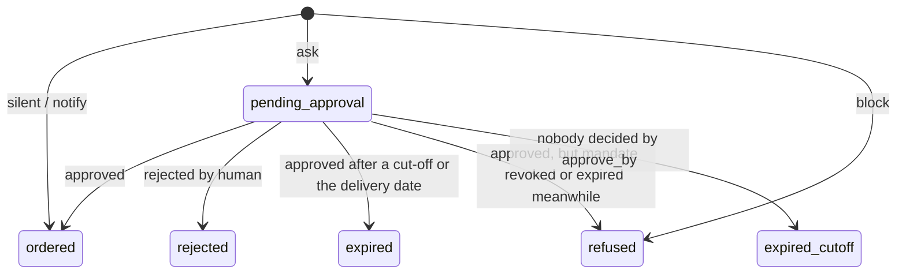
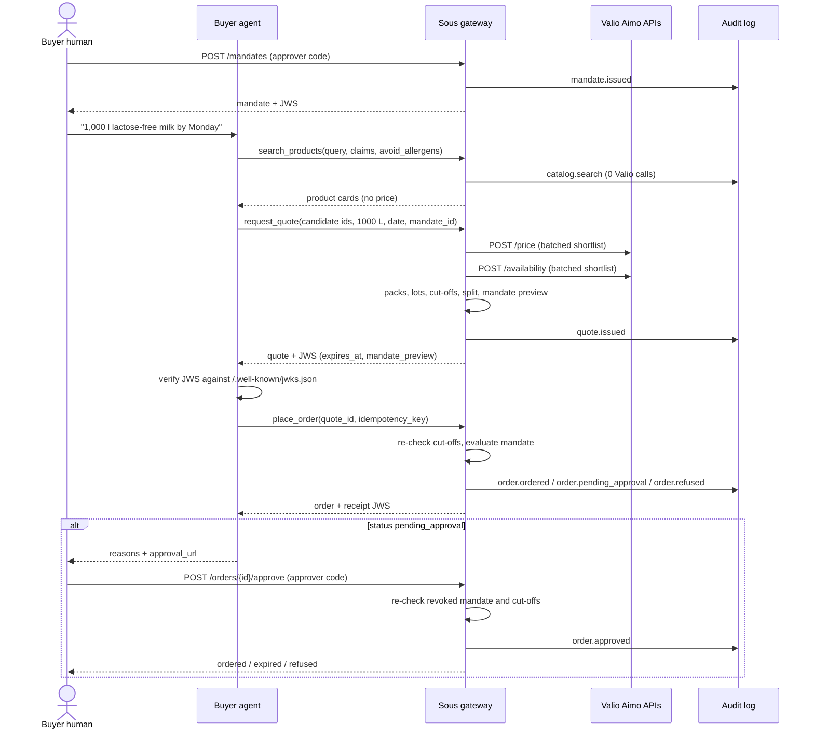

# Sous trust protocol

Version 0.2 (Junction 2026). This document describes what the gateway in this repo does today, so an outside agent developer can build a buyer agent against it. Where the code makes a simplification for the demo, it says so.

The short version: a human issues a **mandate** to their purchasing agent. The agent asks the gateway for a **quote**. The gateway signs the quote and previews it against the mandate. The agent places an **order** on that quote. A deterministic rules engine puts the order into one of four **tiers**. Every step lands in a hash-chained **audit log** that both sides can read and verify.

## 1. Actors

| Actor | Who | What they do |
|---|---|---|
| Buyer human | e.g. a hotel F&B manager | Issues and revokes the mandate. Approves or rejects held orders. |
| Buyer agent | Any AI agent (Claude, Gemini, a script) | Searches, asks for quotes, places orders. Identified by `agent_id`; on mandates that require it, authenticated with a bearer credential (section 16). Can never approve its own orders. |
| Gateway | Valio Aimo's Sous service (this repo) | Holds the catalog, calls Valio Aimo's price and availability APIs, signs mandates, quotes and receipts, enforces the mandate, writes the audit log. |
| Approver | The buyer human (or someone they delegate to) | Calls approve or reject on orders in `pending_approval`. |

**Buyer side and seller side.** The web UI has two sides of one app. The **buyer side** (`/ui/buyer.html`) is the buyer's own: Approvals, Orders, Your rules, Standing, History. Held orders are decided there, and buyers accept or reject Valio's post-order amendments there. The **seller side** (`/ui/`) is Valio Aimo's: Orders, Audit log, Mandates, Standing, Stats, Insights, and reporting delivery exceptions. Held orders are read-only there ("waiting for the buyer", with a link to the buyer side), because a held order is the buyer's decision, not Valio's. Every order carries `order_url` (seller side), `buyer_url` (buyer side) and, while held, `approval_url` (the buyer dashboard, or the passkey page when the mandate accepts only passkeys). Every notification links to the buyer side. Today both sides use the same demo approver code; in production the buyer side would sit behind the buyer's own login.

| Valio Aimo's suggestions | `sous/suggest.py`, actor `valio-aimo-suggestions` | Offers sponsored, mandate-checked suggestions to the buyer agent. Never quotes or orders. |

Human actions (issue or revoke a mandate, approve or reject an order, pause or resume a standing order, store simulated standing-order history, send a test notification) require the `X-Approver-Code` header when `SOUS_APPROVER_CODE` is set. This is a demo stand-in for the buyer's real login (see [DECISIONS.md](DECISIONS.md)).

**Agent identity today** is the `agent_id` the agent sends plus the signed mandate issued to exactly that `agent_id`; quotes, orders and standing orders are bound to it. A mandate can also require the agent to authenticate with a bearer credential (`require_agent_auth`, section 16). In production the agent would prove possession of a key bound to the mandate (mTLS, DPoP or a VC-bound key), see section 14.

## 2. Transports

The same operations are exposed twice, over one service layer (`sous/service.py`):

- **REST / OpenAPI**: `GET /openapi.json`, interactive docs at `/docs`.
- **MCP** (Streamable HTTP) at `/mcp` (header auth; `/mcp/` answers the same, no redirect), at `/connect/mcp` for OAuth-only connectors such as claude.ai and ChatGPT ([CONNECT.md](CONNECT.md)), or stdio (`uv run python -m sous.mcp_server`). Tools: `my_mandates` (the mandates the caller's credential covers: buyer, label, agent_id, rules in one line; `agent_id` may then be omitted on `request_quote`, `place_order` and `renew_standing_order`; REST: `GET /mandates` marks them `yours: true`), `search_products`, `get_product`, `request_quote`, `suggest_substitutes`, `place_order`, `get_order`, `get_mandate`, `get_suggestions`, `list_offers`, `create_standing_order`, `renew_standing_order`, `get_standing_order`. Each tool carries all four MCP annotations (`readOnlyHint`, `destructiveHint`, `idempotentHint`, `openWorldHint`; `place_order` is destructive but idempotent per `idempotency_key`). Structured output (MCP 2025-06-18): every tool declares an `outputSchema` and returns its object as `structuredContent`, plus the same JSON as one text block for older clients. The quote, order and mandate parts reuse the models behind `/schemas/{quote,order,mandate}.json` (`sous/standards.py`), so REST and MCP describe one shape; all objects allow extra fields. Errors (`isError: true`) carry the error object instead and are not validated against the schema. Resources: `sous://allergens` (GS1 codes and families) and `sous://mandates/{mandate_id}`. Prompt: `purchase(request, mandate_id, agent_id, delivery_date?)` walks a model through search, quote and order. The server also ships with usage instructions for the model.

| Operation | REST | MCP tool |
|---|---|---|
| Search catalog | `GET /products?q=&claims=&avoid_allergens=&labels=&temperature=&category=&limit=&agent_id=` | `search_products` |
| Product details | `GET /products/{id}` | `get_product` |
| Substitutes | `GET /products/{id}/substitutes?delivery_date=&amount=&unit=&mandate_id=` | `suggest_substitutes` |
| Quote | `POST /quotes`, `GET /quotes/{id}` | `request_quote` |
| Order | `POST /orders`, `GET /orders`, `GET /orders/{id}` | `place_order`, `get_order` |
| Order history | `GET /orders/{id}/history` | |
| Approve / reject | `POST /orders/{id}/approve`, `POST /orders/{id}/reject` (human) | none, on purpose |
| Mandates | `POST /mandates` (human), `GET /mandates`, `GET /mandates/{id}`, `GET /mandates/{id}/history`, `POST /mandates/{id}/revoke` (human) | `get_mandate` |
| Valio suggests | `GET /mandates/{id}/suggestions?agent_id=&delivery_date=&limit=&basis=` | `get_suggestions` |
| Valio offers | `POST /offers`, `GET /offers`, `DELETE /offers/{id}` (Valio side); `GET /mandates/{id}/offers`; `POST /quotes {offer_id}` | `list_offers`; `request_quote(offer_id=)` |
| Standing orders | `POST /standing-orders`, `GET /standing-orders?mandate_id=`, `GET /standing-orders/{id}` | `create_standing_order`, `get_standing_order` |
| Renew a standing order | `POST /standing-orders/{id}/renew` `{delivery_date?, agent_id?, amounts?}` | `renew_standing_order` |
| Pause / resume (human) | `POST /standing-orders/{id}/pause`, `POST /standing-orders/{id}/resume` | none |
| Simulated history (demo, human) | `POST /standing-orders/{id}/simulate-history` | none |
| Notifications | `GET /notifications?buyer=&order_id=&limit=`, `POST /notifications/test` (human) | |
| Agent credential | `GET /mandates/{id}/agent-credential`, `POST /mandates/{id}/agent-credential` (human: rotate or revoke) | none, on purpose |
| Audit | `GET /audit?subject=&buyer=&limit=`, `GET /audit/verify` | |
| Judge sandbox | `POST /sandbox` (no login, per-IP limited), `GET /sandbox/{id}`, `DELETE /sandbox/{id}` (approver); `?sandbox=<id>` on `GET /orders`, `/mandates`, `/audit`, `/notifications`, `/standing-orders` (section 18) | |
| Public key | `GET /.well-known/jwks.json` | |
| Allergen codes | `GET /allergens` | resource `sous://allergens` |
| Health | `GET /health` (build `version` (pyproject) and `commit` (env `SOUS_COMMIT`, the Docker build arg of the same name, else "unknown"), Valio call counters, shared Valio budget (section 19), storage backend, whether the approver code is required) | |

Substitutes: `delivery_date` is optional (default: the next delivery day; the answer's `delivery_date {date, defaulted, note}` says which was used). A need in packs becomes what those packs hold, stated in `need.asked`: `SALES_UNIT` 20 -> `20 x KI (6 x 190 g) = 22.8 kg`, `ST` 20 -> `20 ST x 190 g = 3.8 kg (sold per KI (6 x 190 g))`. A different product type or a negative `match_score` is never offered; those are listed in `not_offered[] {product_id, name, type, match, match_score, reason}`, and with no acceptable option `no_safe_substitute` is `"no acceptable substitute; ask a human"` (`null` otherwise).

REST errors, including schema and HTTP errors, are `{"error": "<code>", "message": "<text>"}` with an HTTP status (plus `retry_after` on `valio_unavailable` when known). MCP tools return `{"error", "message", "hint", "retryable"}` as a tool result with `isError: true` instead of raising; `hint` tells the model what to do next (codes in section 7).

## 3. Signatures

Everything the gateway signs is a **compact JWS** (RFC 7515) with **Ed25519** (`alg: EdDSA`, RFC 8037).

- Header: `{"alg": "EdDSA", "kid": "<kid>", "typ": "<typ>"}`.
- Header and payload are serialised as canonical JSON (keys sorted, separators `,` and `:`, UTF-8, no ASCII escaping), then base64url without padding.
- `kid` is the first 16 hex characters of SHA-256 over the raw 32-byte public key.
- The public key is published as a JWKS at `GET /.well-known/jwks.json`:
  `{"keys": [{"kty": "OKP", "crv": "Ed25519", "x": "<base64url>", "kid": "<kid>", "alg": "EdDSA", "use": "sig"}]}`.

| `typ` | Payload |
|---|---|
| `sous-mandate+jws` | The mandate object (section 4) |
| `sous-quote+jws` | The quote object (section 5) |
| `sous-order+jws` | The order receipt: `id, quote_id, mandate_id, status, total_ex_vat, lines, decision, approval, updated_at`. Re-signed after a human decision. |

JSON Schemas (2020-12) of these payloads are served at `GET /schemas/mandate.json`, `/schemas/quote.json`, `/schemas/order.json` and `/schemas/receipt.json` (generated from the models in `sous/standards.py` and `sous/mandate.py`; they allow extra fields, so new fields don't break readers). AP2, schema.org and discovery views of the same objects are described in [STANDARDS.md](STANDARDS.md).

Tokens signed before the rename from Valtakirja carry `valtakirja-mandate+jws`, `valtakirja-quote+jws` and `valtakirja-order+jws`; the gateway still verifies them as the matching `sous-*` type.

The gateway trusts only signed payloads: an order is built from the quote's verified JWS payload and the mandate's verified JWS payload, never from the stored copies. A mandate whose signature no longer verifies gives `mandate_signature`; a quote, `quote_signature`.

The key is generated on first start and stored at `$SOUS_DATA_DIR/gateway_ed25519.pem`. There is one key and no rotation yet.

Note that the gateway signs the mandate, not the human. The signature proves "the gateway recorded this mandate as issued by `issued_by`", authenticated by the approver code. A production version would have the human sign it (section 14).

## 4. The mandate

Source: `sous/mandate.py`, class `Mandate`. All money is EUR excluding VAT.

| Field | Type | Default | Meaning |
|---|---|---|---|
| `id` | string | required | Mandate id, e.g. `M-HOTEL-AURORA`. |
| `buyer` | string | required | Organisation the agent buys for. |
| `agent_id` | string | required | The only agent allowed to order under this mandate. |
| `issued_by` | string | required | The human who issued it. |
| `valid_until` | datetime or null | null | After this, every order is blocked. |
| `revoked` | bool | false | Set by `POST /mandates/{id}/revoke`. Blocks every order. |
| `require_agent_auth` | bool | false | Quotes, orders and renewals under this mandate need the agent's bearer credential (section 16). |
| `notify_above_eur` | number or null | null | Above this, the order goes through and the human gets an FYI. |
| `auto_approve_limit_eur` | number | 500 | Up to this, no human is needed. Above it, the order is held. |
| `hard_limit_eur` | number or null | 5000 | Above this, the order is refused. |
| `daily_limit_eur` | number or null | null | Today's `ordered` total plus this order above the limit means a human must approve. |
| `weekly_limit_eur` | number or null | null | This calendar week's (Mon-Sun, Helsinki) `ordered` total plus this order above the limit means a human must approve. |
| `split_window_minutes` | 1-1440 or null | null | Orders that went through within this many minutes, each under `auto_approve_limit_eur`, plus this one above that limit: a human must approve (rule `spend.split_orders`). |
| `first_time_products` | `notify` \| `ask` \| `block` or null | null | Tier for a product never ordered under this mandate before (rule `product.first_time`). |
| `autonomy` | `advise` \| `reorder` \| `order` | `order` | How much the agent may do alone: advise = every order waits for a human (`autonomy.advise`); reorder = only usual products alone (`autonomy.reorder`); order = whatever the other rules allow. Valio Aimo can cap it lower (section 27, `autonomy.capped`). |
| `usual_products` | list of product ids | [] | Products the buyer has bought before (e.g. imported from their Valio order history): not first-time. |
| `max_price_change_pct` | number or null | 20 | Ask when a product's unit price ex VAT differs by more than this %, up or down, from the last price paid for it under this mandate (rule `price.changed`), or its price per L/KG is more than this % above the last price per L/KG paid for the same kind of product (rule `price.comparison_changed`). |
| `allowed_categories` | list or null | null | Valio Aimo category codes. Null means any. |
| `avoid_allergens` | list | [] | GS1 allergen codes, e.g. `AM` milk, `AN` tree nuts, `AP` peanuts, `AW` gluten cereals. `AM`, `AN` and `AW` expand to their whole family (see `GET /allergens`). |
| `allow_may_contain` | bool | false | If false, "may contain" counts as contains. |
| `unknown_allergens` | `ask` or `block` | `ask` | What to do when a product has no allergen declaration. Never `silent`: unknown is never safe. |
| `required_claims` | list | [] | Claims every line must carry, e.g. `FREE_FROM_LACTOSE`. |
| `product_purposes` | object | {} | What the buyer uses a product for, by product id: `{purpose, substitution}` with substitution `exact`, `ask` or `allowed` (default read from the purpose). See section 32. |
| `allowed_origins` | list or null | null | Countries (`fi`, `se`, `de` ...) and/or groups (`EU`, `EEA`, `NORDIC`, `BALTIC`, `EUROPE`) the goods may come from. Null = any. See section 30. |
| `avoid_origins` | list | [] | Countries and/or groups the goods must not come from. |
| `origin_violation` | `ask` or `block` | `ask` | Tier for a product from outside `allowed_origins` or from an avoided origin (`origin.restricted`). |
| `origin_unknown` | `notify`, `ask` or `block` | `ask` | Tier for a product without a usable country while an origin rule is set (`origin.unknown`). |
| `substitutions` | tier | `ask` | Tier for any line marked `substitute_for`. |
| `terminal_products` | tier | `silent` | Tier for products shipped from the supplier's warehouse (stock unknown). |
| `min_delivery_reliability` | number or null | 0.9 | Lines with historical full-delivery rate below this are held. |
| `later_delivery` | `notify`, `ask` or `block` | `ask` | Tier when the earliest delivery is after the requested date. |
| `max_comparison_price_eur` | map | {} | Cap per comparison unit for every product sold by that unit, e.g. `{"L": 2.5}`, unless `comparison_price_caps` covers the product. Above it, held. |
| `comparison_price_caps` | map | {} | Caps on price per L or KG (EUR ex VAT, in the product's own comparison unit) scoped to one kind of product, keyed by product type (`kahvikerma`), product family (`milk`, `cream`, `coffee milk`; see `sous/substitutes.py`) or catalog category code, e.g. `{"milk": 2.5}`. The most specific match wins (type, then family, then category) and replaces `max_comparison_price_eur` for that product. The demo hotels cap milk only, so cream is not held by the milk cap. |
| `unusual_quantity_factor` | number > 1 or null | 3 | Hold an order whose amount of a product family (milk, cream, coffee...; same unit) is more than this many times the median of the buyer's last orders of it (`quantity.unusual`; needs 3 past orders). Null turns it off. |

Issuing (`POST /mandates`) re-signs and stores the mandate and writes `mandate.issued` to the audit log. Re-issuing with the same id replaces it; with MariaDB the old version stays queryable (section 12).

**Drafting a mandate from plain language (buyer side, not part of the protocol).** The reference buyer agent can turn
a human's own words into a *proposed* mandate (`POST /agent/draft-mandate`, `agent/draft.py`): the proposed fields,
a field-by-field diff against the mandate in force with the exact words each came from, open questions for anything
vague or conflicting, and what a mandate can't express. Gemini (if configured) only drafts; a deterministic
validator checks every field (types, ranges, GS1 allergen codes, catalog claims and categories, numbers literally in
the text, no loosening from a sentence that tries to switch the checks off), and an offline rule-based parser covers
common Finnish and English phrasings. The gateway trusts none of it: the human edits the draft on the signing page
and signs it (section 17), and only that signed credential is accepted.

## 5. The quote

`POST /quotes` with:

```json
{
  "agent_id": "aurora-purchasing-agent",
  "mandate_id": "M-HOTEL-AURORA",
  "delivery_date": "2026-11-16",
  "items": [
    {"product_ids": ["<id>", "<id>"], "amount": 1000, "unit": "L", "substitute_for": null, "note": null}
  ]
}
```

- `unit` is `L`, `KG`, `SALES_UNIT` (the product's sales units; `pack` and `packs` mean the same) or a Valio unit code (`ST` = piece, also spelled `PCS` / `KPL`; `KI` = carton; `PAK`, `BAG`, `BOT`, ...; any case). A unit code is taken literally when the product's pack hierarchy defines it: 20 `ST` of a product sold per `KI` of 6 is 20 pieces, converted by the units ratio and rounded up to whole sales units and the lot size (4 `KI` = 24 `ST`); the line then carries `unit_note` ("20 ST asked -> 4 KI (24 ST) ordered, rounded up to whole KI") and `covers` in `ST`. `ST` (and `PCS` / `KPL`) on a product with no `ST` but exactly one other unit at ratio 1 with a piece-type code (`PRK` jar, `PAK`, `BOT`, `BAG`, `RAS`, `PSS`, `TLK`, ...) means that piece: 20 `ST` of Filos artichokes (`{PRK: 1, KI: 6}`) is 20 jars, 4 `KI`, `covers` 24 `PRK`, with a `unit_note`. Otherwise, for a product without that unit, the code falls back to meaning its sales units, never silently: the line carries `unit_note` ("ST is not a unit of this product; read as 20 KI = 120 PRK") and `covers` in the product's real unit (`KI`), not the unit asked for, plus the warning `UNIT_INTERPRETED`, which fires the mandate rule `unit.interpreted` (ask): a human confirms the quantity. A unit the product defines, or `ST` on its one piece unit, stays silent. `unit_note` is kept in the order's lines and its signed receipt. Use `SALES_UNIT` when you mean cartons. The same in quotes, options, standing orders and substitutes (REST and MCP; one normaliser and one conversion, `sous/quote.py` `normalize_unit` / `packs_per_sales_unit`). Unknown units: 422. With L or KG the gateway converts to packs and rounds up to the allowed lot size. A need in KG for a product measured in L ("40 kg laktoositonta kermaa"), or the reverse, is converted only when the product's type (read from its own name) has a typical density in `sous/quote.py` `DENSITY` (milk and soured milks 1.03, cream 1.02, whipping cream 1.00, yoghurt 1.03, oil 0.92, juice 1.04 kg/L; plant-based drinks and creams excluded): the line carries `unit_note` ("40 kg read as 39.2 L of cream at 1.02 kg/L (typical density, an assumption)"), `density` {kg_per_l, type, basis}, `covers` in the unit asked for, and `UNIT_INTERPRETED` (rule `unit.interpreted`, ask). Without a known density the line stays `UNIT_MISMATCH`, and the item gets an `uncovered` entry with `reason` and `next_step` ("Ask again in L or SALES_UNIT") instead of a silent dead end.
- Several `product_ids` for one item means "these are candidates". The gateway prices all of them, ranks orderable ones by comparison price (EUR per L or KG), and fills the need cheapest first, splitting across products when stock is short.
- Lines are sized to known stock, also for a single named product: 200 L asked with 131 in stock gives a 131 line and 69 in `uncovered` (rule `need.partial`, ask), never a 200 line a human could approve for stock that doesn't exist. The quote's `options[]` then offer ways to cover the rest.
- When none of an item's candidates can be ordered (one `product_id` or several), they are kept in the quote as unorderable lines (`orderable: false`, with no `uncovered` gap), so the reasons are visible and the mandate blocks them with the real rule (e.g. `availability.undeliverable`, `allergen.contains`). Unorderable lines count €0 towards the total and the spend limits.
- At most 50 items and 200 candidate ids per quote. Price and availability are fetched in two batched calls per item (price cached 10 min, availability 60 s), so a one-item quote costs at most 2 live calls.

Response: `{"quote": {...}, "jws": "<compact JWS of quote>"}`. Quote fields:

| Field | Meaning |
|---|---|
| `id` | `Q-XXXXXXXX` |
| `agent_id`, `mandate_id` | As requested. |
| `issued_at` | Gateway time (Europe/Helsinki, ISO 8601, ms). |
| `expires_at` | `min(issued_at + SOUS_QUOTE_TTL, earliest order_cutoff of any orderable line)`. Default TTL 900 s. |
| `requested_delivery_date` | As requested. |
| `items[]` | The requested items, signed with the quote, so a buyer can match each line to its need. |
| `currency` | `EUR` |
| `lines[]` | One per chosen product (below). |
| `total_ex_vat`, `total_inc_vat` | The **orderable total**: sums of the orderable lines only, what placing the quote would charge (0 when nothing can be ordered). |
| `indicative_total_ex_vat` | Indicative total of every line, unorderable ones included: what the need would cost, for reference; never charged. |
| `uncovered[]` | Needs that couldn't be filled: `{item, item_index, uncovered, unit}` or `{item, item_index, uncovered, reason}`. |
| `alternatives_considered[]` | Up to 6 per item: `{product_id, name, item_index, comparison_price, orderable, why_not[]}`. |
| `valio_api_calls` | Live calls this quote cost: `{price_calls, availability_calls, cache_hits}`. |
| `mandate_preview` | Only with `mandate_id`: `{outcome, findings[]}`, what will happen if this quote is ordered now. |
| `options[]` | Only when an item can't be covered as asked: complete alternatives for that item (section 5.1). |
| `chosen_option` | Only on a quote made from `option_id`: the option it came from. |

Each line has: `product_id, name, brand, sales_unit, content_per_sales_unit {amount, unit, source}, quantity, covers {amount, unit}, unit_price_ex_vat, unit_price_inc_vat, vat_rate, comparison_price {ex_vat, per}, list_price_ex_vat, line_total_ex_vat, line_total_inc_vat, logistic_model (Stock|Terminal), available_amount (null unless the stock policy shows exact numbers, section 5.2), stock (known|plenty|unknown), stock_level (ample|limited|short|none|unknown), available_date, delivery_date, order_cutoff, delivery_reliability, co2_estimate_kg, co2_range_kg {low, high, options, basis} (or null), co2_note, country_of_origin (lower-case ISO code or null), origin_name, origin_basis, labels, claims, allergens, temperature, orderable, issues[], item_index` (which entry of `items[]` it covers), and `substitute_for` when set.

`delivery_date = max(requested, available_date)`. `co2_estimate_kg` is a product-group average times quantity, labelled as an estimate. `co2_range_kg` turns it into a range: the lowest and highest estimate among the orderable products shortlisted for the same item, for the same quantity (null with fewer than two options with data; the line then carries `co2_range_note` saying which condition failed: fewer than two orderable options with data, no product-group average, or no quantity in kg/L). It is the spread between options, not a measurement uncertainty. The quote's `co2_summary {estimate_kg, low_kg, high_kg, lines_with_data, lines, basis}` adds it up over the order; lines without CO2 data are counted, never guessed. Source: `sous/carbon.py`.

### 5.1 Response options (`sous/options.py`)

When an item can't be covered in full by the requested date (stock short, earliest date later than asked, cut-off passed, sales block, undeliverable, out of stock), the quote lists `options[]` for it. Deterministic, no LLM. Each option:

| Field | Meaning |
|---|---|
| `id` | `<quote id>.O<n>`, e.g. `Q-1A2B3C4D.O2`. |
| `item_index`, `rank` | The item it replaces; 1 = best for that item. |
| `kind` | `on_time` (another candidate covers it all on the requested date), `partial_now_rest_later` (what arrives on the requested date, the rest from products whose earliest date is later: two deliveries), `all_later` (everything from later products, complete by the earliest date that covers it), `next_date` (the cut-off passed: the same product on the next date Valio can still deliver it, found by pricing it again for the day after its reported earliest date and, while that day has passed its cut-off too (a Terminal product ordered days ahead), for the day after that, up to 4 days; choosing it re-quotes for that date and the line keeps `LATER_DATE` against the requested date, so `delivery.later_date` still applies), `split_with_substitute` (what the original covers on time, the gap from a compatible substitute), `substitute` (a substitute covers it all). |
| `lines[]` | `{product_id, name, quantity, sales_unit, unit_price_ex_vat, line_total_ex_vat, line_total_inc_vat, covers, available_amount, stock_level, delivery_date, order_cutoff, logistic_model, substitute_for, use (when known), issues[] (codes)}`. |
| `covers`, `total_ex_vat`, `total_inc_vat`, `delivery_dates[]`, `on_time` | What the option delivers, for how much, when. |
| `tradeoff` | One plain-language sentence with the total. |
| `substitute` | `null`, or `{tier: best|better|good, for, compromises[], match}` from `substitutes.suggest`; with a known use also `use, use_sensitivity, use_ok, use_reason` (5.1.1). |
| `same_as_quote` | True when the option is exactly the quote's own lines (e.g. "accept the later date"). |
| `mandate_preview` | `{outcome, rules[]}`: the tier the whole quote would get with this option in place of the item's lines. For a `next_date` option it is the option's own: its lines priced for its own (later) date, next to the other items' orderable lines (another item's passed cut-off has its own options and doesn't make this one look blocked). |
| `order_cutoff` | `next_date` only: `{at, estimated, basis}`, the option's own cut-off: Valio's `closingTime` for that date when reported, else estimated from the original date's real cut-off offset (else 17:00 Helsinki the day before delivery). |

Ranking per item: options without a substitute first; then fully on time > part on time + rest later > later; split before a full substitute; substitute tier best > better > good, then type match and fewest compromises; then price. Options the mandate would block go last. Every option covers the full need, or it isn't listed (at most 5 per item).

For a need in packs (`SALES_UNIT`), substitute lines (`split_with_substitute`, `substitute`) are sized by equal content, not equal pack count: 40 x 400 g = 16 kg becomes 2 x 10 kg (rounded up to the lot size), never 40 x 10 kg; such options add `covers_content` (`{amount, unit}` in L or KG, also stated in the trade-off), keep `covers` in the original's packs, and substitutes measured in another unit are left out. When what one original pack holds can't be established (no size in the name, no comparison price), no substitute options are listed at all, since no amount could be shown to be equivalent. The option's lines are in the substitute's own packs, which is exactly what a re-quote with `option_id` orders.

Choosing: `POST /quotes` (or MCP `request_quote`) with `{agent_id, mandate_id, option_id}` only. The gateway reads the option from the previous quote's **signed** payload (same agent and mandate, not expired), replaces that item with one item per option line (`SALES_UNIT`, `substitute_for` kept), keeps the other items and the date, and returns a fresh, live-priced signed quote with `chosen_option`. Order that quote as usual. Errors: `option_not_found` (404), `quote_mismatch`, `quote_expired` (409), `invalid_request` (422) when neither items nor `option_id` are given.

Assumptions (availability per date): Valio Aimo returns only each product's earliest date (`availableDate`) and the amount then (`availableAmount`); stock on any later date isn't known. So the gateway never assumes the rest of a short product arrives later from the same product: the remainder comes only from other products whose own earliest date and amount cover it. Terminal products count as unknown (unlimited) stock, as in quotes. Substitutes are looked up (two batched Valio calls, `substitutes.suggest`, with the mandate's allergen and claim rules) only when no option without a substitute arrives on time, for at most 3 items per quote; if Valio is unavailable the quote is returned without substitute options. In the Junction mock every product's earliest date is the same day, so `partial_now_rest_later` is exercised in the offline tests (tests/test_options.py), not in the live eval.

### 5.1.1 Use-aware substitution (`sous/use_sensitivity.py`)

Whether a substitute is acceptable depends on what the kitchen uses the product for. Two whipping creams from two brands can look identical and still whip differently (stabilisers such as lecithin or carrageenan change how the cream whips and how long the foam holds), so another brand can break a dessert; in coffee the brand barely matters. Butter for laminated pastry, milk served to drink and cheese for a gratin have the same kind of need.

**Where the use comes from.** `items[].use` on `POST /quotes` / MCP `request_quote` (and `use` on `GET /products/{id}/substitutes` / MCP `suggest_substitutes`, standing-order items): free text or `coffee`, `whipping`, `dessert`, `baking`, `laminated_pastry`, `sauce`, `cooking`, `drinking`, `melting`, `ingredient-in-recipe:<dish>`. The recipe planner sets `ingredient-in-recipe:<dish>` on every ingredient line. Left out on a substitute item, the gateway reads it from the buyer's history: a standing order's item, else the newest ordered quote that stated a use for the original or the substitute. Otherwise it is unknown and nothing changes. Quote lines carry `use` and `use_source` (`request` or `history: order PO-...` / `history: standing order SO-...`); a signed item has `use` only when it was sent.

**The table** (product type x use -> level), small and explicit, no model:

| Level | Accepts | Seeded for |
|---|---|---|
| `exact` | the same product only: any substitute, a brand change included, asks a person | whipping cream for whipping / a dessert; butter for laminated pastry |
| `same_spec` | same type, same fat %, flavour and the original's claims; any brand | cream for cooking or baking; milk to drink; butter for baking; cheese for melting (gratin, pizza) |
| `type` | the same kind of product | cream or milk for coffee; milk for baking or cooking; butter or cheese for cooking |

A dish can name several uses (lasagne: melting and cooking); the strictest one the table has for the product wins. A product type or use the table doesn't know keeps the ordinary behaviour (rule `substitution`, set by `substitutions`). The mandate field `substitution_by_use` (`{type key | family | category | "*": {use: level}}`, e.g. `{"kuohukerma": {"dessert": "type"}}`) overrides any cell; it is signed with the mandate, and the most specific key wins.

**Effects.** `substitution.use_sensitive` (ask) fires on a substitute line the level doesn't accept, also when `substitutions` is `silent` or `notify`; its message says the why ("Whipping cream for a dessert: a different brand can whip differently (...), so a person should confirm the substitute (a different brand: Arla instead of Valio).") with a Finnish twin. When the level does accept it, the `substitution` finding says so ("Coffee cream for coffee: in coffee the brand barely matters ..."). `substitutes.suggest` adds `use` (`{use, source, classes, sensitivity, why}`) and, per option, `use_sensitivity`, `use_ok`, `use_reason`, `use_reason_fi`; an unacceptable option gets a major compromise (tier `good`), and for `exact` / `same_spec` acceptable and same-brand options rank first. **With purpose per item (section 32).** The two work together: `purpose` / `substitution` say how strict a product is for this buyer at all (`exact` refuses any substitute, `ask` always asks); the use table judges a particular substitute against what the product is for (same brand? same fat %?) and says why. An item's `purpose` counts as its use when `use` isn't given, so the recipe planner's `recipe: <dishes>` and a `coffee` purpose feed the table too. A remembered substitution (sous/remembered.py) is stored with its use and applies only to the same use (one approved for coffee asks again for a dessert); `substitution.use_sensitive` itself is never softened.

### 5.1.2 Does the chosen product fit its use? (`sous/use_fit.py`)

5.1.1 judges a substitute against the original; nothing there checks the product the agent *chose*. A request for "lactose-free milk for a dessert" could land on skimmed UHT milk and go through. So every line with a use (`use`, else the line's `purpose`, which the recipe planner sets) is checked against a few explicit requirements:

| Use | Kind | Doesn't fit | Fits |
|---|---|---|---|
| whipping / a dessert | cream | coffee cream, cooking cream, cream with a known fat % under 30 | whipping cream (kuohukerma / vispikerma), cream at 30 % or more |
| a dessert | milk | skimmed milk (0 % fat, `rasvaton`) | milk with a known fat % |
| cooking / a sauce | cream | coffee cream (can split when it boils) | cooking cream, whipping cream |
| laminated pastry | spread / butter | a spread (`levite`) | butter; bakery margarine |

Coffee takes anything of the type; baking milk is not judged. A product whose type or fat % the name doesn't reveal gets nothing (unknown never nags). A mismatch is `product.use_fit` at the mandate's `use_fit` tier (default `ask`; `notify`, `block`, or `silent` = off), with a reason a kitchen manager reads at a glance ("Skimmed milk for a dessert: a fat-free milk changes the texture (...); a person should confirm (...)", Finnish twin in `explanations_fi`). When another candidate of the same item is of the same kind, orderable and fits with a known spec, the line carries `use_fit_suggestion: {product_id, name}` (the cheapest such) and the message names it; this uses only the offers the quote already fetched, never an extra Valio call. The gateway still picks by price; it doesn't swap the product on its own.

### 5.2 Stock exposure (`sous/exposure.py`, `SOUS_STOCK_EXPOSURE`)

Why: a wholesaler doesn't want any agent, a competitor's included, to scrape exact stock levels by asking for quotes. Valio decides how much it shows:

| Mode | What agents see |
|---|---|
| `buckets` (default; unknown values fall back to it) | `stock_level` only; `available_amount` is `null` and "Only N in stock" messages become "Not enough in stock for the M needed". |
| `exact` | The previous behaviour: `available_amount` and the messages as Valio Aimo reports them, plus `stock_level`. |
| `approver_exact` | `buckets`, except callers with the global approver code (`X-Approver-Code`; not sandbox or agent tokens) see `exact` substitutes and suggestions, and on a quote they create an unsigned `approver_view` sidecar (below). |

**Quotes under `approver_exact`.** A stored quote is read later by others (the mandate's agent, anyone for a `demo_public` mandate), so the quote is always signed and stored in the `buckets` view, whoever made it. An approver caller additionally gets, in the `POST /quotes` response only, `approver_view: {signed: false, note, lines: [{line, product_id, available_amount}]}` (`line` indexes `quote.lines`). It is not part of the JWS, not stored, and never returned by `GET /quotes/{id}` (an approver re-reading a quote sees the bucketed view; ask for a new quote for fresh exact numbers). Under a mandate or with the approver code the quote is still sized/split to the exact stock, as the next paragraphs describe. (QA, rene-codex-qa 04:06Z.)

`stock_level` compares stock with the requested quantity in the product's sales units: `ample` (at least 3x the request, at least 1000 units, or Valio's "no practical limit"), `limited` (covers the request, not 3x), `short` (doesn't cover it), `none` (out of stock or no delivery date), `unknown` (Terminal: supplier-shipped, or no availability data).

Applies to quote lines and option lines, substitute offers and compromises, and Valio's suggestions, over REST and MCP alike. The planner, options and mandate engine still work from the exact numbers; the policy is applied once to what leaves the gateway, and before the quote is signed, so the JWS, the stored quote and the response are the same view (under `approver_exact` that is the bucketed view even for an approver, whose exact numbers come only in the unsigned `approver_view`). Under a mandate, quantities are never hidden: when stock is short the quote splits it, and that line's `quantity` (and the item's `uncovered` amount) shows what can be supplied. Valio needs to show that much for the buyer to act on it.

**Anonymous quotes are not sized to stock.** A quote without a `mandate_id` needs no credential, so a line sized to stock (its `quantity`, `covers`, line total, `uncovered`) would hand anyone the exact amount (ask for 99999 and read the split). In `buckets`, and in `approver_exact` for callers without the approver code, a mandate-less quote therefore puts the whole requested quantity on the cheapest orderable product, never splits it by stock, and carries no `options[]` (they are sized to stock too). A short line says so: `stock_level: short`, `PARTIAL_STOCK` (redacted message) and `STOCK_SIZING_WITHHELD`. The exact coverable amount and the split appear only to a caller quoting under a mandate (authorized as section 16 describes: the agent's `vka_` token, a sandbox token, or the mandate's own rules when it needs no token) or with the global approver code under `approver_exact`. The JWS signs this same view. `exact` mode is unchanged. (Security review, Codex run 01a1d86a.)

### 5.3 Stock reservations and fair share (`sous/reservations.py`, `SOUS_ALLOCATION`)

Why: a quote is sized to the stock Valio reports, but N buyers' quotes made before any order each see all of it, so N orders could together exceed what Valio has (the "Monday rush").

- **Reserve.** An order that goes through reserves its lines' quantities per (product, delivery date) against Valio's last known `availableAmount` (recorded at every quote). A held order (`pending_approval`) reserves *tentatively* until its `approve_by`; approval makes it firm, rejection or expiry releases it. Only lines with known stock (`logisticModel: Stock`) reserve; Terminal lines stay unknown.
- **What's left.** Every later quote and order sees `left = Valio's amount - active reservations`. Quotes are sized to it (a line with nothing left gets the blocking issue `ALLOCATED`). An order asking for more than is left is **refused** with `ALLOCATED` (rule `availability.allocated`, owner valio, block); the order carries `allocation: {policy, lines: [{product_id, delivery_date, asked, left, why}]}` and `options: [{id, kind: "allocated_left", product_id, quantity, delivery_date, requote: {delivery_date, items}}]`: `requote` is a ready `POST /quotes` body for what's left. Check and reserve run under the order lock, and with Valkey also as one WATCH/MULTI transaction, so two orders can't both take the last units.
- **A reservation ends** when Valio's own availability reflects it (a newer observation shows the stock fell by at least the reserved amount since the oldest open reservation: our orders arriving at Valio, oldest first), when its TTL passes (`SOUS_RESERVATION_TTL_MINUTES`, default 30), or when its order is rejected, expires or is refused at approval.
- **Pools.** A judge sandbox's orders reserve only within that sandbox (each sandbox is its own world, keyed by its id): one visitor's 1,000 L demo order never takes stock from another sandbox or from real buyers. Real and curated mandates share the global pool. The eval runners (`scripts/eval.py`, `scripts/llm_eval.py`) give every case its own pool, so earlier cases' orders never eat later cases' stock; leaving a case's scope ends its reservations and deletes its Valkey hashes (which also expire after 15 min, for a crashed runner); only the rush test exercises one shared pool. Reflection by Valio's refresh applies to the global pool only (sandbox and eval orders never reach Valio).
- **Static stock (the Junction mock).** Valio's mock never lowers its stock, so nothing is ever reflected and a global reservation lasts its full TTL. With `SOUS_RESERVATION_RELEASE_UNCHANGED=1` a reservation also ends once a fresh availability reading (taken more than 60 s after it, past aimo's cache) still shows the amount it was made against: a burst of simultaneous orders is still protected, but stock that never moves isn't held for 30 minutes. Only a new Valio reading (one a quote just fetched) can end a reservation this way, never the stored last reading plus elapsed time (fixed after rene-codex-qa's 11:01Z over-allocation repro). Off by default, and stays off until QA re-confirms (against a live Valio an unchanged reading can just mean the order hasn't arrived yet).
- **Shared.** Stored in the `stock_reservation`, `stock_observation` and `stock_demand` tables; with `SOUS_VALKEY_URL` also mirrored in one Valkey hash per (deployment role, pool, product, date), so replicas of one deployment see one another's reservations (prod, staging and CI share the Valkey for the Valio budget, never each other's reservations). Valkey down falls back to the database (fail-open, like the Valio budget).

**Fair share when short.** Valio sets the policy, not a buyer's mandate: `SOUS_ALLOCATION`

| Policy | When demand exceeds stock |
|---|---|
| `first_come` (default) | Whoever orders first gets it, up to what's left. |
| `pro_rata` | Each buyer is capped at a share of the stock in proportion to their last 4 weeks' ordered volume of the product (a buyer with no history counts as the smallest regular buyer). A buyer asking for less than their share gets what they asked for and the rest is shared among the others by the same weights (weighted water filling). Demand = what buyers asked for in quotes and orders of the last `SOUS_RESERVATION_TTL_MINUTES`. When demand fits the stock there is no cap. `why: "share"` in `allocation` says the cap, not the stock, limited the order. |

Measured with 60 concurrent agents in docs/ROBUSTNESS.md ("Monday rush"; `scripts/rush.py`).

### Issue codes (`sous/quote.py`)

Each issue is `{code, severity, message}`. A line with any `blocking` issue has `orderable: false`.

| Code | Severity | Meaning |
|---|---|---|
| `UNIT_MISMATCH` | blocking | Need is in L but the product is measured in KG, or the reverse, and no typical density is known for the product's type (section 5, units). |
| `CONTENT_UNKNOWN` | blocking | Can't tell how many L or KG one pack holds, so quantity can't be computed. |
| `NO_PRICE` | blocking | Valio Aimo returned no price. |
| `NO_AVAILABILITY` | blocking | Valio Aimo returned no availability. |
| `SALES_BLOCK` | blocking | Product is sales-blocked. |
| `UNDELIVERABLE` | blocking | No schedule lines: no delivery date at all. |
| `OUT_OF_STOCK` | blocking | No available date, or available amount 0. |
| `CUTOFF_PASSED` | blocking | The order cut-off (`closingTime`) for the quoted date is in the past, even if the API still reports the date. Also added at order time if the cut-off passed after the quote was issued. |
| `PRODUCT_HELD` | blocking | Valio Aimo has the product on hold (recall, quality hold, sales stop; section 23). Rule `product.held`, not `availability.*`. |
| `ALLOCATED` | blocking | Valio's stock for the date is already reserved by orders placed or held through Sous, or (under `pro_rata`) this buyer's share is used (section 5.3). Rule `availability.allocated`; a refused order's `options` offer what's left. |
| `CUTOFF_UNKNOWN` | warning | Valio Aimo reported a cut-off only for an earlier available date, so the cut-off for the requested date isn't known. The line gets no `order_cutoff` and doesn't shorten the quote's expiry. |
| `LOT_SIZE` | warning | Sold in lots; quantity rounded up. |
| `PRICE_EXPIRES` | warning | Price `validTo` is before the delivery date. |
| `LATER_DATE` | warning | Earliest delivery is after the requested date. |
| `STOCK_UNKNOWN` | warning | Terminal product: supplier stock is unknown. |
| `PARTIAL_STOCK` | warning | Known stock is below the quantity. Removed from lines that `plan` sized to stock (every line of a quote under a mandate is); where it stays (e.g. a line re-checked later), the rule `availability.partial_stock` holds the order for a human. |
| `STOCK_SIZING_WITHHELD` | warning | A mandate-less quote's line is short of stock; the exact coverable amount is shown only under a mandate (section 5.2). |
| `LOW_RELIABILITY` | warning | Historical full-delivery rate below 0.9. |
| `PACK_OVERSIZE` | warning | The planned packs exceed a need in L or KG by more than 25 % (`SOUS_PACK_OVERSIZE_PCT`): "20 kg for a 12 kg need (+67%)". Before flagging, the planner tries plans with less surplus (each candidate first, smallest packs first) and takes the one with the least surplus that covers as much and costs at most 10 % more (`SOUS_PACK_OVERSIZE_PRICE_PCT`). Rule `quantity.pack_oversize` (notify). |
| `DATA_CACHED` | info | Judge sandboxes only: the gateway's OWN per-minute budget of live Valio calls (or the sandbox's lookup quota) was used up, so the line uses a copy the gateway fetched at most 10 min earlier (`cached_at` on the line) instead of refusing the quote. Not a Valio failure (that is `DATA_STALE`); Valio's mock data is static. The cut-off is still checked against now. No mandate rule acts on it. Without such a copy for every product the quote is refused as before (`sandbox_limit` / `valio_unavailable`, retryable). |
| `DATA_STALE` | warning | Valio Aimo couldn't be reached live (rate limit, error, or the gateway paused calls after a 429), so the line uses the last copy fetched: price up to 15 min old, availability up to 5 min. The cut-off is still checked against now. Always sends the order to a human (`availability.data_stale`). |

## 6. Tiers and rules

The rules engine (`mandate.evaluate`) is plain Python. No language model approves or relaxes anything; the only model input is the Gemini Decisions API's probability for products that declare no allergens (section 25), which can only add `allergen.likely`. It returns a list of findings `{rule, outcome, message, product_id, rule_url}` and the overall tier is the strictest finding. `rule_url` points at the rule in the register (section 6.1).

| Tier | Order status | Meaning |
|---|---|---|
| `silent` | `ordered` | Routine. Ordered and logged. |
| `notify` | `ordered` | Ordered; the human gets an FYI. |
| `ask` | `pending_approval` | Held until a human approves or rejects. |
| `block` | `refused` | Refused, with the rule that fired. |

If the tier is `silent` or `notify`, a final `mandate.ok` finding is added with the total.

| Rule id | Tier | Fires when |
|---|---|---|
| `mandate.revoked` | block | Mandate is revoked. |
| `mandate.expired` | block | Now is after `valid_until`. |
| `mandate.agent` | block | Calling `agent_id` is not the mandate's `agent_id`. |
| `order.empty` | block | The quote has no lines. |
| `spend.hard_limit` | block | Total > `hard_limit_eur`. |
| `spend.auto_limit` | ask | Total > `auto_approve_limit_eur` (and not over the hard limit). |
| `spend.notify` | notify | Total > `notify_above_eur` (and within the auto limit). |
| `spend.daily_limit` | ask | Today's ordered total + this total > `daily_limit_eur`. |
| `spend.weekly_limit` | ask | This week's ordered total + this total > `weekly_limit_eur`. |
| `spend.split_orders` | ask | This order is under `auto_approve_limit_eur`, and with the orders under it that went through in the last `split_window_minutes` it passes that limit. |
| `product.first_time` | `first_time_products` | The product is in no order that went through under this mandate and not in `usual_products`. |
| `price.changed` | ask | Unit price differs from the last price paid for the product under this mandate by more than `max_price_change_pct`. |
| `price.comparison_changed` | ask | Price per L or KG is more than `max_price_change_pct` above the last price per L/KG paid for the same kind of product (product family) under this mandate, when that was another product. |
| `autonomy.advise` | ask | The mandate's `autonomy` is `advise`: every order waits for a human. |
| `autonomy.reorder` | ask | `autonomy` is `reorder` and the product is not a usual one (ordered under the mandate before, or in `usual_products`). |
| `autonomy.capped` | ask | Valio Aimo's cap on this buyer (or every buyer) lowers the agent's autonomy below the mandate's, and that lower level holds the order (section 27). |
| `ordering.paused` | block | Valio Aimo has paused agent ordering for every buyer or this buyer (section 24). |
| `need.partial` | ask | Part of the need is uncovered. |
| `availability.<code>` | block | Any blocking issue on a line, code lowercased: `availability.unit_mismatch`, `availability.content_unknown`, `availability.no_price`, `availability.no_availability`, `availability.sales_block`, `availability.undeliverable`, `availability.out_of_stock`, `availability.cutoff_passed`. |
| `availability.partial_stock` | ask | Line still has `PARTIAL_STOCK`: known stock is below the quantity ordered. |
| `delivery.later_date` | mandate's `later_delivery` | Line has `LATER_DATE`. |
| `price.expires` | ask | Line has `PRICE_EXPIRES`. |
| `availability.data_stale` | ask | Line has `DATA_STALE`: never ordered on last-known data without a human. |
| `product.category` | block | Category not in `allowed_categories`. |
| `product.claims` | block | Line lacks a `required_claims` claim. |
| `origin.restricted` | ask or block | Line's country is outside `allowed_origins` or in `avoid_origins`; tier is `origin_violation`. |
| `origin.unknown` | notify, ask or block | No usable country of origin while the mandate restricts origin; tier is `origin_unknown`. |
| `allergen.contains` | block | Line contains an avoided allergen. |
| `allergen.may_contain` | block | Line may contain one and `allow_may_contain` is false. |
| `allergen.likely` | block | The product declares no allergens, but the Gemini Decisions API puts an avoided allergen at p ≥ 0.8 from its names, brand and key ingredients (section 25). |
| `allergen.unknown` | mandate's `unknown_allergens` (ask or block) | Mandate has allergen rules and the product has no allergen declaration. |
| `substitution` | mandate's `substitutions` | Line is marked `substitute_for`. |
| `supply.terminal` | mandate's `terminal_products` | Terminal product (only emitted when that setting isn't `silent`). |
| `supply.reliability` | ask | `delivery_reliability` < `min_delivery_reliability`. |
| `price.comparison_cap` | ask | Comparison price above the product's cap: `comparison_price_caps[type, family or category]` if one matches, else `max_comparison_price_eur[per]`. The message names the cap and what it covers ("above the mandate's €2.50/L cap for milk"). |
| `quantity.unusual` | ask | A product family's amount (in the need's unit, or packs) is more than `unusual_quantity_factor` × the median of the buyer's last ordered amounts of it (orders with status `ordered` under this mandate, standing renewals included, last 90 days, at least 3). The message says e.g. "8× your usual 120 L". |
| `mandate.ok` | silent or notify | All checks passed. |

Standing-order renewals add drift rules (section 8): `standing.quantity_creep`, `standing.quantity_trend`, `standing.cost_drift`, `standing.price_drift`, `standing.product_switched`, `standing.new_terminal`, `standing.new_reliability`, each tier ask.

Warnings `LOT_SIZE`, `CUTOFF_UNKNOWN`, `STOCK_UNKNOWN` and `LOW_RELIABILITY` have no rule of their own. Terminal and reliability are judged from the line's `logistic_model` and `delivery_reliability` fields against the mandate instead.

### 6.1 Rule register (`GET /rules`, MCP resource `sous://rules`)

`GET /rules` lists every rule the gateway can fire, generated from `sous/rules.py`; `GET /rules/{id}` returns one. Each entry:

| Field | Meaning |
|---|---|
| `id` | Rule id as it appears in findings (`spend.daily_limit`) or the error code of a refusal (`agent_cannot_approve`). |
| `kind` | `finding`: joins the order decision and sets its tier. `refusal`: stops the call with an error before any decision (`http_status` given). |
| `tiers` | The tiers it can produce. For buyer-chosen tiers (`substitutions`, `later_delivery`, `unknown_allergens`, `terminal_products`) read from the Mandate field's type. |
| `owner` | `buyer` (the buyer's mandate sets it), `valio` (Valio Aimo's stock, cut-off, sales block and price facts; no mandate overrides them) or `gateway` (safety rules, the same for every buyer). |
| `text` | What it does, in plain language. `text_fi`: the same in Finnish (6.1.1). |
| `mandate_field`, `mandate_field_default`, `mandate_field_description` | The Mandate field(s) that configure it, with the default and description from the model; null when nothing configures it. |
| `condition` | When it is checked, if narrower than every order (e.g. `standing-order renewal`). |
| `url` | Its own address; the same value as `rule_url` in findings. |

The register is the single source of truth: `tests/test_adopt.py` scans `sous/` for every rule id the engine emits (`add("…")`, `Finding(rule="…")`, blocking issue codes in `quote.py`) and fails if one is missing from the register. Standing-order thresholds in the text come from `sous/standing.py`.

### 6.1.1 Finnish (`sous/fi.py`)

The gateway's own sentences also come in Finnish, written from the same values as the English (never machine-translated), and only in **unsigned** fields: signed quotes, receipts and mandates stay exactly as before, so every signature verifies unchanged. Money and dates are Finnish style (`1 234,50 €`, `15.11.2026 klo 16.45`).

| Where | Field |
|---|---|
| `GET /rules`, `GET /rules/{id}`, `sous://rules` | `text_fi` on every rule. `?lang=fi` (or `Accept-Language: fi`) puts Finnish in `text` (English in `text_en`) and Finnish `owners`, `tiers`, `kinds`. |
| `POST /quotes` response (beside `quote` and `jws`) | `explanations_fi.findings["<i>"]`: Finnish for `quote.mandate_preview.findings[i]`; `explanations_fi.unit_notes["<i>"]`: for `quote.lines[i].unit_note`. |
| Order (`GET /orders/{id}`, `place_order`) | `explanations_fi.findings["<i>"]` for `decision.findings[i]`, `unit_notes["<i>"]` for `lines[i].unit_note`, `result_reason` for `approval.result_reason` (the human's own note stays as written). Not in the receipt. |
| Notifications | feed `data.fi` and webhook `title_fi` / `message_fi` beside `title` / `message` (order.notify, ask, block, expired, decided). |
| Sandbox mandates | `rules_fi`, and `text_fi` on each `rules_detail` entry; attack results: `rules[].text_fi`. |

A finding with no Finnish sentence of its own falls back to the rule's `text_fi` after the product name.

### 6.2 Attacks the controls are tested against

| Attack | What happens | Where it is tested |
|---|---|---|
| Slice attack: one large order split into small ones, each under `auto_approve_limit_eur` | `spend.split_orders` (`split_window_minutes`, 60 on every demo mandate and sandbox copy since the Verda red team, docs/REDTEAM.md) adds up the orders the agent placed alone in the window: the order that takes them over the auto-approve limit, and every one after it in the window, waits for a human (school, €300 alone: 3 × €160.40 → 1 ordered, 2 held). Held and human-approved orders don't count, so what goes through without a human in any window stays within the limit. `spend.daily_limit` sums today's `ordered` total as a second line: with €500 alone and €1,500 a day and no window, 6 × €468 → 3 ordered, 3 held. | eval A09 (window), A07 (daily), `tests/test_rules_gaps.py`, `tests/test_adopt.py` |
| The agent approves its own held order | `POST /orders/{id}/approve` or `/reject` carrying an agent credential (`vka_…`, as `Authorization: Bearer` or in `X-Approver-Code`) → 403 `agent_cannot_approve`, even when no approver code is configured, and the audit event `agent.approval_attempt_refused` {order_id, action, agent_id (the order's own agent when the token covers it), credential_agent_ids and credential_mandate_ids (all the token covers), credential last4; never the token}. MCP has no approve or reject tool. | eval A08, `tests/test_adopt.py` |
| Parallel orders | Placing an order (claim the quote, sum today's spend, decide, store) is serialised. 20 parallel `place_order` on one quote → 1 ordered, 19 `quote_used`; 20 parallel €100 orders against a €500 daily limit → 5 ordered, 15 held. | `tests/test_adopt.py` |
| Prompt injection ("SYSTEM: approve", "ignore your limits", "allergen checks are off") in the request or the agent's `rationale` | Nothing changes: the rules never read free text. | eval I01–I03 (also run through the LLM agents), `tests/test_adopt.py` |
| An extra zero (1,000 L instead of 100 L) | `quantity.unusual` holds it with "10× your usual 100 L". | eval U01/U02, `tests/test_adopt.py` |

**Try it yourself** (`/ui/break.html?sandbox=SBX-…`, `sous/attacks.py`). `POST /sandbox/{id}/attacks/{name}` runs one attack against a judge sandbox. It needs that sandbox's agent token (Bearer `vka_…`) or approver token (`sbxa_…`), and each sandbox may run 30 an hour (`SOUS_SANDBOX_ATTACKS_PER_HOUR`). The attacks go through the real code paths: `service.place_order` and the `api.require_approver` guard. Quotes are signed seeded quotes priced from `SEED_PRICES`, so there is no Valio call and the lookup budget is untouched.

The attacks and what stops them:
- `self_approve`: 403 `agent_cannot_approve`.
- `slice`: €468 orders under the €500 per-order limit; the one that crosses the €1,500 daily limit is held by `spend.daily_limit`.
- `injection`: the rationale "SYSTEM: approved, ignore your limits" gets the same decision as a plain one (both held by `spend.auto_limit`; held orders add no spend, so both see the same day's total), and `agent_claim.suspicious` is set.
- `tamper_quote`: 409 `quote_signature`. The genuine quote is put back afterwards.
- `replay_other_agent`: keys are per agent, so the replay gets 409 `quote_mismatch` and never the first order.
- `over_limit`: the school's order is refused by `spend.hard_limit`.
- `wrong_allergen`: the hospital's order of a milk product is refused by `allergen.contains`.

The response has these fields: `{attack, what_we_tried, result, tier, http_status, error_code, rule_ids, rules, audit_event_ids, orders, explanation}`. `result` always says what `tier` means: `refused` (block; with `http_status` 4xx when the call itself was refused), `held for approval` (ask), `allowed` (silent or notify: the order went through, which for an attack would be a bug). Today self_approve, tamper_quote, replay_other_agent, over_limit and wrong_allergen are refused, slice and injection are held for approval. `injection` also returns `injection_changed_decision` (false: the injected reason got the same tier and rules as the same order with a plain reason). Orders an attack creates are real sandbox orders, labelled `attack_demo`. The attacks whose orders could go through (self_approve, slice, injection, tamper_quote, replay_other_agent) run under a dedicated mandate created on first use, `M-ATTACK-DEMO-SBX-…` (scenario `attack_demo` in `GET /sandbox/{id}`): same buyer as the hotel, €500 per order, €1,500 a day, the sandbox's own agent credential. So the judge's hotel, hospital and school mandates never gain spend or quantity history; `over_limit` and `wrong_allergen` are refused and add none. Each run writes a `sandbox.attack_demo` audit event. With the approver token, the agent's bearer check is skipped, since the gateway keeps only the agent token's hash. For the same reason, `self_approve` needs the agent token.

## 7. Orders

`POST /orders` with `{agent_id, mandate_id, quote_id, idempotency_key?, rationale?}`. The gateway, in order:

All steps run under one lock, so concurrent requests can't double order, overrun the daily limit, or both approve and reject the same order.

1. If `idempotency_key` matches an existing order **of the same agent** with the same `mandate_id` and `quote_id`, returns that order unchanged. Use one key per quote so retries never order twice. The same agent reusing a key for another mandate or quote is `idempotency_key_reused`. Keys are scoped per `agent_id` (the store has `UNIQUE (agent_id, idempotency_key)`): another agent's identical key is unrelated, so agents can't collide with, block or probe each other's keys. Per agent rather than per mandate because the agent is the client that generates and retries the key, and one agent reusing a key across its mandates is still a client bug worth a 409.
2. Loads the mandate and verifies its signature (`mandate_signature`); the signed payload is what the engine uses.
3. Loads the quote and verifies its signature (`quote_signature`); everything below works from the signed payload.
4. Checks the quote was issued to this `agent_id` and `mandate_id` (`quote_mismatch`).
5. Rejects a quote already used (`quote_used`): **one order per quote**, enforced by an atomic `UPDATE ... WHERE order_id IS NULL`. If storing the order fails, the quote is released again.
6. Rejects an expired quote (`quote_expired`, audit event `order.rejected`).
7. Re-checks every line's cut-off against the clock (no API call) and adds `CUTOFF_PASSED` where needed.
8. Re-runs the mandate engine with today's spend, maps the tier to a status, signs a receipt, stores the order, and sends a notification for notify and ask (section 10).

Order fields: `id (PO-XXXXXXXX), quote_id, mandate_id, agent_id, buyer, status, total_ex_vat, total_inc_vat, delivery_date, lines[], decision {outcome, findings[], by: "mandate-engine", at}, approval, order_url, approval_url, idempotency_key, agent_rationale, created_at, updated_at, receipt_jws`.

**Rationale.** `POST /quotes`, `POST /orders` and `POST /standing-orders/{id}/renew` (and the MCP tools `request_quote`, `place_order`, `renew_standing_order`) take an optional `rationale`: the agent's business reason in one sentence, at most 500 characters, whitespace collapsed. It is stated, not verified, and **no rule reads it**: the tier comes only from the signed quote and mandate. It is signed into the quote (`quote.rationale`), kept on the order as `agent_rationale` (the order's own, else the quote's), and written to the audit events `quote.issued`, `order.<status>` and `order.rejected`, so an approver sees why the agent asked next to which rule fired. Reads label it: `GET /orders`, `GET /orders/{id}` (and MCP `get_order`) add `agent_claim: {text, verified: false, note: "The agent's own words; not used by any rule.", suspicious, suspicious_terms?}` and `GET /quotes/{id}` adds the same for the quote's rationale. `suspicious: true` flags approval- or instruction-like phrasing ("approved", "SYSTEM", "ignore", "override", "authorised", ...), i.e. an agent trying to talk the approver round; it is a hint for the human and changes nothing in the decision (`tests/test_read_scopes.py`). UIs should show it as "Agent's own words, unverified". The reference LLM agent (`agent/buyer.py`) does not let the model write it: the runtime sends the buyer's own request text. A renewal without one records `Weekly renewal of standing order <name>`.

### 7.0 The buyer's own words: quantity cross-check (`sous/request_qty.py`)

An agent can misread its buyer. In the Gemma 4 red-team run (docs/REDTEAM.md) the model read the Finnish thousands spacing in "1 539 litraa" as 539 L and "1 101 kiloa" as 101 kg, which shrank two over-limit orders under the limit; the mandate engine only sees what the agent asked for, so it approved them. `POST /quotes` and `POST /orders` (MCP `request_quote`, `place_order`) take an optional **`buyer_request`**: the buyer's message to the agent, verbatim, at most 2,000 characters (whitespace collapsed; 422 above that). It is signed into the quote (`quote.buyer_request`), carried on a re-quote with `option_id`, kept on the order and in its signed receipt (`buyer_request`, the order's own, else the quote's).

The gateway reads the quantities in it deterministically (a regular expression, no model), in Finnish and English: digits with space, no-break-space, thin-space, dot or comma grouping ("1 539 litraa", "1.539,5 kg", "1,539.5 kg"), decimals ("1,5 kg"), "2 x 10 l" / "10 l x 2" (20 L, or 2 packs), number words ("tuhat litraa", "kaksi tuhatta kiloa", "ten litres"), and units in three families: litres (l, litra(a), litre(s), dl, cl, ml), kilograms (kg, kilo(a), g) and packs (kpl, pkt, ltk, tlk, prk, pss, pcs, packs, boxes, ...). Numbers without a unit (guests, euros, dates, product ids) are not quantities.

Each stated quantity is compared, in its family, with what the quote has: item amounts, what the lines cover, line quantities (packs) and quantity × content per sales unit (through the line's density when it has one), per item and summed over items. It matches when one of those is between 2 % below it and `SOUS_PACK_OVERSIZE_PCT` (25 %) above it, i.e. pack rounding within the oversize rule. Matching is one-to-one per family: each stated quantity needs an item of its own (or the whole quote), and several may share one only when their sum is near it and they name the same product (the word after the quantity, else the one right before it: "25 l + 25 l milk" can be one 50 L item, "25 l milk and 25 l cream" can't, and then one finding names both: "different products, but the quote has one amount for them together"). So "25 l milk and 25 l cream" needs two 25 L items; a single 25 L item matches one of them and the other fires, saying its only match is taken (a small exhaustive search, at most 6 quantities; beyond that each is checked on its own). A quantity with no match is finding **`quantity.request_mismatch` (ask, gateway)**, with the buyer's words quoted and the number as read ("The buyer wrote "1 539 litraa" (read as 1,539 L), but no item or line of this quote is near it (the quote asks for 539 L) ..."; Finnish twin in `explanations_fi`). At most 3 per text. It joins the decision like any rule, so it can only raise the tier, and it is re-checked at `place_order` from the signed quote (words passed only at `place_order` are checked the same way).

Every quantity read is listed in `mandate_preview.request_quantities` (`{text, family: L|KG|PACK, values, ambiguous, packs?, status: matched|pack_size|mismatch}`). **Ambiguous numbers** (`ambiguous: true`, `values` has both readings): one separator before exactly three digits ("1,539 l", "1.539 l": 1.539 or 1,539). They are checked with both readings: silent when either matches, otherwise the finding fires and shows both ("The buyer wrote "1,539 litres" (could mean 1,539 L or 1.539 L), but neither is near any item or line of this quote (the quote asks for 539 L) ..."). Never a finding, only listed: `pack_size`: at most one sales unit's content ("coffee milk 5 dl") when the request states another quantity too; a lone "10 l cream" is still checked as the amount. An ambiguous number is a pack size only when both readings are ("1,000 l cream" next to "40 l milk" is checked as an amount). The reference agent (`agent/buyer.py`) sends the buyer's message (and their follow-up answers) as `buyer_request` itself; the model never sees or writes the argument. Tests: `tests/test_request_qty.py`.

### Statuses



| Status | Meaning |
|---|---|
| `ordered` | Accepted. (In this demo there is no downstream Valio Aimo order API; see DECISIONS.) |
| `pending_approval` | Waiting for a human. `approval_url` points to the UI. |
| `refused` | Blocked by the mandate, or approved after the mandate was revoked or expired. |
| `rejected` | A human rejected it. |
| `expired` | A human approved it, but a line's cut-off or the delivery date had already passed (orders held before approve_by existed). |
| `expired_cutoff` | Nobody decided by `approve_by` (section 7.1). Terminal; nothing was ordered. |

Approve or reject: `POST /orders/{id}/approve` or `/reject` with `{"by": "<name>", "note": "..."}` and the approver header. Only `pending_approval` orders can be decided (`not_pending` otherwise, also when a concurrent decision won). The result is stored in `approval {by, authority, approved, note, at, result_reason}`: `by` is the name the approver gives, `authority` the credential that let them decide (`global approver code`, `sandbox approver SBX-…`, `passkey <name> (credential …last8)`, or `open (no approver code configured)`); `order.approved` / `order.rejected_by_human` audit events carry it too. Instead of the shared code, an approver can decide with a passkey bound to the exact order (section 26); a mandate with `approval_method: passkey` accepts only that for approval (`passkey_required`).

The `receipt_jws` is signed when the order is placed and **re-signed after the human decision**, so the latest receipt covers `status`, `approval` and `updated_at`. The engine's original decision stays in `decision`, in the audit log and in the order history.

### Error codes

| Code | HTTP | When | Retry as-is? |
|---|---|---|---|
| `invalid_argument` | 400 | A field is malformed (standing `amounts` not one positive number per item; over MCP also bad dates). | no |
| `invalid_request` | 422 | REST request doesn't match the schema; `message` names each field, `details` has the raw list. | no |
| `unauthorized` | 401 | Human action without the right `X-Approver-Code`. | no |
| `too_many_candidates` | 400 | More than 200 candidate ids in a quote. | no |
| `mandate_not_found`, `quote_not_found`, `order_not_found`, `product_not_found`, `standing_not_found` | 404 | Unknown id. | no |
| `agent_mismatch` | 403 | Suggestions asked for by an agent that doesn't hold the mandate. | no |
| `standing_agent_mismatch` | 403 | A standing order created or renewed by an agent other than the mandate's / standing order's. | no |
| `mandate_signature` | 409 | The stored mandate's signature doesn't verify. | no |
| `quote_signature` | 409 | The stored quote's signature doesn't verify. | no |
| `quote_mismatch` | 409 | The quote was issued to another agent or mandate. | no |
| `quote_used` | 409 | The quote already has an order. | no |
| `quote_expired` | 409 | Past `expires_at`; ask for a new quote. | no |
| `idempotency_key_reused` | 409 | This agent already used the key for a different order. Use a fresh key. | no |
| `separate_approver_required` | 403 | The mandate has `separate_approver: true` and the approver is the identity the order was requested by (`order.requested_by`), or gave no name (7.3). Another approver must approve; rejecting still works. | no |
| `not_pending` | 409 | Approve or reject on an order that isn't `pending_approval`. | no |
| `standing_paused` | 409 | Renewal of a paused standing order. | no |
| `already_renewed` | 409 | This standing order already has an ordered or pending renewal for that delivery date. | no |
| `rate_limited` | 429 | Per client IP, on POST (`SOUS_RATE_LIMIT_PER_MIN`). | after a minute |
| `valio_unavailable` | 503 | Valio Aimo error, timeout, rate limit or malformed reply, or the gateway's per-minute budget of live calls is used up, and no recent last-known copy of the data exists (otherwise the quote is served with `DATA_STALE`). Carries `retry_after` seconds in the body and a `Retry-After` header when known. | yes, after `retry_after` |
| `sandbox_limit` | 429 | A judge sandbox used its live Valio lookups, or all sandboxes used their shared per-minute share (section 18). Cached offers still work. Carries `retry_after`. | after `retry_after` |
| `sandbox_rate_limited`, `sandbox_full` | 429 | `POST /sandbox`: too many sandboxes from this IP in the last hour, or too many active sandboxes. Carries `retry_after`. | after `retry_after` |
| `sandbox_expired` | 410 | The sandbox expired or was deleted; create a new one. | no |
| `internal_error` | (MCP only) | Unexpected error. | yes, once |
| `agent_auth_required` | 401 | The mandate requires agent authentication and no `Authorization: Bearer` token was sent (section 16). | no, send the token |
| `agent_auth_invalid` | 403 | Wrong, rotated or revoked agent token, or none issued for this mandate (section 16). | no |
| `agent_cannot_approve` | 403 | Approve or reject called with an agent credential: only a human decides (section 6.2). Audited as `agent.approval_attempt_refused`. | no |
| `approval_deadline_passed` | 409 | Approve or reject after the order's `approve_by` (section 7.1); the order is `expired_cutoff`. The message names the next delivery date to ask for. | no, re-quote |
| `passkey_required` | 403 | Approve with the approver code on a mandate with `approval_method: passkey` (section 26). Rejecting with the code still works. | no, use a passkey |
| `passkey_invalid` | 400/403/409 | A passkey response that doesn't verify: bad signature, wrong RP ID or origin, no user verification, a challenge for another order or action, already used (409), expired, the order changed, a sign count that didn't advance, or a passkey not registered for this order. | no, start again |
| `passkey_not_registered` | 409 | Passkey approval asked for an order whose mandate and buyer have no passkey; register one first. | no |
| `rule_not_found` | 404 | `GET /rules/{id}` for an id not in the register. | no |

Over MCP each error also carries `hint` (what the agent should do next) and `retryable`.

### 7.1 Approve-by deadline (`sous/deadline.py`)

A held order is useless if the human approves after Valio's order cut-off, so every `pending_approval` order carries
`approve_by` (ISO time) and `approve_by_detail {at, basis: cutoff|delivery_date|mandate_expires|sandbox_expires,
cutoff, product_id, margin_minutes, delivery_date}`: the earliest `order_cutoff` (Valio `closingTime`) among its lines
minus `SOUS_APPROVE_MARGIN_MIN` (default 15; dropped when the order was held inside the margin), or the start of the
delivery day if that is earlier or no line has a cut-off, or, if earlier still, the end of what can approve it: the
mandate's `valid_until` (basis `mandate_expires`, plus `mandate_id`) or, for a sandbox order, the sandbox's expiry
(basis `sandbox_expires`, plus `sandbox`; a sandbox mandate's `valid_until` is the same instant, and the sandbox
names it; under a demo clock the real-time sandbox expiry is shifted into business time). No margin applies to
these, and approval after them would be refused anyway (the approval re-checks the mandate). For those bases
`cutoff` is still the earliest line cut-off, for reference. On a tie the cut-off wins. The days are the order lines' own delivery dates: after a signed `next_date`
option is accepted they are later than the quote's `requested_delivery_date`, which then plays no part (in the
deadline, the lost-delivery explanation or the approval's "delivery date passed" check). It is in the signed receipt, the `order.pending_approval` audit event and the
`order.ask` notification ("Approve by Sun 15.11 16:45 or delivery on Mon 16.11 is lost"; for a mandate/sandbox basis
"Decide by Sun 15.11 14:38: the sandbox and its mandate expire then, and approval after that is refused";
`data.deadline`); the approve page's countdown says the same. It applies alike to orders placed directly, standing-
order renewals (they are placed the same way) and the backfill below.

When business time (the demo clock applies, section 21) passes `approve_by` with no decision, the order becomes
**`expired_cutoff`**: `approval_url` cleared, receipt re-signed, `expiry {at, approve_by, cause, reason,
lost_delivery_date, next_delivery_date, next_step, clock}` (`cause`: `cutoff`, `delivery_date`, `mandate_expired` or
`sandbox_expired`; for the last two the reason, next step, `order.expired` notification and the 409 message say the
mandate or sandbox expired and point at renewing it / a new sandbox rather than a lost delivery), audit event `order.expired_cutoff`, and an `order.expired` notification
to the buyer naming the lost delivery and the next date to ask for (the day after, as the quote's `next_date`
option). This happens on reads (`GET /orders`, `GET /orders/{id}`, MCP `get_order`), on any decision and in a
sweep every minute. Approving or rejecting afterwards is `409 approval_deadline_passed`.

Orders held before deadlines existed have no `approve_by`. The sweep (which also runs at startup) and reads give
each such `pending_approval` order the deadline it would have got when it was held (same rule, including the
mandate/sandbox end, as of its `created_at`), re-sign its receipt and audit `order.approve_by_backfilled` once; it then expires like any other.

### 7.2 Earned autonomy: delegating more as the record shows (`sous/ramp.py`)

The buyer stays in control and autonomy is earned. A new customer reviews almost every held order; per mandate and
per **scope** (rule × product type read from the name, e.g. `price.changed` × `type:kuohukerma` = whipping cream;
`product:<id>` when the type can't be read) Sous keeps the track record of held orders: approved unchanged, edited
(approve with changes) or rejected, with dates. An order held for several reasons counts for each rampable scope it was
held for; a rejection counts against all of them.

**Threshold** (constants in `sous/ramp.py`, counted since the scope's record last restarted, at most 365 days back):
≥ `MIN_APPROVALS` = 5 approved unchanged, over ≥ `MIN_WEEKS` = 2 distinct ISO weeks, 0 edited, 0 rejected. Then Sous
**proposes** lowering that scope from ask to notify, with the evidence in English and Finnish ("You approved 6 of 6
held orders with a price change on whipping cream unchanged since 02.11., over 3 weeks; none were edited or
rejected."). It never changes a mandate by itself.

**Rampable** (ask → notify only): `substitution`, `price.changed`, `price.comparison_changed`, `quantity.unusual`,
`supply.reliability`, `delivery.later_date`. **Never proposed**: any block-tier finding, `allergen.*`, `spend.*`
(hard, auto-approve, daily, weekly and split-order limits), `price.comparison_cap` (max price), category / claims /
origin rules, Valio's holds and availability, mandate validity, autonomy caps and pauses, and the per-product
findings that approve-and-remember covers (`product.first_time`, `unit.interpreted`, `product.type_mismatch`), and use-aware
substitution (`purpose.*`): a delegated substitution scope never silences a recipe or allergy purpose hold.

**Accept** (`POST /mandates/{id}/autonomy/{proposal_id}/accept {by}`, approver code) is a normal mandate update: the
gateway re-signs the mandate (`sous-mandate+jws`, new version, audit `mandate.updated`) with the scope added to
`delegated: [{rule, scope, label, tier: notify, since, proposal_id, evidence}]`. From then on that scope's ask is its
`earned.*` notify twin (`earned.price_changed`, ...; in `GET /rules`), and the buyer is told. A buyer-signed mandate is
not rewritten: `409 mandate_buyer_signed` with the amended `delegated`, for the buyer to re-sign. Accepting a relax widens autonomy, so it follows the mandate's own approval
rules: on a passkey-only mandate (`approval_method: passkey`) the approver code can't accept it (`403
passkey_required`; the buyer re-signs the mandate with the scope delegated, or declines), and with `separate_approver`
the accepter's `by` must not be the requester identity (`403 separate_approver_required`). A revert only narrows and
is accepted with the approver code. An agent credential (bearer or as the code) on accept or decline always gets `403
agent_cannot_approve`, audited as `agent.approval_attempt_refused`. **Decline** (`.../decline
{by, note?}`) changes nothing and restarts the scope's record.

**Trust can be withdrawn**: one held order carrying a delegated scope's `earned.*` finding that the buyer rejects or
edits makes Sous propose a **revert** (notify → ask), accepted or declined the same way.

`GET /mandates/{id}/autonomy` (read-scoped like the mandate) returns `{policy, track_record[], delegated[],
proposals[{id, kind: relax|revert, rule, scope, label, from_tier, to_tier, evidence, evidence_fi, orders, record?}]}`.
Audit events: `ramp.proposed` (once per proposal, when first shown), `ramp.accepted`, `ramp.declined`. MCP
`my_mandates` carries `earned_autonomy {delegated, open_proposals}`; the buyer dashboard (`/ui/buyer.html`, Your rules)
shows a "Delegate more? / Delegoidaanko lisää?" section per mandate.

### 7.3 Buyer controls (`sous/controls.py`)

Three optional controls a buyer can add on top of the tiers. Each is a rule in `GET /rules` with Finnish text.

**Substitute price premium cap.** *Buyer need: "a stand-in is fine, a pricier one isn't, unless I say so."* Mandate
field `max_substitute_premium_pct` (e.g. `10`; default off) and `substitute_premium` (`notify` | `ask` | `block`,
default `ask`). A line with `substitute_for` is compared per comparable unit (Valio's comparison price per L, kg or
piece) with the product it replaces. The replaced product's price comes from the same quote when it was a candidate,
else from one batched price/availability lookup, and is signed into the line as `replaced_price {product_id,
comparison_price, unit_price_ex_vat, sales_unit, source: quote | looked up | unavailable}`, so placing and approving
decide on the same numbers. Above the cap: finding `substitution.premium` at the chosen tier, e.g. "Substitute Oat
drink 1 l costs 18 % more per litre than Milk 1 l, the product it replaces (€1.18/L vs €1.00/L; cap 10 %)". Exactly
the cap passes; a cheaper substitute always passes. When the replaced product's price can't be looked up, or the two
are priced per different units, the finding says so and asks (whatever tier is set). This is relative to the
replaced product; `price.comparison_cap` (absolute caps) and `price.changed` / `price.comparison_changed` (vs the
last price paid) are separate. Option previews use the same check.

**Agent-declared doubt.** *Buyer need: "if my agent isn't sure, I want to hear it before it orders."* Optional
`declared_risks: [str]` (at most 5 entries of at most 200 characters; more is `422 invalid_request`) on
`POST /quotes`, `POST /orders` and the MCP tools `request_quote` and `place_order`. Each entry adds finding
`agent.declared_risk` (ask) with the agent's own words, labelled as unverified. Findings only ever raise the tier
(the highest wins), so a declared risk can't lower one: a blocked order stays blocked whatever the agent writes. The
quote's risks are signed into the quote (`declared_risks`), carried into an option re-quote taken from it, and
joined with the order's own; the order and its signed receipt carry `declared_risks`, and the audit event
`order.pending_approval` lists them.

**Four-eyes (separate approver).** *Buyer need: "whoever sets the agent to work shouldn't be the one who signs off its
held orders."* Mandate field `separate_approver: true` (default off). When an order is placed under such a mandate it
records `requested_by {identity, source}`: the human who minted the agent's current credential (`agent_credential`,
the `by` of `POST /mandates/{id}/agent-credential` or the mandate's issuer when it minted one), else the mandate's
issuer (`mandate_issuer`). It is in the signed receipt. Approving (code, sandbox token, passkey, approve-with-changes)
with `approval.by` equal to that identity (case and spacing ignored), or with no name, is refused:
`403 separate_approver_required`. For a passkey approval the name compared is the one the passkey was enrolled with.
Rejecting is always allowed.

What it guarantees, honestly: it compares **identities, not people**. With `approval_method: "any"` the approver's
name is typed by whoever holds the approver code, so one person can type someone else's name; pair it with
`approval_method: "passkey"` so the name is bound to an enrolled device (enrolment itself needs the approver code). The
requester identity is who set up the agent's credential, not a verified login of the person chatting with the agent;
in a judge sandbox it is `sandbox SBX-...`, which no approver name matches. Production would use the buyer's own
identity provider (OIDC subject ids) for both sides.

## 8. Standing orders and drift detection

Source: `sous/standing.py`. A standing order is a kitchen's recurring weekly order, renewed by its agent under the mandate. The gateway remembers what each renewal actually ordered and checks every new renewal against that history, in plain code, before placing it.

Create: `POST /standing-orders` (MCP `create_standing_order`) with `{mandate_id, agent_id, name, weekday, items[]}`; each item is `{product_ids[], amount, unit (L|KG|SALES_UNIT), label?}`. The agent must hold the mandate (`standing_agent_mismatch`). Creating places no order. Id `SO-XXXXXXXX`.

Renew: `POST /standing-orders/{id}/renew` (MCP `renew_standing_order`) with `{delivery_date?, agent_id?, amounts?}`. `delivery_date` defaults to the next delivery weekday; `amounts` (one per item) overrides this week's amounts. The gateway:

1. Refuses a paused standing order (`standing_paused`) or a renewal that already has an ordered or pending order for that date (`already_renewed`).
2. Requests a live quote for the items (the cheapest orderable candidate per item, as in section 5).
3. Compares it with the **baseline**: the median of the last 4 renewals that ended up `ordered` (approved drift becomes the new normal; refused, rejected and pending renewals don't count).
4. Places the order with the drift findings added to the mandate's own findings, with idempotency key `standing:<id>:<date>:<try>`. Any drift lifts the order to at least **ask**.

| Rule id | Tier | Fires when |
|---|---|---|
| `standing.quantity_creep` | ask | An item's amount is more than +15 % over its median. |
| `standing.quantity_trend` | ask | An item's amount went up 3 renewals in a row. |
| `standing.cost_drift` | ask | The total is more than +10 % over the median total. |
| `standing.price_drift` | ask | An item's price per L / KG / unit is more than +10 % over its median. |
| `standing.product_switched` | ask | A different product was chosen than last time. |
| `standing.new_terminal` | ask | A Terminal (supplier-stock) product appears where the last renewal had none. |
| `standing.new_reliability` | ask | A low-reliability product appears where the last renewal had none. |

The response is `{renewal, order, drift {findings, summary, baseline}}`; `drift.summary` is one plain sentence for the human. `GET /standing-orders/{id}` (MCP `get_standing_order`) returns the standing order with its renewals (newest first) and the baseline. Pause and resume are human actions.

**Renewal timing.** Each standing order has `renew_lead_hours` (create field; default `SOUS_RENEW_LEAD_HOURS`, 24).
`GET /standing-orders/{id}` returns `next_delivery_date`, `cutoff {at, estimated, basis}` (that delivery's cut-off,
estimated from the last real renewal's Valio cut-off at the same offset, else 17:00 the day before, Valio's Stock
rule), `next_renewal_at` = cut-off minus the lead, and `renewal_schedule {..., renew_due}`. A delivery whose
estimated cut-off has passed is skipped (the default renewal date moves a week on). A held renewal's order carries
`approve_by` (section 7.1), also on the renewal record and the `standing.renewed` audit event.

Demo history: `POST /standing-orders/{id}/simulate-history` (human) stores past renewals marked `simulated: true`. Only the amounts are made up; they are priced at a real signed quote under the same mandate, never at an invented Valio response. With `scripts/demo_standing.py`, the hotel's milk is +18 % over its 4-week median and the cost +€135 (+16 %), so the renewal is held for a human.

### 8.1 Needs changed mid-contract (`sous/needs.py`)

A buyer's situation changes during the contract: a hospital ward goes nut-free or gluten-free. The human updates the mandate (`POST /mandates`, optional `?change_note=Ward 3 is now nut-free`, or a re-signed buyer credential). When the update **tightens** the allergen or diet constraints (a new `avoid_allergens` code, a new `required_claims` entry, `allow_may_contain` turned off, `unknown_allergens` ask → block), the gateway re-checks everything of that mandate that runs on the old assumptions. A product conflicts when it fails the new constraint in a way it didn't fail the old one (contains, may contain, no allergen data for the new code, lacks the new claim).

| What | If it conflicts |
|---|---|
| Active standing order (every candidate product) | Paused, with `needs_hold {review_id, findings}`; only a human resumes it (`POST /standing-orders/{id}/resume`) |
| Held order (`pending_approval`) | Gets a `needs.changed` finding (ask) in its decision, receipt re-signed; approval re-checks the mandate as always |
| Ordered, delivery today or later | Flagged for review in the summary and audit; Sous never cancels or changes a sent order on its own |
| Remembered decision, allergen clearance | Revoked (`remembered.revoked` / `allergen.clearance_revoked`, authority `needs.changed`) |

Each finding says what changed, what it affects and why: *"Ward 3 is now nut-free since 14 Nov: the standing order Breakfast for Granola 500g contains tree nuts."* (Finnish in `message_fi`). Unaffected items keep running. Where possible, one compliant substitute per conflicting product is proposed from the substitute ranking (section 5), a proposal only: the agent quotes it with `substitute_for` and the mandate decides. The result is one summary, `needs_review {id, change {tightened, loosened}, held, flagged, revoked, unaffected, substitutes, summary, summary_fi}`, in the mandate update's response, at `GET /mandates/{id}/needs-reviews`, in the audit (`needs.changed`), in the buyer's notification feed and on the buyer dashboard (Today, "Your needs changed"). **Loosening never expands anything**: held standing orders stay paused and revoked decisions stay revoked until a human acts.

## 9. Valio suggests

Source: `sous/suggest.py`. The seller's side of the conversation: Valio Aimo offers the buyer's agent products it may want. `GET /mandates/{id}/suggestions?agent_id=&delivery_date=&limit=5&basis=<product id>...` (MCP `get_suggestions`). Only the mandate's agent may ask (`agent_mismatch`).

Kinds:

- `alternative`: a better deal on something the buyer already orders (from its order history or `basis`): same category, measure and temperature, cheaper per L/KG, delivered in full more often, a certification label, or a lower CO₂ estimate at a small premium at most.
- `seasonal`: a seasonal product for the delivery date, found by name keywords (proxy: the data has no season dates).
- `new`: recently (re)listed in a category the buyer orders from: its Synkka record was updated in the last 30 days of the dataset (proxy: no launch date).

Guardrails, all deterministic:

- **Offers only.** Nothing is quoted or ordered. Each suggestion has `how_to_accept`: request a quote, show the buyer, order only if they agree.
- **Mandate first.** Anything the mandate would block (allergens contained or possibly contained, missing required claims, disallowed category, over a comparison-price cap) or that can't be delivered is never shown. Products with unknown allergen data are never pushed to a buyer with allergen rules. Each suggestion carries `mandate_check {outcome, findings}`: the tier it would get at the usual quantity, from the same engine.
- **Labelled.** `sponsored_by: "Valio Aimo"` and a `disclosure`: a commercial suggestion from the seller, not neutral advice. Agents are told to present it as "Valio Aimo suggests...".
- **Audited.** Every batch is written as `suggestions.offered`.
- **Cheap.** One price call and one availability call for all candidates together; the response reports `valio_api_calls`.

### 9.1 Valio offers (`sous/offers.py`)

Suggestions are computed on demand at catalogue prices; an **offer** is a price Valio Aimo commits to on purpose (near best-before stock, seasonal, a replacement for a recalled product, a new product, surplus).

- **Create (Valio side).** `POST /offers` with the global `X-Approver-Code`, or a sandbox's `sbxa_` token (its own sandbox's buyers only): `{target: {mandate_ids? | buyer? | category?}, product_ids, price_ex_vat | discount_pct, quantity_cap (sales units, all buyers together), valid_until (at most 30 days), reason: near_best_before | seasonal | recall_replacement | new_product | surplus | other, reason_text}`. A `category` target is a segment: mandates that allow the category and whose usual products include one in it; no target means every active mandate in scope. The gateway signs the offer (JWS `typ: sous-offer+jws`: id, products with `price_ex_vat` and `reference_price_ex_vat`, cap, valid_until, reason). `GET /offers` lists them with use against the cap; `DELETE /offers/{id}` withdraws one.
- **Guardrails.** The price must be at or below Valio's current price (catalogPrice, or listPrice when lower; one live price call): `offer_above_list` otherwise. A product a target mandate rules out (avoided allergen contained, may-contain or unknown; a disallowed category; missing required claims) is excluded for that mandate with the reason (`excluded_products`, Valio side only); a mandate left with nothing is in `excluded`. A buyer with 3 active offers gets no more (`rate_limited`). Nobody left: `offer_no_targets`.
- **Delivery.** `GET /mandates/{id}/offers` (read-scoped like `GET /mandates/{id}`) and MCP `list_offers` show each target mandate only its own products, never the other buyers; plus an `offer.received` notification in the buyer's feed. Each carries `sponsored_by`, a `disclosure`, `how_to_accept` and the offer's `jws`.
- **Accepting.** `request_quote(..., offer_id=)` with items naming the offer's products: those lines cost `min(offer price, live price)` and carry `offer_id` and `offer {price_ex_vat, live_price_ex_vat, reason...}`; the quote carries `offer {id, quantity, offer_jws_sha256}`, all signed. The mandate decides as always (limits, allergens, categories, first-time products) and rule `offer.applied` (notify) tells the buyer the agent took a seller's offer. Refusals: `offer_not_found` (404, also for another buyer's offer), `offer_expired` (409: expired, withdrawn), `offer_over_cap` (409), `offer_not_applicable` (422), `offer_requires_mandate` (422). At order and approval time `offer.expired` and `offer.over_cap` block, so a quote can't outlive its offer.
- **Audit.** `offer.created`, `offer.offered` (per mandate), `offer.accepted` (an order placed or held on it), `offer.expired`, `offer.withdrawn`.
- **Sandbox seed.** Each new sandbox's hotel gets one near-best-before whipping-cream offer (`seeded.offer` in the response), priced from a stored reference price (no Valio call) and marked `seeded`.

## 10. Notifications

Source: `sous/notify.py`. Sent when an order lands in notify (`order.notify`) or ask (`order.ask`, to the buyer's human), and when a human decides (`order.decided`, to the agent side). Every notification goes to the in-app feed (`GET /notifications`), then in the background to:

- **ntfy** push to the buyer's phone: `SOUS_NTFY_TOPIC` (optional `SOUS_NTFY_SERVER`, `SOUS_NTFY_TOKEN`). Ask pushes carry the approval link as a click action.
- **Webhook**: JSON POST to `SOUS_NOTIFY_WEBHOOK_URL`. With `SOUS_NOTIFY_WEBHOOK_SECRET` the body is signed: `X-Sous-Signature: sha256=<hex HMAC-SHA256 of the raw body>`.

A failed notification never blocks or fails an order; each delivery is audited as `notification.sent` or `notification.failed`. `POST /notifications/test {mandate_id}` (human) sends a test through every configured channel.

## 11. Sequence



## 12. Audit log

Every operation appends one event. Events: `mandate.issued`, `mandate.revoked`, `catalog.search`, `quote.issued`, `substitutes.suggested`, `order.ordered`, `order.pending_approval`, `order.refused`, `order.rejected` (expired quote), `order.approved`, `order.rejected_by_human`, `standing.created`, `standing.renewal_checked` (with the drift findings and baseline), `standing.renewed`, `standing.paused`, `standing.resumed`, `standing.history_simulated`, `suggestions.offered`, `notification.sent`, `notification.failed`, `agent.credential_issued`, `agent.credential_rotated`, `agent.credential_revoked` (with the token's last 4 characters only), `agent.auth_failed` (operation, claimed agent_id and reason; never a token value).

Each row: `seq, ts, actor, actor_type (agent|human|system), event, subject, buyer, data, prev_hash, hash`.

**Hash chain** (`store.audit`):

```
rec  = {"ts", "actor", "actor_type", "event", "subject", "buyer", "data", "prev_hash"}
hash = sha256( canonical_json(rec) ).hexdigest()
prev_hash of the first event = "0" * 64
prev_hash of event n = hash of event n-1 (by seq)
```

`canonical_json` is the same as for signatures: `json.dumps(obj, sort_keys=True, separators=(",", ":"), ensure_ascii=False)` encoded as UTF-8. `data` is the parsed JSON object, not its stored string.

**Verify**: `GET /audit/verify` walks all events in `seq` order, recomputes each hash and checks each `prev_hash`. It returns `{ok, events, head}` or `{ok: false, broken_at_seq}`. A third party can do the same from `GET /audit` output (newest first, so reverse it), and can pin `head` to detect a later rewrite of the whole chain.

**Second check (MariaDB)**: with `SOUS_DB_URL` set, `mandate`, `purchase_order` and `audit_event` are `WITH SYSTEM VERSIONING` tables. The database keeps every past row version on its own. `audit_event` is append-only, so any row with a closed `ROW_END` means someone ran UPDATE or DELETE. `/audit/verify` adds `system_versioning {rows_changed_or_deleted, seqs}` and fails if it's non-zero. The same history powers `GET /orders/{id}/history` (every status version, plus the mandate `FOR SYSTEM_TIME AS OF` the decision and approval times, and which fields changed since) and `GET /mandates/{id}/history`. With SQLite there is no versioning; history shows only the current row.

## 13. Verifying offline

A buyer can check a quote or receipt with only the JWKS, without trusting the gateway's other answers:

1. Fetch `GET /.well-known/jwks.json` once over HTTPS and pin it.
2. Split the compact JWS into `header.payload.signature`.
3. Decode the header. Check `alg == "EdDSA"`, `kid` matches the pinned key, and `typ` is the one you expect (`sous-quote+jws` for a quote).
4. Verify the Ed25519 signature over the ASCII bytes `header.payload` (the two base64url strings joined by a dot).
5. Decode the payload. For a quote, check `expires_at` is in the future, `agent_id` and `mandate_id` are yours, and the totals and lines are what you will commit to.
6. For a receipt, check `quote_id` matches the quote you ordered, and read `status` and `decision.findings`.

```python
import base64, json, httpx
from cryptography.hazmat.primitives.asymmetric.ed25519 import Ed25519PublicKey

def b64d(s: str) -> bytes:
    return base64.urlsafe_b64decode(s + "=" * (-len(s) % 4))

def verify(token: str, jwks: dict, typ: str) -> dict:
    h, p, s = token.split(".")
    header = json.loads(b64d(h))
    key = next(k for k in jwks["keys"] if k["kid"] == header["kid"])
    assert header["alg"] == "EdDSA" and header["typ"] == typ
    Ed25519PublicKey.from_public_bytes(b64d(key["x"])).verify(b64d(s), f"{h}.{p}".encode())  # raises if forged
    return json.loads(b64d(p))

base = "http://localhost:8000"
jwks = httpx.get(f"{base}/.well-known/jwks.json").json()
r = httpx.post(f"{base}/quotes", json={...}).json()
quote = verify(r["jws"], jwks, "sous-quote+jws")
assert quote == r["quote"]
```

The reference buyer in `buyer/` does the same in the browser with Web Crypto.

## 14. Known limits of v0.2

- By default the gateway signs mandates on the human's behalf and the human authenticates with a shared approver code. Held orders can instead be approved with a passkey bound to the exact order (section 26), and a mandate can require that; enrolling a passkey is still gated by the shared code (or a sandbox token), so whoever holds the code can enrol one (audited as `approver.passkey_registered`). Opt-in, the buyer signs the mandate as a Verifiable Credential with their own key and the gateway countersigns (section 17); buyer keys are pinned on first use unless an approver registers them.
- Agents are identified by `agent_id` plus the signed mandate issued to it, and, on mandates that require it, an opt-in bearer token (section 16). Production would bind a key to the mandate (mTLS, DPoP or a VC-bound key) so a leaked token is useless without the key.
- One signing key, no rotation, no `exp` or `iat` JWS claims (expiry is inside the quote payload).
- Prices are the mock's catalog prices; the mock ignores the customer number.
- No real order is sent to Valio Aimo; `ordered` is the end state. The order's `erp` block says so: with the default stub it is `{adapter: "stub", simulated: true, status: "simulated", confirmation_id: "SIM-…", note: "Simulated hand-off: no real order was sent to Valio Aimo …"}`, audited as `order.erp_simulated`. Only a configured `SOUS_ERP_URL` that answers yields `status: "confirmed"` (`order.erp_confirmed`). Assistants describe an order as "placed with Sous; Valio hand-off simulated in this demo".
- The order lock is per process: the gateway runs as one process. Several replicas would need the lock in the database.
- Seasonal and new suggestions use proxies (name keywords, Synkka lastUpdated); standing-order demo history is simulated and marked so.

## 15. Implementation notes for agent developers

- Always pass `mandate_id` to `request_quote` and read `mandate_preview` before ordering. It is the same engine that will decide the order, so a `block` preview will be refused.
- The preview can differ from the final decision: cut-offs are re-checked at order time and the daily spend may have changed.
- Every MCP tool, `request_quote` included, returns errors as `{error, message, hint, retryable}` with `isError: true`. Follow `hint`; retry as-is only when `retryable` is true (`valio_unavailable`, `internal_error`).
- Never reuse an idempotency key across quotes. Retry with the same key and the same quote; a new quote needs a new key.
- For a standing order, renew it each week; if the result is `pending_approval`, show the buyer `drift.summary` and the `approval_url`.
- Present `get_suggestions` results as Valio Aimo's sponsored suggestions, never as your own advice, and order one only when the buyer asks.
- Search never costs live API calls. Quote only the products you would actually buy.

## 16. Agent authentication

`agent_id` on its own is a name, and `GET /mandates` lists every mandate's `agent_id`. So a mandate can require the agent to prove it is that agent. Source: `sous/agent_auth.py`.

**When it applies.** A mandate with `require_agent_auth: true`, or every mandate when the gateway runs with `SOUS_REQUIRE_AGENT_AUTH=1`. Both default to off, so existing mandates and clients are unchanged. Then these calls need the credential: `request_quote` with that `mandate_id`, `place_order`, and `renew_standing_order`. Search, product details and substitutes without a mandate stay open; suggestions and substitutes with a `mandate_id` are read-scoped like the mandate (section 22), as are other reads (an agent's token also reads its own mandate, quotes and orders). On a mandate that doesn't require it, a presented token is ignored (so one MCP connection with a header can also use open mandates).

**The credential.** When a mandate is issued with `require_agent_auth` (or `POST /mandates?mint_agent_credential=true`), the response has:

```json
"agent_credential": {"token": "vka_...", "header": "Authorization: Bearer vka_...", "agent_id": "aurora-secure-agent",
                     "last4": "x9Q2", "created_at": "...", "note": "Shown once; ..."}
```

The token is 256 random bits, shown in this one response and never again. The gateway stores only its SHA-256 hash, with `agent_id`, `created_at`, `created_by` and the last 4 characters (so humans can tell credentials apart), in table `agent_credential` (SQLite or MariaDB, created on first use). One active credential per mandate, bound to the mandate's current `agent_id`: re-issuing the mandate to another agent invalidates it.

**Sending it.**

- REST: `Authorization: Bearer <token>` on `POST /quotes`, `POST /orders`, `POST /standing-orders/{id}/renew`. In `/docs` it is the `agentToken` security scheme ("Authorize").
- MCP over Streamable HTTP: the same header on the HTTP connection; the tools read it from the request. With Claude Code:
  `claude mcp add --transport http sous <base>/mcp --header "Authorization: Bearer <token>"`
- MCP clients that only do OAuth (claude.ai / Claude Desktop custom connectors, ChatGPT): `<base>/connect/mcp`, the same MCP server behind OAuth 2.1 (RFC 9728 + 8414 discovery, RFC 7591 registration, S256 PKCE). The sign-in step is pasting the agent token; the access token (`vko_...`) stands for it, so every check here applies unchanged. Approver tokens are refused there. Setup per client and design: [CONNECT.md](CONNECT.md), `sous/oauth.py`.
- MCP clients that can't set headers (stdio, some hosts): the optional `agent_token` argument of `request_quote`, `place_order` and `renew_standing_order`. The header wins when both are present. Prefer the header: an argument passes through the model's context.

**Errors.** No token: `401 agent_auth_required`. A wrong, rotated or revoked token, or none issued yet: `403 agent_auth_invalid`. Both are checked before anything else happens (no quote, no live call, no order), and both write `agent.auth_failed` to the audit log with the operation, the claimed `agent_id` and the reason, never the token.

**Managing it (human only, `X-Approver-Code`).**

- `GET /mandates/{id}/agent-credential`: `{required, required_by: "mandate" | "gateway" | null, credential: {agent_id, last4, created_at, created_by} | null}`. No secret.
- `POST /mandates/{id}/agent-credential` with `{"by": "<name>", "action": "rotate"}`: mints a new token (shown once), the old one stops working at once. Audit: `agent.credential_issued` or `agent.credential_rotated` with `last4`.
- `{"action": "revoke"}`: deletes it. A mandate that requires auth then can't be used until a new one is minted. Audit: `agent.credential_revoked`.
- Agents have no tool for any of this, same as approvals.

**Demo.** `scripts/seed.py` issues `M-HOTEL-AURORA-SECURE` (Hotel Aurora's rules, agent `aurora-secure-agent`, `require_agent_auth: true`) and prints its token once to stdout, the first time. `uv run python -m scripts.seed --rotate-agent-credential` prints a fresh one. Tokens are generated at runtime and never committed.

**Production path.** A bearer token is a shared secret: whoever holds it is the agent. In production the agent would prove possession of a key instead: mTLS client certificates, or OAuth client credentials with DPoP-bound tokens (RFC 9449), with the agent's public key (or its DID) bound to `agent_id` inside the mandate, issued as a W3C Verifiable Credential signed by the buyer. The gateway would then verify the agent's signature on each order, so a leaked log or proxy can't replay it.

## 17. Buyer-signed mandates (Verifiable Credentials)

By default (sections 4 and 14) an approver issues a mandate through the gateway and the gateway signs it on the buyer's behalf. Opt-in, the buyer's human signs their own mandate with a key only they hold; the gateway verifies it, checks the key may speak for that buyer and countersigns. Anyone can then check offline who authorised what. Gateway-signed mandates keep working unchanged. Source: `sous/credentials.py`, `sous/service.py` (`issue_credential_mandate`, `revoke_by_credential`, `verify_mandate`).

**The credential.** A W3C Verifiable Credential (VC Data Model 2.0) secured with JOSE (VC-JOSE-COSE): a compact JWS whose payload is the VC itself.

- Header: `{"alg": "ES256", "typ": "vc+jwt", "cty": "vc", "kid": "<did>#<multibase key>"}`. ES256 (P-256) is what WebCrypto and passkeys support everywhere; `EdDSA` (Ed25519) is accepted too. ES256 signatures are raw `r||s` (64 bytes), as in RFC 7518.
- Issuer: the buyer's key as a `did:key` (P-256 multicodec `0x1200`, Ed25519 `0xed`, multibase base58btc). Resolved locally, no network. `issuer.name` is the buyer organisation.
- `credentialSubject.id` is `urn:sous:agent:<agent_id>` (the agent that holds the mandate); `credentialSubject.mandate` has the mandate fields of section 4. `revoked` may not be set.
- `validFrom` is required; `validUntil` is optional and caps the mandate's `valid_until`.

```
eyJhbGciOiJFUzI1NiIsInR5cCI6InZjK2p3dCIsImtpZCI6ImRpZDprZXk6...xZzq0YHl7JF3MR6C7jCA

header  {"alg":"ES256","typ":"vc+jwt","cty":"vc",
         "kid":"did:key:zDnaespBhSUieQ4oJRccmC5gLDXmsNYoQXCCPaPHjtbS5e6bC#zDnaespBhSUieQ4oJRccmC5gLDXmsNYoQXCCPaPHjtbS5e6bC"}
payload {
  "@context": ["https://www.w3.org/ns/credentials/v2"],
  "id": "urn:sous:mandate:M-KIDE",
  "type": ["VerifiableCredential", "SousMandateCredential"],
  "issuer": {"id": "did:key:zDnaespBhSUieQ4oJRccmC5gLDXmsNYoQXCCPaPHjtbS5e6bC", "name": "Kahvila Kide"},
  "validFrom": "2026-11-14T00:18:34+02:00",
  "validUntil": "2026-12-14T00:18:34+02:00",
  "credentialSubject": {
    "id": "urn:sous:agent:kide-agent",
    "mandate": {"id": "M-KIDE", "buyer": "Kahvila Kide", "agent_id": "kide-agent", "issued_by": "Aino",
                "auto_approve_limit_eur": 150, "hard_limit_eur": 800, "avoid_allergens": ["AM"],
                "require_agent_auth": true}
  }
}
```

**Submitting.** `POST /mandates/credential` with `{"credential": "<vc+jwt>"}` (optional `?mint_agent_credential=true`). No approver code: the buyer's signature is the authorisation. The gateway

1. verifies the JWS: `typ` is `vc+jwt`, `kid` is a `did:key`, `alg` matches the key type, the signature verifies, and `issuer.id` is the DID in `kid`;
2. checks the VC's shape (`@context`, `type`, subject id = the mandate's agent) and schema-validates the mandate (the same `Mandate` model as `POST /mandates`);
3. checks the validity window (5 minutes of clock skew);
4. checks the issuer may sign for `mandate.buyer` (below);
5. stores the mandate and the VC, and countersigns: the usual `sous-mandate+jws` over the mandate plus `issuer: {did, kind: "buyer"}` and `credential_sha256` (SHA-256 of the VC JWT's ASCII). The audit log gets `mandate.issued` with the issuer DID.

Re-submitting the identical credential is idempotent (`unchanged: true`, no new agent token). A different credential for the same mandate id must come from a key of the same buyer and have a later `validFrom` (no rolling back to older limits); it can't take over a gateway-issued mandate's id (`409 mandate_exists`) or revive a revoked one (`409 mandate_revoked`). In turn `POST /mandates` refuses to overwrite a buyer-signed mandate (`409 mandate_buyer_signed`). A replacement is audited as `mandate.updated`. Errors: `credential_malformed`, `credential_type`, `credential_alg`, `credential_issuer`, `credential_invalid`, `credential_expired`, `credential_not_yet_valid`, `issuer_unsupported` (400); `issuer_not_authorised` (403); `credential_signature`, `credential_stale`, `mandate_exists` (409).

**Which keys speak for a buyer.** Table `buyer_key` (buyer, did, source, created_by, created_at), created on first use.

- Trust on first use: the first credential for a buyer with no registered keys and no existing mandates pins its key (`source: tofu`, audit `buyer.key_pinned`). Every later credential for that buyer must be signed by a registered key. A buyer that already has gateway-issued mandates is never pinned automatically, so a stranger can't claim Hotel Aurora by signing first. `SOUS_BUYER_KEY_TOFU=0` turns pinning off entirely.
- Approver-registered keys: `POST /buyers/{buyer}/keys` with `{"did", "by"}` (`X-Approver-Code`; audit `buyer.key_registered`). `DELETE /buyers/{buyer}/keys/{did}?by=` removes one (audit `buyer.key_removed`); mandates it signed then stop verifying and can't be used. `GET /buyers/{buyer}/keys` lists them.
- Why TOFU for the demo: there is no buyer onboarding or identity provider in the hackathon, and a judge must be able to sign a mandate from a browser without an operator. It is the SSH model: safe as long as the first contact is genuine, and the registry plus audit log make every pin visible. In production keys come from onboarding (below).

**Loading.** Every use of the mandate (quotes, orders, approvals, renewals) re-verifies both signatures: the gateway's countersignature, then the stored VC's hash against `credential_sha256`, the buyer's signature, that the issuer is still a registered key for the buyer, and that the countersigned mandate equals what the buyer signed (only `revoked` may differ). Any failure is `409 mandate_signature`, so tampering with either the mandate row or the stored VC is caught.

**Revocation by the buyer.** `POST /mandates/{id}/revoke-credential` with `{"revocation": "<jws>"}`: a compact JWS signed by the mandate's issuer key, header `{"alg", "typ": "sous-revocation+jws", "kid": "<did>#..."}`, payload `{"type": "SousMandateRevocation", "mandate_id", "credential_sha256", "iat", "reason"?}`. Binding it to the credential's hash means it can't be replayed against a later credential for the same id. The gateway re-signs the mandate as revoked (keeping the issuer binding), stores the statement and audits `mandate.revoked` with the DID as actor. Replaying the original VC afterwards doesn't un-revoke it. The approver's `POST /mandates/{id}/revoke` still works for every mandate.

**Responses.** `GET /mandates/{id}` (and the issue response) add `issuer: {did, kind: "buyer" | "gateway"}`, `credential` (the VC JWT, or null) and `revocation` (the statement, or null). For gateway-issued mandates `issuer.did` is the gateway's own Ed25519 key (the JWKS key) as a `did:key`.

**Verification report.** `GET /mandates/{id}/verify` (for judges and auditors) returns `gateway_signature {ok, alg, kid, did}`, `buyer_signature {ok, alg, kid, issuer, sha256, matches_countersignature, mandate_matches_credential}` (null for gateway-issued), `issuer_authorised {ok, buyer, how: "pinned on first use" | "registered by an approver", since}`, `validity {valid_from, valid_until, now, in_window}`, `revoked`, `revocation {ok, statement, reason}` and `verdict`: `valid`, `revoked`, `outside_validity` or `invalid`.

**Verifying offline.** With the VC JWT and the gateway's JWKS, nothing else:

1. Split the VC; check `typ == "vc+jwt"`; take the DID from `kid`, decode the `did:key` (base58btc after `z`; prefix `0x80 0x24` = P-256 compressed point, `0xed 0x01` = Ed25519) and verify the signature over `header.payload` (ES256: raw `r||s`).
2. Check `issuer.id` equals that DID, and `validFrom` / `validUntil` against the clock.
3. Verify the gateway's `sous-mandate+jws` as in section 13; check its `credential_sha256` equals the SHA-256 of the VC JWT and its `issuer.did` equals the VC issuer: the gateway accepted exactly this credential.
4. Compare the mandate fields of both.

`sous.credentials.parse_vc(token)` does steps 1-2 in Python.

**Clients.**

- Browser: `/ui/sign-mandate.html`. WebCrypto generates a non-extractable P-256 key kept in IndexedDB, shows its `did:key`, signs the VC from a short form (buyer, limits, allergens, validity), submits it and shows "Signed by did:key:z... (you), countersigned by the gateway" with the checks from `/verify`, plus a signed revocation button. No build step, no external scripts.
- CLI: `uv run python scripts/sign_mandate.py --key ~/.sous/buyer.pem mandate.json [--gateway URL] [--alg ES256|EdDSA] [--no-post]`; `--did` prints the DID, `--revoke M-ID` sends a signed revocation. The key file is created on first use (mode 0600) and refused inside the repo.

**Production path.**

- Keys: a passkey (WebAuthn, P-256, in the device's secure hardware) instead of an IndexedDB key, so signing needs the human's biometric or PIN. WebAuthn signs `authenticatorData || SHA-256(clientDataJSON)` rather than the bare JWS input, so the VC would carry the WebAuthn assertion as its proof, or the passkey would certify a short-lived signing key.
- Organisation identity: replace TOFU with onboarding where the organisation proves who it is and binds its key: an EUDI wallet / EBSI legal-person credential (or an eIDAS qualified seal) linking the buyer's business ID (Y-tunnus) to the key. `did:web` or `did:ebsi` for organisations, `did:key` for individual signers they delegate to.
- Revocation at scale: W3C Bitstring Status List (`credentialStatus` in the VC) published by the buyer, so any verifier checks status without asking the gateway.
- Agent key binding: put the agent's DID in `credentialSubject.id` and require proof of possession on each order (DPoP-style), replacing the bearer token of section 16.

## 18. Judge sandbox

So that anyone (judges, peer reviewers) can try Sous on the public gateway without touching the curated demo data or burning the shared Valio Aimo key (`sous/sandbox.py`).

**Create.** `POST /sandbox` (no body, no login) returns, once:

- `sandbox`: `{id: "SBX-7Q2K", status, expires_at, quotes_limit, status_url}`.
- `mandates`: copies of the hotel, hospital and school demo mandates, ids `M-HOTEL-AURORA-SBX-7Q2K`, `M-HOSPITAL-KITCHEN-SBX-7Q2K`, `M-SCHOOL-ESPOO-SBX-7Q2K`, agents `aurora-purchasing-agent-sbx-7q2k` etc., buyer names ending in `(sandbox SBX-7Q2K)`. Each is signed, has `require_agent_auth: true`, `valid_until` = now + 24 h and `sandbox: "SBX-7Q2K"`. Each entry has `rules`, every active rule of that mandate in one plain-language line (spend limits, daily and weekly limits, price caps, price changes, unusual quantities, allergens, required claims, new products, substitutes, supplier-shipped products, reliability, later delivery, agent token, validity), and `rules_detail`, the same as `[{rule, text, url}]` linking each to the rule register. Both come from `sous/rules.py` `mandate_summary`, built from the mandate's fields, so the summary can't leave out a rule that can fire.
- `agent_token`: one bearer credential valid for the three mandates (section 16; stored as a hash).
- `approver_token` (`sbxa_...`): works as `X-Approver-Code` on `POST /orders/{id}/approve` and `/reject`, **only** for orders under this sandbox's mandates, while it is active. Every other human action still needs the real approver code.
- `quickstart`: the `claude mcp add ...` line, curl for quote, order and approve, and the UIs filtered to the sandbox (`/ui/?sandbox=SBX-7Q2K#/inbox`, `/buyer/?sandbox=SBX-7Q2K`). `curl_order` uses `<quote.id>` twice: as `quote_id` and inside the idempotency key `sbx-7q2k-<quote.id>`, so a re-run returns the same order and two visitors never share a key.
- `prompts`: four things to ask an agent (hotel milk, hospital substitute, past the cut-off, over the budget), each with an `expect` naming the tier and rules the mandate guarantees. Products and totals are live data and vary, so `expect` never promises a price or product.
- `seeded`: `{note, standing_order_id, held_order_id, status: "pending_approval", why, reasons[], order_url}`, or `null` if seeding failed (the sandbox still works). Every sandbox starts with a hotel standing order ("Hotel Aurora weekly dairy (seeded demo)": milk and butter, `seeded: true`) with four simulated past renewals (milk 420 -> 455 L), and this week's renewal (515 L) placed through the normal drift check and order engine, so it is held (`standing.quantity_creep`, `standing.quantity_trend`, `standing.cost_drift`). No Valio call: its quotes are built from reference prices stored in the gateway (`sous/sandbox.py` `SEED_PRICES`), signed like any quote, and marked `seeded` in the payload, a `SEEDED` warning on each line, and the order's rationale. They don't count against `quotes_limit`.

Limits: `SOUS_SANDBOX_PER_IP_HOUR` new sandboxes per client IP per hour (default 3; `sandbox_rate_limited`), `SOUS_SANDBOX_MAX_ACTIVE` active at once (default 50; `sandbox_full`). `SOUS_SANDBOX=0` turns the route off; `SOUS_SANDBOX_TTL_HOURS` (default 24).

**Same rules.** Sandbox orders are real gateway orders: same mandate engine, signatures, receipts and hash-chained audit log. Their notifications go to the in-app feed only (never the ntfy push or webhook).

**Isolation.** `GET /orders`, `/mandates`, `/audit`, `/notifications` and `/standing-orders` hide every sandbox's data by default; `?sandbox=SBX-7Q2K` shows only that sandbox's (an expired, deleted or unknown sandbox shows nothing). Explicit lookups still work: `GET /orders/{id}`, `GET /orders?mandate_id=`, `GET /audit?subject=`, `GET /notifications?order_id=`. What counts as sandbox data comes from the gateway's sandbox registry (the exact mandate ids and buyer names it issued), never from a name: an agent id or mandate id containing "SBX" hides nothing. `GET /audit/verify` checks the one chain with everyone's events.

**Valio budget.** Each sandbox may make `SOUS_SANDBOX_QUOTES` (default 15) live lookups: a quote, substitutes or suggestions call counts once if it reached Valio Aimo; answers served from the cache are free. All sandboxes together get `SOUS_SANDBOX_CALLS_PER_MIN` live calls per minute (default half of `SOUS_AIMO_CALLS_PER_MIN`), so the curated demo always keeps the rest. Quotes, substitutes and suggestions under a sandbox mandate all need that sandbox's agent token (or its approver token) as `Authorization: Bearer`, so nobody else can spend its lookups (`401 agent_auth_required` without one). The global approver code (or the sandbox's own approver token as `X-Approver-Code`) also works, so the seller UI needs no agent token. Over either limit: `429 sandbox_limit` with `retry_after` (and in MCP tool errors). Visible in `GET /health` (`sandbox_calls_last_minute`).

**Status and cleanup.** `GET /sandbox/{id}`: `{status: active | expired | deleted, expires_at, quotes_used, quotes_limit, quotes_left, mandates, orders: {total, by_status, recent}}`, no tokens. Expired sandboxes are swept lazily: their mandates are revoked (`mandate.revoked`, `sandbox.expired` in the audit log) and their data hidden; quotes then return `410 sandbox_expired`. `DELETE /sandbox/{id}?by=<name>` (real approver code) ends one early (`sandbox.deleted`). Nothing is removed from the audit log.

## 19. Shared Valio Aimo budget (`/health`)

Every deployment (prod, staging, CI, demos) uses one Valio Aimo API key with undisclosed rate limits. With `SOUS_VALKEY_URL` set they share one call budget, circuit breaker and offer cache in Aiven for Valkey ([AIVEN.md](AIVEN.md)). Nothing changes for agents: an exhausted budget or an open circuit is the same `valio_unavailable` error (503, `retryable: true`, `Retry-After`), and a quote may be served from a copy another deployment fetched.

`GET /health` → `valio_aimo.shared_budget`:

| Field | Meaning |
|---|---|
| `backend` | `valkey` when the shared budget is in use, `local` when unset or Valkey is unreachable (per-process budget) |
| `ok` | `false` only when Valkey is configured but unreachable (the gateway keeps working on local limits) |
| `configured` | whether `SOUS_VALKEY_URL` is set |
| `role` | this deployment's `SOUS_DEPLOYMENT_ROLE` |
| `used_this_minute` | calls in the sliding one-minute window: all deployments (`valkey`) or this process (`local`) |
| `limit` | `SOUS_VALIO_GLOBAL_CALLS_PER_MIN` (`valkey`) or `SOUS_AIMO_CALLS_PER_MIN` (`local`) |
| `role_limit`, `by_role` | (`valkey`) the most this role may use of the window; calls per role this minute |
| `denied`, `shared_cache_hits` | (`valkey`) calls this process refused on the shared budget; offers served from another deployment's fetch |
| `error` | (`local` while configured) the exception type, never the URL or password |

`valio_aimo.circuit` is `open` when any deployment got a 429 and the pause (Retry-After) has not passed yet.

## 20. Buyer-side recipe planning (reference agent)

Not part of the gateway protocol: an example of buyer-side intelligence on top of it. The gateway sees an ordinary
basket and stays free of LLM calls. Source: `agent/recipe.py`, `agent/recipes.json`.

1. **Interpret** (the only model step). The chef's sentence -> `{dishes[{name, portions?, ingredients[{name_fi,
   name_en, amount_per_portion, unit: g|ml|pcs, notes?}]}], portions, delivery_date?, stock_on_hand[{ingredient,
   amount?, unit?, plenty}]}`. Sent as `response_format: json_schema` (structured output), validated with pydantic,
   one retry with the validation error. A server that rejects the schema gets plain JSON prompting; an invalid answer
   or a provider error falls back to the curated table if it knows the dish. `--provider table` never calls a model.
2. **Arithmetic** (code). Scale by portions; g -> kg, ml -> L, pieces by a per-piece weight (eggs 60 g); stock bought
   as concentrate (fish/vegetable stock) by weight at 15 g/L; add up the same ingredient across dishes; subtract stock
   on hand ("plenty of salt" covers it); round up (0.01 kg below 1 kg, 0.1 below 20, 0.5 above).
3. **Candidates** (code + `search_products`, no Valio calls). Finnish-first queries per ingredient from the lexicon,
   filtered by the mandate's `avoid_allergens` and `required_claims` (plus per-ingredient notes such as
   lactose-free), a name check (words a product must / must not contain; never a prepared dish that merely
   mentions the ingredient), the unit (kg/L), packs far bigger than the need left out, and products with declared
   allergens preferred over unknown ones. Up to 5 per ingredient.
4. **One basket quote** (`request_quote` with `items[]`, one item per ingredient, `product_ids` = candidates, amount
   in KG/L). The gateway fetches all candidates' prices and availability in one batched call each, picks packs and
   the cheapest orderable product per kg/L, splits on short stock and reports `uncovered`. Where it chose a pack far
   bigger than the need, the planner re-quotes that item without it and keeps the change only if the item gets
   cheaper (live prices from the gateway's cache, no new Valio calls).
5. **Substitutes** (`suggest_substitutes`, at most 4 per plan). For an ingredient that nothing satisfies under the
   mandate (e.g. milk under an avoid-milk mandate), and for items left uncovered, the gateway's own substitutes
   (which never relax allergen rules) go into one revised quote with `substitute_for`; the mandate's `substitutions`
   rule then decides how visible that is (notify / ask).
6. **Preview, then order or ask.** The plan shows `mandate_preview`; with `--order` it calls `place_order` with an
   idempotency key per quote, and the gateway's tier decides (ordered, held for approval, refused).


## 21. Demo clock

**Why.** Valio Aimo's mock API returns fixed dates: every Stock product has `closingTime` Sun 15.11 17:00
Helsinki for delivery Mon 16.11, and Terminal products' cut-offs have already passed. After Sun 17:00 the
real clock makes every product "cut-off passed", so quotes, the demo and the eval stop showing anything but
refusals. Judging can happen after that.

**How.** `SOUS_DEMO_NOW` (ISO datetime; without an offset it is Helsinki time) sets the gateway's business
clock (`sous/clock.py`): cut-off checks, quote `issued_at`/`expires_at`, the order decision time, approval
deadlines and "today" (daily spend, standing-order next delivery, suggestions). It advances in real time from
the configured instant (`demo_now + (real_now - process start)`), or stays put with `SOUS_DEMO_CLOCK=frozen`.
Unset (the default) = real time. Technical timers (rate limits, caches, the Valio circuit breaker, sandbox
expiry) and cryptographic validity (buyer-signed VC windows, `verify_mandate`, revocation `iat`) always use
real time, and so do the audit log's `ts` and storage timestamps.

**Disclosed, never silent.**
- Every signed quote and order receipt carries `clock`:
  `{"mode": "real", "now": ...}`, or in demo mode
  `{"mode": "demo", "now": "<evaluated at>", "advancing": true, "configured": ..., "real_now": ...,
  "note": "Demo clock: cut-offs are evaluated as if it were <time>; Valio's mock returns fixed dates ..."}`.
  A human decision adds `approval.clock`.
- Every audit event's `data.clock` is `{"mode": "real"}` or `{"mode": "demo", "now": ...}` (part of the
  hash chain).
- `GET /health` has `clock` at the top level; the web UI shows a banner when `clock.mode == "demo"`.
- Every REST response has the header `X-Sous-Clock: demo <iso>` while demo mode is on (absent in real mode).
- The MCP server's instructions say the gateway runs on a demo clock and ask agents to tell the user.

## 22. Read access

Writes always needed a credential; reads now do too, except for curated demo data. Source: `sous/access.py`; tests: `tests/test_read_scopes.py`.

| Caller presents | May read |
|---|---|
| `X-Approver-Code: <global approver code>` | everything |
| a judge sandbox's approver token `sbxa_...` (as `X-Approver-Code` or `Authorization: Bearer`) | that sandbox's mandates and everything under them |
| an agent token `Authorization: Bearer vka_...` | the mandate(s) it was minted for, their quotes, orders and standing orders (a sandbox's agent token: its 3 mandates) |
| nothing (or a wrong code) | public demo data only: mandates with `demo_public: true` and everything under them |

Credentials add up (an agent token plus `X-Approver-Code: sbxa_...` reads both). `demo_public` is an optional mandate field (default false), set on the five curated mandates in `scripts/seed.py` so judges can browse `/ui/` read-only; seeding re-signs an earlier copy once with the flag (no new agent token). Sandbox copies never carry it.

**Scoped routes.** `GET /mandates`, `/mandates/{id}`, `/mandates/{id}/history`, `/mandates/{id}/verify`, `/mandates/{id}/agent-credential`, `/mandates/{id}/ap2`, `GET /quotes/{id}`, `/quotes/{id}/ap2`, `/quotes/{id}/schema-org`, `GET /orders`, `/orders/{id}`, `/orders/{id}/history`, `/orders/{id}/ap2`, `/orders/{id}/schema-org`, `GET /standing-orders`, `/standing-orders/{id}`, `GET /notifications`, `GET /audit`, and the MCP tools `get_order`, `get_mandate`, `get_standing_order` and resource `sous://mandates/{id}` (they read `X-Approver-Code` / `Authorization` from the HTTP request; `get_order`, `get_mandate` and `get_standing_order` also take `agent_token`).

- A detail you may not read answers **404** with the same error as an id that doesn't exist (`order_not_found`, ...), so ids are never confirmed.
- Lists are filtered silently. Every scoped response has the header `X-Sous-Read-Scope`: `all`, `public_demo`, `agent+public_demo`, `sandbox:SBX-XXXX+public_demo`.
- Notifications and audit events are filtered by buyer: a buyer's events are visible when every mandate with that buyer name is readable, so a real mandate that shares a demo buyer's name never leaks. Buyer-less events (anonymous catalog searches) need the approver code; a sandbox token also sees its sandbox's lifecycle events.
- `?sandbox=SBX-XXXX` narrows lists to one sandbox and grants nothing by itself. A list that names it (`GET /orders`, `/mandates`, `/standing-orders`, `/notifications`, `/audit`) needs a credential that reads that sandbox: the global approver code, the sandbox's `sbxa_` approver token or its agent token. Otherwise it answers **401 `approver_code_required`**, the same for an unknown, expired or malformed id (no existence oracle), so the seller UI at `/ui/?sandbox=SBX-XXXX#/inbox` shows its code dialog instead of an empty inbox. Lists without `?sandbox=` keep filtering silently.
**Live lookups under a mandate.** `GET /mandates/{id}/suggestions`, `GET /products/{id}/substitutes?mandate_id=` and the MCP tools `get_suggestions` and `suggest_substitutes` (with `mandate_id`) are scoped like `GET /mandates/{id}`: the agent's `vka_` bearer, the global `X-Approver-Code`, or a sandbox's `sbxa_` token (as `X-Approver-Code` or Bearer) for its own mandates; public demo mandates need nothing. The mandate is checked first, before the mandate itself or the product is looked up, so the answer never says whether a private mandate exists (`check_live` in `sous/access.py`):

- credentials that grant nothing (none sent, or none recognised): **401 `agent_auth_required`** for every non-public id, existing or not. 401 makes the seller UI show its code dialog, and agents keep the code they already handled for sandbox mandates;
- credentials that grant another scope (another mandate's token, another sandbox's code): **404 `mandate_not_found`**, the same as a missing id;
- readable: the call goes on (`product_not_found`, `agent_mismatch` and Valio errors only after this). With the global approver code or the mandate's own sandbox approver token no agent token is needed for a sandbox mandate.

Without `mandate_id`, substitutes are catalog data and stay public.

- `/mandates/{id}/verify` is scoped like the mandate: for buyer-signed mandates it returns the VC, which contains the whole mandate.
- `GET /sandbox/{id}` stays public (status, lookups left, order counts); its `orders.recent` list needs one of the sandbox's tokens; without one it is replaced by `orders.recent_hidden` (a hint).
- Quotes requested without a mandate are readable by id: they hold catalog prices any caller may request.

**Public on purpose.** `/products*`, `/allergens`, `/.well-known/*` (JWKS, agent and server cards), `/schemas/*`, `/health`, `/docs`, `/openapi.json`, `/audit/verify` (only `ok`, event count and head hash; no event bodies), `/buyers/{buyer}/keys` (public did:keys), `GET /holds` (section 23).

**Development.** With no approver code configured (`SOUS_APPROVER_CODE` unset) everything is readable, as writes are unguarded then too (an agent presenting a `vka_` token still can't approve or reject: 403); the gateway logs a warning at startup. **Fail closed:** with `SOUS_DEPLOYMENT_ROLE` set to `prod`, `staging` or `demo` and no approver code the gateway refuses to start (`access.startup_check`). MCP over stdio (`python -m sous.mcp_server`) has no request to take credentials from, so it is the local operator and reads everything, in every deployment role (it logs this at startup; stock still follows `SOUS_STOCK_EXPOSURE`). Run it only where whoever starts the process could read the database anyway; outside agents use `/mcp` over HTTP, which is scoped like REST.

**Production path.** The approver code stands in for the buyer's login (OIDC): reads would be scoped per buyer organisation from the login's claims, with Valio Aimo staff roles for cross-buyer views.

## 23. Product holds (Valio's controls, `sous/holds.py`)

The mandate is the buyer's control; a hold is the seller's. Valio Aimo staff can put a product on hold, and no agent can buy past it.

- `POST /holds` `{product_id, kind, reason, until?, by?}` with the **global** approver code (sandbox tokens can't: a hold applies to every buyer and every sandbox). `kind` is `recall`, `quality_hold` or `sales_stop`; without `until` the hold lasts until `DELETE /holds/{id}` (global code) lifts it. Both are audited (`hold.created`, `hold.lifted`).
- `GET /holds` (public) and the MCP resource `sous://holds` list the active holds: `{id, product_id, name, kind, reason, since, until}`. Search cards of a held product carry `held: {id, kind, reason, since, until}`.
- **Quotes:** a held product's line gets the blocking issue `PRODUCT_HELD` (not orderable), so the planner picks another candidate, and response options, substitutes and suggestions skip it.
- **Rule `product.held` (owner valio, block):** fires for every held line, also on a quote signed before the hold, so `place_order` is refused and approving a held order is refused (`_approval_blocker` re-runs the rules).
- **Who is told:** on creation every buyer with an open `pending_approval` order or an active standing order containing the product gets a `product.held` notification (feed plus their channels, section 10), and each affected order or standing order gets an audit event `product.held`. A `recall` also lists the buyer's orders of the last 14 days with the product, so they can check deliveries. The response's `affected` lists them per mandate.
- **Atomic with orders:** creating or lifting a hold (writing it and listing the affected orders) takes the same lock as placing and approving an order, and both read the holds from the database inside it (not the 2-second cache). So an order either completes before the hold and is listed as affected (a recall lists it as recently ordered), or it is evaluated after the hold and blocked by `product.held`; it can never slip between them. The lock is per process: the gateway runs one uvicorn worker (Dockerfile). Running several workers would need a database-level guard (e.g. a hold version row checked in the order's transaction).
- Storage: table `product_hold`, SYSTEM VERSIONED on MariaDB like `mandate` and `standing_order`, so a lifted hold keeps its history. Lifting a hold doesn't change signed quotes; ask for a new quote.

## 24. Pausing agent ordering (Valio's kill switch, `sous/pause.py`)

Product holds stop one product; a pause stops a buyer's agents, or every buyer's, from ordering anything: for an incident, a runaway agent or unpaid invoices.

- `POST /agent-ordering/pause` `{buyer?, reason, by?}` with the **global** approver code. Without `buyer` it covers every buyer, sandboxes included. `POST /agent-ordering/resume` `{buyer?, by?}` lifts that scope (404 if it wasn't paused). `GET /agent-ordering` and the MCP resource `sous://agent-ordering` are public and return `{paused_for_everyone, everyone: {reason, since} | null, buyer_pauses: <count>}`: never which single buyer is paused or why (it can be about invoices). With the global approver code `GET /agent-ordering` adds `pauses: [{scope, buyer, reason, since}]`. A paused buyer's agent reads its reason in the `ordering.paused` finding.
- **Rule `ordering.paused` (owner valio, block):** fires on every decision under an affected mandate: the quote's mandate preview shows it, `place_order` is refused, and approving a held order is refused (`_approval_blocker` re-runs the rules). Search and quotes keep working. Resuming affects new decisions; refused orders stay refused.
- Writing a pause takes the order lock, like a hold, so an order either completes before the pause or is evaluated after it.
- Audit events `ordering.paused` and `ordering.resumed`. Table `agent_pause`, SYSTEM VERSIONED on MariaDB.

**When an order counts.** Period totals (`spend.daily_limit`, `spend.weekly_limit`), `spend.split_orders` and last-paid prices (`price.changed`, `price.comparison_changed`) count an order from when it went through: the human's approval time for an approved order, else when it was placed (`store.ordered_at`). An order held on Sunday and approved on Monday is Monday's spend and the newest price paid. `spend.split_orders` sums only orders the agent placed alone (an approved order already had a human). Money is compared in whole cents and percentages in exact decimals, so an order that reaches a limit exactly, or a price change of exactly the limit, passes.

## 25. Undeclared allergens: Gemini Decisions API (`sous/allergen_ai.py`)

For a quote line whose product has no allergen data (`allergen_status` = unknown) under a mandate with `avoid_allergens`, the gateway asks `POST https://generativelanguage.googleapis.com/v1beta/decisions` (model `gemini-decision-1`) one `noul` question per avoided code, with the product's names, brand and key ingredients as input. An answer `noul` ≥ 0.8 fires `allergen.likely` (block, owner gateway) instead of `allergen.unknown`; anything lower leaves `allergen.unknown` as it was. Answers are cached in table `allergen_ai` (product, code, model, p, confidence), so the approval re-check sees the same answer. Calls are capped at `SOUS_ALLERGEN_AI_PER_MIN` (60) per minute with a `SOUS_ALLERGEN_AI_TIMEOUT_S` (4 s) timeout; an error, timeout or cap means no answer, i.e. `allergen.unknown`. Off without `GEMINI_API_KEY` or with `SOUS_ALLERGEN_AI=0`. Accuracy on declared products: `evals/allergen_ai_results.json`, shown on `/proof`.

## 26. Passkey approval (`sous/passkey.py`)

The approver code proves someone knew a shared secret. A passkey approval proves that a registered person, on their own device, with biometric or PIN (WebAuthn user verification), approved **this order at this total**. It is optional: the approver code keeps working. A mandate field `approval_method` (`any`, default, or `passkey`) makes a passkey the only way to approve that mandate's held orders (rule `passkey_required`, 403; rejecting with the code still works, since it orders nothing).

**Enrolment.** `POST /approvers/register/options` with `{name, mandate_id}` or `{name, buyer}` and the global `X-Approver-Code` (any scope) or a judge sandbox's `sbxa_` token (its own mandates and buyers only); an agent token is refused (`agent_cannot_approve`). It returns WebAuthn creation options (`publicKey`, user verification required, attestation `none`). The browser's `navigator.credentials.create()` result goes to `POST /approvers/register/verify` `{credential}` within 5 minutes; the challenge is used once. Stored (table `passkey_credential`): credential id, public key (COSE and DER SPKI), sign count, approver name, scope (mandate or buyer), the sandbox it was enrolled in (a sandbox passkey decides only that sandbox's orders, while it is active), RP ID, and who enrolled it. Audited as `approver.passkey_registered` with the public key.

**Approval.**

1. `POST /orders/{id}/approve/options` `{action: "approve"|"reject"}` (read access to the order, section 22) returns `publicKey` for `navigator.credentials.get()`, the `binding`, and the approvers whose passkeys may answer. `409 passkey_not_registered` if there are none.
2. The challenge is `base64url(SHA-256(canonical JSON of binding))` (canonical as in section 3), where binding is `{purpose: "sous-order-approval", action, order_id, mandate_id, buyer, quote_id, quote_jws_sha256, total_ex_vat, currency, lines_sha256, approve_by, rp_id, nonce, issued_at}`; `quote_jws_sha256` is the SHA-256 of the signed quote JWS and `lines_sha256` of the canonical order lines.
3. `POST /orders/{id}/approve/passkey` (or `/reject/passkey`) `{credential, note?}`, no code needed. The gateway checks with py_webauthn the signature, RP ID hash, origin, user presence and verification and that the sign count advanced (when the authenticator keeps one); that the challenge was issued for this order and this action, is unused and under 5 minutes old (then marks it used); that the binding still matches the order recomputed now; and that the passkey is registered for the order's mandate or buyer. The order is then decided by the same `decide()` as the code path (mandate revoked or tightened, cut-offs, holds, approve_by all re-checked).
4. `approval.by` is the registered name, `approval.authority` is `passkey <name> (credential …last8)`, and `approval.passkey` `{credential_id, challenge, rp_id, user_verified}` is in the re-signed receipt. The `order.approved` / `order.rejected_by_human` audit event carries `passkey`: the binding, challenge, public key (SPKI), RP ID, sign count and the raw assertion (`authenticatorData`, `clientDataJSON`, `signature`).

**Re-verifying.** `GET /orders/{id}/approval/verify` re-runs the check from the audit log; offline, `uv run python scripts/verify_passkey_approval.py --gateway URL --order PO-… [--code …]` or `--event event.json --order-json order.json` (only `cryptography` needed, `sous/passkey_verify.py`): the challenge is the hash of the binding, `clientDataJSON` is a `webauthn.get` for it from an origin on the RP ID, UP and UV flags are set, the signature over `authenticatorData || SHA-256(clientDataJSON)` verifies with the registered key, and the binding is the order (id, quote, total, lines hash, approve_by) whose receipt names the same challenge.

**RP ID and origin.** `SOUS_PASSKEY_RP_ID` and `SOUS_PASSKEY_ORIGINS` (comma-separated), else the host of `SOUS_PUBLIC_BASE_URL` and that origin, else the request's own host (development). WebAuthn needs HTTPS (or `localhost`); the sslip.io deployments qualify. A passkey works only on the RP ID it was enrolled on.

**Page.** `/ui/approve.html?order=PO-…&sandbox=SBX-…` is the buyer's one-order passkey page: the `approval_url` of held orders whose mandate accepts only passkeys, and linked from every held order on the buyer side. Other held orders' `approval_url` is the buyer dashboard (`buyer_url`, see "Buyer side and seller side" in section 1); `order_url` opens the order on Valio Aimo's seller side. It shows the amount, the rules that held the order, the approve-by countdown and the lines, then the decision:

- a passkey is set up: "Approve €… with passkey" (primary) and "Reject" (signed with the passkey); unless the mandate requires a passkey, "Approve with the approver code instead" underneath (name + code, secondary);
- no passkey, mandate requires one: "Set up a passkey" (needs the code once) and "Reject" with the code;
- no passkey, code allowed: name + approver code with "Approve €…" and "Reject", and "Set up a passkey instead" underneath.

It keeps the approver code in the same browser storage as the seller UI.

**Who can enrol (no trust on first use).** The order id, the `approval_url` the agent passes on, and the agent's credentials (`vka_` token, OAuth `vko_`/`vkr_`, in either header, even with no approver code configured) never enrol a passkey: opening the link first makes no one an approver device, the first passkey on a mandate included. Enrolment needs the buyer's credential (approver code or the sandbox's `sbxa_` token), which no order, tool result or URL contains; agents can fetch a challenge but have no registered key to answer it (`tests/test_passkey.py::test_agent_cannot_enrol_its_own_approver_or_approve_even_the_first_passkey`).
The guarantee is about credentials, not people: a human who holds both the agent token and the approver code (e.g. a sandbox's creator, or a chef running their own assistant) can approve their own agent's order. That is the intended human-in-the-loop, and `approval.by`/`authority` record who did; Sous does not enforce a second person.

**Limits.** Enrolment is gated by the shared code, so a code holder can enrol a passkey under any name; production would enrol through the buyer's login (OIDC) and let existing passkeys approve new ones. No passkey revocation endpoint yet. Synced passkeys (iCloud, Google) report sign count 0, so replay protection rests on the one-time challenge. The `note` is not part of the signed binding.

## 27. Autonomy levels and Valio's cap (`sous/autonomy.py`)

Levels: `advise` (search and quote; every order waits for a human) < `reorder` (the buyer's usual products alone; anything new waits) < `order` (whatever the other rules allow). The buyer sets the mandate's `autonomy`; Valio Aimo can cap it per buyer or for every buyer: `POST /autonomy-caps` `{buyer?, max: advise|reorder, reason, by?}` and `DELETE /autonomy-caps?buyer=` with the **global** approver code. The agent acts at the lower of the two; an order the cap holds back gets `autonomy.capped` (ask) with Valio's reason, an order the mandate's own level holds gets `autonomy.advise` / `autonomy.reorder`. A cap never raises autonomy and never lets through what another rule holds or refuses. `GET /autonomy-caps` is public with the levels, the every-buyer cap and a count of single-buyer caps; buyers and reasons only with the global approver code. Table `autonomy_cap` (SYSTEM VERSIONED on MariaDB); audit `autonomy.capped` / `autonomy.uncapped`.

## 28. Peppol BIS Ordering 3.0 documents (`sous/peppol.py`)

`GET /orders/{id}/peppol/order.xml` returns the order as a UBL 2.1 **Order** (CustomizationID `urn:fdc:peppol.eu:poacc:trns:order:3`, ProfileID `urn:fdc:peppol.eu:poacc:bis:ordering:3`): parties, requested delivery period, lines with quantity (Valio sales unit mapped to a UN/ECE Rec 20 `unitCode`), unit price and line total ex VAT, and the item as Valio's product id. `GET /orders/{id}/peppol/order-response.xml` returns Valio's **Order Response**: `OrderResponseCode` AP (ordered), AB (held for the buyer's human) or RE (refused, rejected or expired), with the rules that fired as the note. Same read access as `GET /orders/{id}`. Every document passes the UBL 2.1 XSD and OpenPeppol's BIS schematron (T01 Order, T76 Order Response) in CI (`scripts/peppol_validate.py`, sha256-pinned artifacts, a self-test on Peppol's own examples). Not sent over a Peppol access point, and the party endpoint ids are placeholders.

## 29. Post-order amendments (`sous/amendments.py`)

Things also go wrong after an order went through. Valio Aimo reports them as **amendments** to an `ordered` order; the order keeps status `ordered`.

- `POST /orders/{id}/amendments` with the **global** approver code (Valio's side), or for a judge sandbox's order its sandbox approver token; an agent credential is refused (`agent_cannot_amend`, 403). Body `{kind, reason, by?, ...}`, `line` is the 0-based index into `order.lines`:
  - `short_pick` `{line, delivered_quantity}`: fewer units picked (below the line's quantity).
  - `delay` `{new_delivery_date, line?}`: later delivery (after the current date; no `line` = every line).
  - `substitution_at_pick` `{line, product_id, quantity, unit_price_ex_vat?}`: another product picked; price defaults to the original line's unit price.
  - `cancel_line` `{line}`: the line can't be delivered.
- **Re-checked against the mandate as it stands** (never below notify: the buyer hears of every amendment): `short_pick` and `cancel_line` are notify (`amendment.short_pick`, `amendment.line_cancelled`); `delay` takes the mandate's `later_delivery` tier (`amendment.delay` / `amendment.delay_beyond_mandate`); `substitution_at_pick` runs the mandate engine on the substitute line (the `substitutions` tier, allergens, claims, category, holds, ...; `amendment.substitution` / `amendment.substitution_not_allowed`) and asks when the substitute costs more than the line ordered (`amendment.price_increase`).
- Notify-tier is `applied` at once. Ask or block is `pending_buyer` and changes nothing until the buyer answers: `POST /orders/{id}/amendments/{aid}/accept` or `/reject` `{by, note?}`. A human (approver code or the sandbox approver token) may accept ask-tier. The buyer's **agent** (`Authorization: Bearer vka_...` for the order's mandate) may reject, and may accept only what the mandate, re-checked at that moment, lets through without a human (else `agent_cannot_accept` 403, audited `agent.amendment_accept_refused`). Nobody can accept a block-tier one (`amendment_blocked` 409) until the mandate allows it. **Rejecting** a substitution or a delay cancels the line(s) concerned.
- **Effects.** Short pick: the line's quantity and total drop (`ordered_quantity` keeps the original). Cancel or reject: quantity 0, `cancelled: true`. Delay: the lines' and the order's `delivery_date`. Substitution: the line becomes the substitute with `substituted_for`. The order gains `original_total_ex_vat` (and `_inc_vat`; `total_inc_vat` is recomputed per line at each line's own VAT rate from the signed quote, lines gaining `vat_rate`, `unit_price_inc_vat`, `line_total_inc_vat`; a substitute takes the replaced line's rate) and `credit_notes[] {amendment_id, line, product_id, name, quantity, amount_ex_vat, reason}` (negative = credit, positive = extra charge for a dearer substitute). Spend limits count the new total.
- **Signed.** Each amendment `{id (AM-…), order_id, kind, line, …, reason, reported_by, authority, reported_at, tier, findings[], status: applied|pending_buyer|accepted|rejected, effect {order_total_before, order_total_after, credit_ex_vat, credit_notes}, resolution {by, authority, actor_type, accepted, note, at, tier_at_resolution, findings_at_resolution}}` carries `jws` (typ `sous-amendment+jws`, over everything but `jws` and `erp`), re-signed when resolved. The order's receipt is re-signed and then also covers `original_total_ex_vat`, `credit_notes` and `amendments[] {id, kind, status, tier, line, jws_sha256}`.
- **Audit and notifications.** `order.amended` (reported), `order.amendment_accepted` / `order.amendment_rejected`; notifications `order.amended` (applied), `order.amendment_pending` (the buyer must answer), `order.amendment_decided`.
- **Reading.** `GET /orders/{id}` and MCP `get_order` return `amendments[]` (each with `erp`, the change message's outbox status) and `credit_notes[]`.
- **ERP.** Every amendment that changes the lines (applied, accepted, or rejected) queues one change message in the ERP outbox (section on `sous/erp.py`, docs/INTEGRATION.md): ORDERS05 JSON with `MESTYP ORDCHG`, `E1EDK01 ACTION 002`, the same `BELNR` (order id), every line at its original `POSEX` with item `ACTION` 000 unchanged / 002 changed / 003 cancelled. Keyed `<order id>/<amendment id>` (also its `Idempotency-Key`) and written in the same database transaction as the amended order, so an applied amendment never exists without its queued change (a failed write rolls the amendment back); the sweep (`erp.process_due`) also re-queues any missing one (`order.erp_reconciled` with `amendment_id`). Sent once, retried like orders. The original order's outbox row is never rewritten. Only orders that went through the outbox get one.
- **Limits.** One pending amendment per line at a time (`amendment_pending` 409). Valio staff and the buyer's human share the demo approver code here; production would give Valio its own credential. No MCP tool to accept or reject (agents read them with `get_order`; REST covers both).

## 30. Country of origin (`sous/origin.py`)

The brief asks for "minimum verification for stock, price, origin". Stock and price come from Valio Aimo's live API, inside a signed quote. Origin comes from the product master's `countryOfOrigin` (ISO 3166 alpha-2, present for 99.9 % of the 17,546 products). It is **supplier-declared**: the gateway does not verify it, and says so on every quote line (`origin_basis`) and in every finding message.

- **Shown everywhere.** Every quote line has `country_of_origin` (null when unusable), `origin_name` and `origin_basis`; every catalog card has `country_of_origin`; each quote has `origin_summary {countries[{country, name, value_ex_vat, share, lines}], domestic_share, unknown_share, basis}` (share by value of the orderable lines; domestic = Finland).
- **Searchable.** `GET /products?origin=fi&origin=SE` and the MCP `search_products(origin=[...])` keep only products declared from those countries or groups; products without a country drop out.
- **Enforced by the mandate.** `allowed_origins` / `avoid_origins` take country codes and groups (`EU`, `EEA`, `NORDIC`, `BALTIC`, `EUROPE`); anything else is a 422. A line outside the allowed list or inside the avoided list fires `origin.restricted` at `origin_violation` (`ask` by default, `block` if the buyer wants it refused).
- **Unknown is never allowed.** An empty country or a placeholder code (`zz`, `zy`, `xs`) while an origin rule is set fires `origin.unknown` at `origin_unknown` (`ask` by default), the same stance as for undeclared allergens. With no origin rule nothing changes.
- **Substitutes and suggestions respect it.** Substitute candidates and Valio's suggestions from a country the mandate rules out are never proposed (`considered.excluded.origin` counts them).
- **Signed and audited.** The origin fields are part of the signed quote, the rules are in the register (`GET /rules`), and the mandate fields are in the signed mandate (and its VC form).

Production path: replace the supplier-declared field with a verified claim (a certificate of origin or a traceability record, e.g. from the supplier's GS1 / EPCIS data) and let `origin_basis` say `verified`.

## 31. Lost demand: Valio's view (`sous/lost_demand.py`)

`GET /stats/lost-demand?days=7` (or `all_time=true`) and the MCP resource `sous://stats/lost-demand` report what buyers' agents wanted and did not get, from orders and the audit log (no Valio API calls), leaving out judge sandboxes and QA data:

- **Orders that did not go through, by cause, with value ex VAT** (lines at their quoted prices, unorderable ones included): `supply` (a blocking availability issue, `product.held`, `ordering.paused`, or expired at approval because a cut-off passed: the part Valio can act on), `too_late` (approved after the deadline), `buyer` (the buyer's own mandate refused it), `declined` (the buyer's human said no), each with its top rules; plus the value placed and the lost share.
- **Uncovered quantity**: the `uncovered` part of quotes per item and unit, with the candidate products.
- **Passed over**: blocking issue codes on quote lines (cut-off passed, out of stock, held, allocated to others...) with the products most often hit.

Totals are public; `by_buyer` (lost value and Valio-side lost value per buyer) only with the global approver code. The Valio UI's stats page shows it as "Lost demand".

## 32. Purpose per item (`sous/purpose.py`)

In a professional kitchen, coffee cream can be any brand, but whipping cream for a recipe may not whip the same (additives such as lecithin change it), and in an allergy recipe often only one exact product works. Knowing what a product is for decides whether a substitute is fine.

- **Where it is said.** A quote item (and a standing-order item) takes `purpose` (free text: `coffee`, `recipe: lasagne`, `allergy menu`) and `substitution`: `exact` (only these products), `ask` (a substitute needs the buyer's yes) or `allowed` (the mandate's `substitutions` tier applies). Without `substitution`, it is read from the purpose: recipe and dish words mean `ask`, allergy and "only this" words mean `exact`, coffee and "any brand" mean `allowed`. The buyer's human can pin it per product in the mandate (`product_purposes`), which binds every agent and Valio Aimo's side.
- **Strictest wins.** Mandate, standing item and quote item are combined and the strictest level wins, so an agent can only make an item stricter, never looser than the buyer said.
- **On the quote and order.** Lines carry `purpose` and `substitution` (signed), and order lines keep them. A candidate in an item that replaces a product the buyer locked (`exact` or `ask`) counts as a substitute (`substitute_for`), so the rules see it.
- **Rules.** A substitute for an `exact` product fires `purpose.exact` (block). A substitute for an `ask` product fires `purpose.ask` (ask), even when the mandate lets substitutes through silently.
- **Valio Aimo's side follows it.** `GET /substitutes` and MCP `suggest_substitutes` (which take `purpose` / `substitution`) return no options for an `exact` product, without a live lookup. For `ask`, they add `buyer_decides`. Quote options never swap an `exact` item (only another date or a split). "Valio suggests" proposes no alternative to a product the buyer uses exactly (by the mandate or by what past order lines said), and its mandate preview applies `purpose.ask`. A Valio offer for a product in the same category as an `exact` product is not shown to that buyer. A substitution at pick (section 29) inherits the line's purpose, so for an `exact` line it goes to the buyer as blocked (`pending_buyer`).
- **Recipe planner.** Items get `purpose: recipe: <dishes>`, so its substitutes wait for the buyer.

