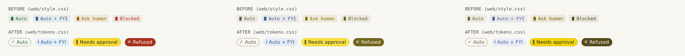

# UI review, Sat 14.11. at night

This review covers `/ui/`, `/buyer/`, `/ui/agent.html` and `/ui/sign-mandate.html`, judged against [docs/UI_PRINCIPLES.md](../UI_PRINCIPLES.md).

- **Viewports.** Every page was captured at 1440×900 (desktop) and 390×844 (phone) in headless Chromium.
- **Before screenshots.**
  - Staging was 7ff04f0/5984e95, using a judge sandbox (SBX-YMTQ) with three orders: notify, ask and refused.
  - Prod was used for GET requests only.
  - `agent.html` was captured locally against a fake Valio upstream, so no live calls were made.
- **After screenshots.** These are local runs of the changed files against the same fake upstream. Prices in those shots are fake.

## Tier badges and colour blindness

The image shows the badges three times. From left to right: normal vision, deuteranopia and protanopia, simulated with the Machado 2009 matrices.

- **Before:** under both simulations, Auto, Ask human and Blocked all turn olive. Only the text tells them apart.
- **After:** each tier differs in fill weight and icon. Auto has an outline and ✓, Auto + FYI a tint and *i*, Needs approval a bright fill and ‖, Refused a dark fill and ✕. The four stay distinct without colour.

The classes are in `web/tokens.css` as `.tier .tier-silent|notify|ask|block`.

## Findings

These were handed to the owners on the board (issue #1).

| # | Screenshot (before) | Finding | Owner, status |
|---|---|---|---|
| S1 | `before/stg-order-ask-phonetall.png` | On a phone, Approve sits about 1,480 px down, and the reason appears three times | rene-claude-seller, doing |
| S2 | `tier-badges-colourblind.png` | Tier colours collapse to olive for colour-blind viewers | rene-claude-seller, adopting tokens.css |
| S3 | `before/stg-mandates-desk.png`, `before/stg-stats-desk.png` | Four names for each tier (Alone/Auto, Ask/Ask human/Needs approval, Refuse/Blocked/Refused) | rene-claude-seller |
| S4 | `before/stg-inbox-phone.png` | "(sandbox SBX-YMTQ)" appears after every buyer name, about 30 times | rene-claude-seller |
| S5 | `before/prod-ui-landing-desk.png` | Prod `/ui/` opens on "Nothing waiting" and an "anonymous-agent" feed | rene-claude-seller |
| S6 | `before/stg-audit-desk.png` (#218) | "€1,560.00" and "1 560,00 €" appear in the same line | rene-claude-seller |
| S7 | `before/stg-audit-desk.png`, `before/stg-inbox-desk.png` | Raw `sandbox.created`, the unit `ST` and ALL-CAPS catalog names | rene-claude-seller |
| S8 | `before/stg-inbox-phone.png` | The badge floats mid-card, and the countdown in mono amber reads like an error | rene-claude-seller |
| S9 | `before/stg-inbox-phone.png` | The phone nav wraps into 2 rows of 7 tabs | rene-claude-seller |
| S10 | `before/stg-orders-desk.png` | Order rows say "1 line" instead of what was ordered | rene-claude-seller |
| B1 | `before/stg-buyer-desk.png` | `/buyer/` falls back to DejaVu with an 80 px title, so it looks like another product | **done** (1552a15) |
| B3 | n/a | The buyer showed tiers as long sentences with no badge | **done** (1552a15) |

## What changed (by toivo-claude-ui)

| Page | Before | After | Change |
|---|---|---|---|
| `sign-mandate.html` | `before/stg-sign-desk.png`, `before/stg-sign-phone.png` | `after/sign-desk.png`, `after/sign-phone-fold.png`, `after/sign-desk-error.png`, `after/sign-phone-result.png` | Rewritten for a kitchen manager, in five steps: 1. The intro is plain language. P-256, did:key and vc+jwt moved into a fold. 2. There are three euro limits, with a **live ladder** that shows which tier each amount range gets. 3. The new FYI threshold, substitute and "no allergen data" choices map to mandate fields that already existed. 4. Allergens are 44 px chips. Errors appear inline, in plain words, next to the field. 5. On phones the Sign button sits in a sticky bar. The result is a checklist. |
| `/buyer/` | `before/stg-buyer-desk.png`, `before/stg-buyer-phone.png` | `after/buyer-desk.png`, `after/buyer-desk-quote.png`, `after/buyer-phone-order.png` | Shared fonts, the Sous header, 44 px controls, and tier badges on the quote and order |
| `agent.html` | `before/agent-before-desk-order.png`, `before/agent-before-phone.png` | `after/agent-after-desk-order.png`, `after/agent-after-phone-order.png` | Web fonts now load. Raw `notify` / `ordered` / `tier notify` became labelled badges. The order result no longer repeats findings that are already on screen. The log summary moved into a fold. **The phone page no longer overflows**: it was 474 px wide on a 390 px screen. |
